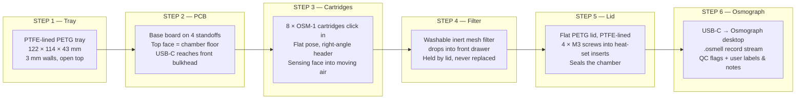

# Smell Monitor — Open-Source Digital Olfaction Hardware

**Status:** Design locked and consolidated in the single source of truth — **`docs/blueprint.md`** (OS-BP-001). Schematic ERC-clean, PCB placed + routed + **DRC-clean** (reproducible pipeline), firmware compiling, model + HLR drawing set produced. The module interface is fixed by **`docs/module-standard.md`** (OpenSmell Module Standard v1, OSM-1, blueprint §4.9); the board in the tree is still the revision that predates it, and `tools/verify_module_fit.py` prints every remaining gap as an open item.

The enclosure is the simple one a builder can hold in their head: an open tray,
a board on four standoffs, modules plugged into eight headers, a flat lid with
four M3 screws, a filter pad that drops into the front, and a 40 mm fan on the
back. No baffle, no plenum, no separate panel. Service is four screws.

The Smell Monitor is an open-source, modular, sensor-agnostic electronic nose. It is a low-cost (~$50–150 BOM), reproducible acquisition platform for anyone doing digital olfaction — researchers, labs, and makers who can't justify $10k–100k commercial e-nose systems.

**You** choose the sensors. **It** supplies the repeatable pneumatic environment, clean power, 16-bit acquisition, and logged temperature/humidity to make their outputs comparable.

## Why it's different from incumbents

| | Smell Monitor | Commercial e-noses |
|---|---|---|
| Price | ~$50–150 BOM | $8k–100k+ |
| Architecture | Open, modular, sensor-agnostic | Closed, proprietary |
| Sensors | You plug in whatever fits a slot | Vendor-locked array |
| Users | Researchers, makers, small business | Large enterprise / regulated QC |

We're not competing on certified precision. We're building the *Arduino of noses* — an ecosystem of sensors, packs, software, and shared datasets.

## Key features

- **8 identical, sensor-agnostic slots:** every slot carries a keyed 5 V gas-cell socket (`+5V GND AO DO 3V3 ID`, the `ID` pin being a 1-Wire EEPROM that says what the module is and carries its calibration) *and* a 3.3 V Qwiic/STEMMA QT port. MOX, MEMS, NDIR, electrochemical, piezo, QCM — plug in whatever the use case needs, in any mix, in any slot. The socket, the flat cartridge envelope, the identity memory map and the wetted-material rules are the [OpenSmell Module Standard v1](docs/module-standard.md); rewiring the board in the tree to it is the OSM-1 re-lay.
- **Repeatable measurements:** active three-phase cycle (intake → hold → purge), a chamber with PTFE-lined wetted surfaces (no smell memory), a permanent washable inert mesh filter (zero recurring cost), and the board itself as the chamber floor.
- **Defensible data:** 16-bit ADC (ADS1115), SHT31 temp/humidity in the gas path, I2C mux (TCA9548A) so address collisions never happen.
- **Open:** KiCad source, orderable BOM, STL/STEP enclosure, firmware, verification gates — all in this repo. `bom-costed.csv` carries the manufacturer part numbers, supplier and an indicative qty-10 price for every line; `electrical/bom.csv` is the designator/value/footprint/qty view the build uses.

## How it works, in one paragraph

Air is pulled through three Ø6 nostrils in the front wall, through a serviceable
filter pad, over the flat module row (digital upstream, the hot MOX row last)
and out through a 40 mm fan in the back. There is no baffle and no well: a
module plugs into its header and its sensing face looks straight into the moving
sample. Readings stay comparable because the cycle is driven (intake → hold →
purge) and every record carries slot index, flow position, temperature,
humidity, and the module's identity and calibration from its 1-Wire EEPROM.

## Product Specification — Assembly & Functionality

The Smell Monitor is designed for manufacture and service. Every part has a
single source of truth in `mechanical/constants.py`; the BOM is orderable from
`bom-costed.csv`; the PCB is ERC/DRC-clean; the enclosure prints on any FDM
machine. The wetted path is PTFE-lined so no smell memory builds up, and the
filter is permanent and washable — zero recurring cost.



### Step 1 — Tray
The PTFE-lined PETG tray is the outer shell. It prints as one open box
(122 × 114 × 43 mm, 3 mm walls). All interior surfaces that touch sample air
are PTFE-lined — no smell memory, wipe-clean with a dry lint-free cloth.

### Step 2 — PCB
The base board mounts on four Ø6 standoffs. Its top face *is* the chamber floor
(at z = 8.6 mm). USB-C enters through a bulkhead pigtail in the front wall;
the fan, buttons, LED and buzzer are reachable with the lid off. No panel
openings penetrate the chamber.

### Step 3 — Cartridges
Eight OSM-1 cartridges plug into keyed 1×6 gas-cell sockets, one per slot.
Every slot also carries a Qwiic/STEMMA QT port. Cartridges mount flat
(right-angle header in a vertical socket), sensing face up, looking straight
into the moving sample. Digital row upstream; MOX row downstream. Tool-free
swap in under 60 seconds.

### Step 4 — Filter
A washable sintered stainless-steel or PTFE mesh filter drops into the front
drawer. It stops dust and hair only — it does not strip analytes and it never
needs replacing. Rinse under tap water, dry, reinsert.

### Step 5 — Lid
A flat 6 mm PETG lid seals the chamber with four M3 screws into heat-set
inserts. The lid is PTFE-lined on its underside (wetted surface). Remove the
four screws to access cartridges, filter, board, and fan.

### Step 6 — Osmograph
USB-C carries power and data. Osmograph on the host computer receives the
`.osmell` record stream at 115200 baud, runs five automatic QC checks, and
displays slot values, temperature, humidity, red QC flags, and user-supplied
labels/notes. Wi-Fi and BLE are optional (same data over the air).

---

### Pneumatic flow path

```
  3 × Ø6 nostrils → washable inert filter → digital row (upstream)
                                              → MOX row (downstream)
                                              → 40 mm fan exhaust (rear)
```

Air is pulled through the front, crosses the filter, passes the digital row
then the hot MOX row last, and exits through the rear fan. No baffle, no plenum,
no well — a plugged-in cartridge already has unobstructed air over its sensing
face.

---


## What it costs

Indicative one-off prices in USD (Oct 2026). The gates check geometry and nets,
not prices.

| Item | ~ |
|---|---|
| PCB, 114 × 105 mm, 2-layer, 5 pcs | $3 |
| Board parts: ESP32-WROOM, ADC, I²C mux, LDO, passives, connectors | $16 |
| 8 × keyed 1×6 gas-cell sockets + 8 × Qwiic ports | $4 |
| SHT31 reference module | $4 |
| 40 mm 5 V PWM fan | $6 |
| Permanent washable inert mesh filter (sintered SS or PTFE) | $2 |
| PETG + PTFE-lined stock | $8 |
| M3 thumb screws + heat-set inserts | $3 |
| **Base, no sensors** | **≈ $48** |
| Starter pack: MQ-135, MQ-136, MICS-6814 carrier, ZE03-C2H4, SCD40 | $60–110 |

## Repository layout

```
smell-monitor/
├── docs/
│   ├── blueprint.md         # ← THE single source of truth: objective, design,
│   │                        #   verification, BOM, assembly, manual, drawings,
│   │                        #   decision record (§15)
│   └── module-standard.md   # OpenSmell Module Standard v1 (OSM-1): the slot,
│                            #   pinouts, cartridge envelope, ID EEPROM, materials
├── electrical/
│   ├── interface.py         # the frozen slot contract (schematic+PCB+firmware)
│   ├── board.py             # parts + nets (netlist source of truth)
│   ├── gen_schematic.py     #   -> KiCad schematic (ERC-clean)
│   ├── gen_pcb.py           #   -> placed board (--force-guarded)
│   ├── route_pcb.py         #   -> DSN / FreeRouting / SES auto-route
│   ├── bom.csv              # designator, value, footprint, qty
│   └── smell_monitor_v1_1/  # KiCad project + routed board + fab/ export
├── mechanical/
│   ├── constants.py         # locked parametric dimensions (single source)
│   ├── standard.py          # the OSM-1 module rules as data (gates read this)
│   ├── modules.py           # what the market actually sells, with sources
│   ├── freecad/             # parametric 3D model (build + style scripts)
│   └── drawings/            # DXF/PDF sheet generation
├── firmware/esp32/smell_monitor/   # ESP32 firmware (arduino-cli, sketch.yaml)
├── cfd/                     # OpenFOAM case: exchange time, cascade, interference
├── tools/                   # numeric verification gates (see below)
└── README.md
```

Every claim above is checked by a gate that must exit 0 — there are no
hand-verified numbers:

| Gate | Checks |
|---|---|
| `tools/verify_electrical.py` | slot contract ↔ geometry ↔ GPIO/pin budget |
| `tools/verify_netlist.py` | model netlist == exported schematic netlist |
| `tools/verify_pcb.py` | headers on contract, outline, track width, vias, 0 unconnected, DRC |
| `tools/verify_cad.py` | HLR views, section extents, hole patterns, DXFs, vector A3 PDF, print meshes |
| `tools/verify_clearance.py` | solid-to-solid clearances: filter pad vs tray, PCB outline vs lid bosses |
| `tools/verify_sensor_matrix.py` | starter pack covers every persona |
| `tools/verify_orthogonality.py` | response-matrix rank / slot-count trade study |
| `tools/verify_firmware_pins.py` | firmware pin map == `interface.PINMAP` |
| `tools/verify_module_fit.py` | real plug-in modules vs the chamber, and the chamber vs the OSM-1 module standard |

## Quick links

1. **Read the blueprint:** `docs/blueprint.md` — objective & success criteria (§0), design (§1–7), verification (§8)
2. **Design a module:** `docs/module-standard.md` — the slot, pinouts, cartridge envelope, identity EEPROM, conformance checklist
3. **Build one:** `bom-costed.csv` (orderable parts and cost) → `docs/blueprint.md` §9 (BOM) → §10 (assembly)
4. **Use one:** `docs/blueprint.md` §11 (user manual)
5. **Order a board:** `tools/export_fab.py` exports Gerbers, Excellon drill and a CPL to `electrical/smell_monitor_v1_1/fab/`

## Project status

- [x] Objective & success criteria locked (blueprint §0)
- [x] Architecture locked — pneumatic, sensing, electrical, mechanical (blueprint §1–7)
- [x] Volume model + HLR drawing set — real hidden-line views → editable DXF + vector PDF (blueprint §12)
- [x] Schematic generated from the model, ERC-clean, with netlist parity
- [x] PCB placed + routed + DRC-clean, reproducibly (blueprint §12.1)
- [x] Fab package (Gerbers + drill + CPL)
- [x] Firmware — three-phase cycle, USB/Wi-Fi/BLE, compiles clean
- [ ] Electrical sheet OS-003 (PCB floor plan) + pneumatic sheet OS-004
- [ ] Enclosure CAD — PTFE-lined tray + lid specified in `docs/blueprint.md` §15; `mechanical/constants.py` is the single source; export `smell_monitor_assembly.step` when FreeCAD model is finalised
- [ ] Fabrication pass (send Gerbers to board house)
- [ ] Physical flow bench validation — CFD proves air moves; exact t63/t90 requires the NF1 bench (blueprint §3.8) once hardware is in hand

## Contributing

Open issues for hardware bugs or component suggestions. Contributions welcome per the licenses. If you identify a conflict between files and `docs/blueprint.md`, the blueprint wins until deliberately amended (see its traceability note and revision history).

## Licenses

- Hardware: **CERN-OHL-S**
- Firmware/software: **MIT**
- Documentation: **CC BY-SA 4.0**

## Community

OpenSmell · [github.com/OpenSmell](https://github.com/OpenSmell) · smell-monitor issues are monitored.