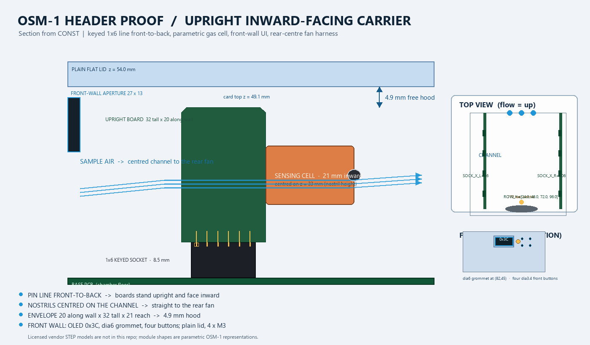
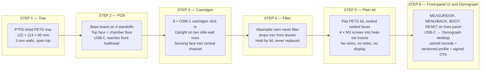

# Smell Monitor — Open-Source Digital Olfaction Hardware

**Status:** One SKU. Source of truth: **`docs/blueprint.md`** (OS-BP-001). The board implements **`docs/module-standard.md`** (OpenSmell Module Standard v1, OSM-1, blueprint §4.9): eight uniform slots, each with a keyed 1×6 gas-cell socket and a Qwiic port. Schematic ERC-clean, PCB placed + routed + DRC-clean, firmware compiling, model + drawing set produced. The front-panel display, device-verified OTA, profile and telemetry contracts are documented in the blueprint and the user manual.

The enclosure is an open tray, a board on four standoffs, breakout boards standing upright in two inward-facing side-wall socket rows around a clear central channel, a sealed SSD1306 OLED in a shallow bezel on the FIXED FRONT WALL (27 × 13 mm window centred at shell x=61, z=45), four buttons on that same panel, a filter pad that drops into the front, and a 40 mm fan at the rear. One sealed 6 mm grommet at (82,45) carries the display and button harnesses into the chamber. The lid is a plain flat plate with four M3 screws: no wires, no holes, and no need to open the box to use the UI. BOOT and RESET are on the front panel for recovery. Plug-in USB-C supplies power and data; there is no battery, and stable supply is the installer's responsibility. Service is four screws. Routine firmware updates arrive OTA; USB-C serial flashing is recovery only, although USB-C remains the wired data path.

The Smell Monitor is an open-source, modular, sensor-agnostic electronic nose: a reproducible acquisition platform for digital olfaction. The host owns the slot map, sensor type, specification and calibration; firmware emits null identity and calibration fields.

You choose the sensors. It supplies the repeatable pneumatic environment, clean power, 16-bit acquisition, and logged temperature and humidity.

## Key features

- **8 identical, sensor-agnostic slots:** every slot carries a keyed 5 V gas-cell socket (`+5V GND AO DO 3V3 ID`) *and* a 3.3 V Qwiic/STEMMA QT port. The `ID` pin is wired to one shared 1-Wire bus. Firmware emits null identity and calibration fields; the host owns the slot map, sensor type, specification and calibration. MOX, MEMS, NDIR, electrochemical, piezo and QCM modules fit in any mix in any slot. Every header and pin is permanently silkscreened. The socket, upright cartridge envelope and wetted-material rules are the [OpenSmell Module Standard v1](docs/module-standard.md).
- **Local readout and recovery:** a sealed SSD1306 OLED at `0x3C` on the master I²C bus, in a shallow bezel on the fixed front wall with a 27 × 13 mm window centred at shell (61,45). All four buttons are reachable without opening the box — MEASURE/OK (88,49), MENU/BACK (100,49), BOOT (88,39) and RESET (100,39) — and one 6 mm grommet at (82,45) carries the display and button harnesses into the chamber. No display hardware occupies an OSM-1 slot.
- **Raw data with derived fields:** raw `.osmell` records stay canonical. Osmograph pushes a versioned interpretation profile; firmware computes additive derived fields only when a profile is present and marks them `derived`. Without a profile the device keeps its raw-only behavior. Local inference is bounded arithmetic and threshold logic; heavy ML runs on the host.
- **Telemetry:** sequence IDs, 32-record NVS replay over `HTTP /data` and `/data?since=<seq>`, retained MQTT status and LWT, NTP `wall_clock` timestamps, a per-record power-fail flush, and realtime telemetry. Radios stay off until the user enables them.
- **OTA updates:** the host signs a manifest with its private key; the device verifies the signature with its embedded public key and the SHA-256 image digest before install, checks the version gate and keeps rollback-safe activation. USB-C serial flashing is recovery only.
- **Repeatable measurements:** active three-phase cycle (intake → hold → purge), a sealed inert gas path, a permanent washable woven-PTFE mesh filter, and the board itself as the chamber floor.
- **Acquisition:** 16-bit ADC (ADS1115), SHT31 temperature/humidity in the gas path, I2C mux (TCA9548A) so address collisions do not occur.
- **Open source:** KiCad source, build BOM, STL/STEP enclosure, firmware, verification gates — all in this repo. `bom-sourced.csv` carries manufacturer part numbers and supplier notes; `electrical/bom.csv` is the designator/value/footprint/quantity view the build uses.

## How it works, in one paragraph

Air is pulled through three centred Ø6 nostrils in the front wall, through a
serviceable filter pad, straight down the channel between two inward-facing rows
of upright breakout boards, and out through a 40 mm fan in the back. There is no
baffle and no well: a board plugs into a side-wall socket, stands upright and
its sensing face looks across the channel into the moving sample. The sealed
OLED sits in a shallow bezel in the fixed front wall; the window gasket keeps it
outside the sample path, and a single grommet carries its harness and the four
button harnesses into the chamber. The lid stays a plain flat plate. Readings
stay comparable because the cycle is driven (intake → hold → purge) and every
record carries slot index, wall, temperature and humidity. Sensor identity and
calibration are attached by the host application.

## See it assembled and running

These renders are generated from the **routed KiCad board** plus
`mechanical/constants.py`: real copper, pads, sockets and component positions,
eight distinct supported sensor styles, a rotating fan, animated airflow,
LED/buzzer status, and the lid screwing down. Air enters through the three
nostrils at the lower-left and exits through the fan at the upper-right.

Vendor STEP models for sensors are not in this repository.

| View | File |
|---|---|
| Full assembly + flow animation | `docs/figures/cad/assembly_animation.gif` |
| Six-frame storyboard | `docs/figures/cad/assembly_storyboard.png` |
| Header / upright-card proof | `docs/figures/cad/header_proof.png` |
| Exploded cutaway | `docs/figures/cad/assembly_exploded_iso.png` |
| Assembled cutaway | `docs/figures/cad/assembly_assembled_iso.png` |
| Flow frame | `docs/figures/cad/assembly_flow_top.png` |




The header proof shows the 1×6 pin line running **front-to-back** along each side
wall, the cartridge standing **upright** in the Y-Z plane and facing
**inward**, and the mating pins going **down into the socket**. Thirteen millimetres
of clearance behind each socket leaves room for rear pins; the sensing can
reaches 21 mm into the channel, leaving a clear central stream for the sample.

Regenerate: `tools/extract_pcb_geometry.py` (KiCad Python) exports the routed
board to `pcb_geometry.json`; `python tools/render_assembly_visual.py` renders the
GIF and stills; `python tools/verify_visuals.py` checks them against the BOM and
locked constants.

## Product Specification — Assembly & Functionality

The Smell Monitor is designed for manufacture and service. Every part has a
single source of truth in `mechanical/constants.py`; the BOM is sourced from
`bom-sourced.csv`; the PCB is ERC/DRC-clean; the enclosure prints on any FDM
machine. The wetted path is sealed for inert-gas service so no smell memory
builds up, and the filter is permanent and washable with no scheduled consumable.



### Step 1 — Tray
The PTFE-lined PETG tray is the outer shell. It prints as one open box
(122 × 114 × 60 mm, 3 mm walls). All interior surfaces that touch sample air
are PTFE-lined — no smell memory, wipe-clean with a dry lint-free cloth.

### Step 2 — PCB
The base board mounts on four Ø6 standoffs. Its top face *is* the chamber floor
(at z = 8.6 mm). USB-C enters through a bulkhead pigtail in the front wall; the
fan, LED and buzzer are reachable with the lid off. The SSD1306 display sits on
the master I²C bus at `0x3C` in a shallow sealed bezel on the front wall; its
window gasket keeps it outside the sample path. All four buttons are on that
same panel, including BOOT/RESET for recovery. One 6 mm grommet at (82,45)
carries the display and button harnesses into the chamber; the lid stays plain.
No display opening penetrates the chamber ceiling.

### Step 3 — Cartridges
Eight OSM-1 cartridges plug into keyed 1×6 gas-cell sockets, one per slot.
Every slot also carries a Qwiic/STEMMA QT port, and every header and pin is
silkscreened. Cartridges stand upright on the two inner side walls (1×6 pin line
front-to-back, pins down into the socket), sensing faces turned inward across
the central channel. Any module goes in any slot; every record names the slot
and wall it came from. Tool-free swap in under 60 seconds.

### Step 4 — Filter
A washable woven-PTFE mesh drops into the front drawer. It is thin and open
enough that a 40 mm fan pulls through it without meaningful pressure loss; it
stops dust and hair only, does not strip analytes, and never needs replacing.
Rinse under tap water, dry, reinsert.

### Step 5 — Plain lid
A flat 6 mm PETG lid seals the chamber with four M3 screws into heat-set
inserts. Its wetted faces are sealed for the inert gas path. The lid carries no
wires, no holes and no display: the UI is on the fixed front wall. Remove the
four screws to access cartridges, filter, board and fan without disturbing the
display or button harnesses.

### Step 6 — Front-panel UI and Osmograph
The display shows live status, temperature/humidity, derived values when a
profile is installed, and fault banners; MENU/BACK steps the screens. USB-C
carries power and data; routine firmware updates are OTA, with USB-C serial
reserved for recovery. Osmograph on the host receives the `.osmell` stream at
115200 baud, runs automatic QC checks, and pushes a versioned interpretation
profile.
Raw records stay canonical; derived fields appear only when a profile is present
and are marked `derived`. Osmograph also delivers OTA updates. Wi-Fi and BLE are
off until the user enables them.

---

### Pneumatic flow path

```
  3 × Ø6 centred nostrils → washable woven-PTFE mesh filter
                           → central channel between two inward-facing card rows
                           → 40 mm fan exhaust (rear)
```

Air is pulled through the front, crosses the filter, runs straight down the
channel between the two side-wall rows and exits through the rear fan. No
baffle, no plenum, no well — a plugged-in card already has unobstructed channel
air over its sensing face. The gas path is inert-gas only: acrylic or
polyurethane conformal coat, never silicone.

---

## Build inputs

The build inputs are the two BOMs in the repository: `electrical/bom.csv`
(designator / value / footprint / quantity) and `bom-sourced.csv` (manufacturer
part numbers and supplier notes).

## Repository layout

```
smell-monitor/
├── docs/
│   ├── blueprint.md         # single source of truth: objective, design,
│   │                        #   verification, BOM, assembly, manual, drawings
│   ├── MANUAL.md            # user-facing display, buttons, OTA, profile, replay
│   ├── VALIDATION_PLAN.md   # physical acceptance gates for a built unit
│   ├── CFD_NOTES.md         # numerical results
│   └── module-standard.md   # OpenSmell Module Standard v1 (OSM-1): the slot,
│                            #   pinouts, cartridge envelope, host identity, materials
├── electrical/
│   ├── interface.py         # the frozen slot contract (schematic+PCB+firmware)
│   ├── board.py             # parts + nets (netlist source of truth)
│   ├── gen_schematic.py     #   -> KiCad schematic (ERC-clean)
│   ├── gen_pcb.py           #   -> placed board (--force-guarded)
│   ├── route_pcb.py         #   -> DSN / FreeRouting / SES auto-route
│   ├── bom.csv              # designator, value, footprint, qty
│   └── smell_monitor_v1_1/  # KiCad project + routed board + fab/ export
├── mechanical/
│   ├── constants.py         # locked parametric dimensions (single source)
│   ├── standard.py          # the OSM-1 module rules as data (gates read this)
│   ├── modules.py           # module database with sources
│   ├── freecad/             # parametric 3D model (build + style scripts)
│   ├── step/                # exported production STEP (assembly + shell + lid)
│   └── drawings/            # DXF/PDF sheet generation + sheets/ (OS-000…OS-004 SVG)
├── firmware/esp32/smell_monitor/   # ESP32 firmware (arduino-cli, sketch.yaml)
├── cfd/                     # OpenFOAM case + RESULTS.md (numerical results)
├── tools/                   # numeric verification gates (see below)
└── README.md
```

Every claim above is checked by a gate that must exit 0 — there are no
hand-verified numbers:

| Gate | Checks |
|---|---|
| `tools/verify_electrical.py` | slot contract ↔ geometry ↔ GPIO/pin budget |
| `tools/verify_netlist.py` | model netlist == exported schematic netlist |
| `tools/verify_pcb.py` | headers on contract, outline, track width, vias, 0 unconnected, DRC |
| `tools/verify_cad.py` | HLR views, section extents, hole patterns, DXFs, vector A3 PDF, print meshes |
| `tools/verify_visuals.py` | animation/render assets trace to the routed board and locked cart dimensions |
| `tools/verify_clearance.py` | solid-to-solid clearances: filter pad vs tray, PCB outline vs lid bosses |
| `tools/verify_sensor_matrix.py` | starter pack channel coverage and rail draw |
| `tools/verify_orthogonality.py` | response-matrix effective rank for the eight slots |
| `tools/verify_firmware_pins.py` | firmware pin map == `interface.PINMAP` |
| `tools/verify_module_fit.py` | real plug-in modules vs the chamber, and the chamber vs the OSM-1 module standard |

## Quick links

1. **Read the blueprint:** `docs/blueprint.md` — objective & success criteria (§0), design (§1–7), verification (§8)
2. **Design a module:** `docs/module-standard.md` — the slot, pinouts, cartridge envelope, host-managed identity, conformance checklist
3. **Build one:** `bom-sourced.csv` (build inputs) → `docs/blueprint.md` §9 (BOM) → §10 (assembly)
4. **Use one:** `docs/MANUAL.md` — display screens, buttons, OTA, profiles, status and replay
5. **Accept one:** `docs/VALIDATION_PLAN.md` — physical tracer/purge and interface/data gates; `cfd/RESULTS.md` and `docs/CFD_NOTES.md` for numerical results
6. **Fabricate a board:** `tools/export_fab.py` exports Gerbers, Excellon drill and a CPL to `electrical/smell_monitor_v1_1/fab/`

## Project status

- [x] Objective & success criteria locked (blueprint §0)
- [x] Configuration locked — pneumatic, sensing, electrical, mechanical (blueprint §1–7)
- [x] Volume model + HLR drawing set — real hidden-line views → editable DXF + vector PDF (blueprint §12)
- [x] Schematic generated from the model, ERC-clean, with netlist parity
- [x] PCB placed + routed + DRC-clean, reproducibly (blueprint §12.1)
- [x] Fab package (Gerbers + drill + CPL); board carries permanent silkscreen branding and is DRC-clean
- [x] Firmware — three-phase cycle, local SSD1306 front-panel display and four buttons, device-verified OTA with rollback, versioned profiles, sequence/replay telemetry, USB/Wi-Fi/BLE
- [x] Electrical sheet OS-003 (PCB floor plan) + pneumatic sheet OS-004 — `mechanical/drawings/sheets/` (SVG, ASME Y14)
- [x] Enclosure CAD — `mechanical/step/smell_monitor_assembly.step` exported (FreeCAD model + shell/lid STEPs alongside); sealed tray, plain flat lid and front-panel display bezel per `docs/blueprint.md` §6.1; `mechanical/constants.py` is the single source
- [x] Acceptance specification — `docs/VALIDATION_PLAN.md` (tracer breakthrough, purge, wall-to-wall uniformity, front-panel display readability, four-button debounce, bezel/grommet sealing, OTA verification and rollback, power-fail flush/replay)
- [x] HIL stream sanity — `tools/hil_simulator.py --cycles 1` emits a valid `.osmell` record with all five QC injection paths available
- [x] Fabrication package generated — Gerbers, Excellon drill, CPL and BOM in `electrical/smell_monitor_v1_1/fab/`
- [x] Coded assembly + flow animation rendered from the routed PCB — `docs/figures/cad/` (storyboard and header proof included)
- [x] CFD baseline — stable `side-wall-v2-linux` solve in `cfd/RESULTS.md`: 81,432 cells, Courant 0.783, continuity -5.65e-08, 3/8 slots at or below 4 s t63, 0.23 s wall-to-wall delta. Nostril geometry unchanged after CFD review. Numerical results in `cfd/RESULTS.md`; physical acceptance in `docs/VALIDATION_PLAN.md` §3.
- [x] Black-and-white plan and section drawing in the user manual — `docs/figures/cad/manual_linework.svg`

## Contributing

Open issues for hardware bugs or component suggestions. Contributions are welcome per the licenses. If files disagree with `docs/blueprint.md`, the blueprint is the source of truth.

## Licenses

- Hardware: **CERN-OHL-S**
- Firmware/software: **MIT**
- Documentation: **CC BY-SA 4.0**

## Community

OpenSmell · [github.com/OpenSmell](https://github.com/OpenSmell) · smell-monitor issues are monitored.
