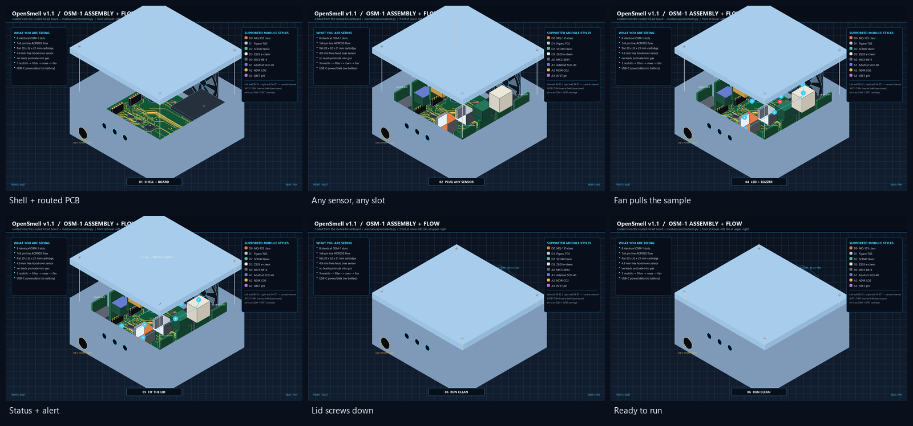
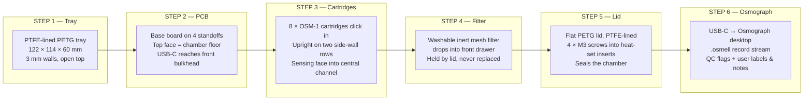

# Smell Monitor — Open-Source Digital Olfaction Hardware

**Status:** Design locked and consolidated in the single source of truth — **`docs/blueprint.md`** (OS-BP-001). Schematic ERC-clean, PCB placed + routed + **DRC-clean** (reproducible pipeline), firmware compiling, model + HLR drawing set produced. The board implements **`docs/module-standard.md`** (OpenSmell Module Standard v1, OSM-1, blueprint §4.9): eight identical slots, each with a keyed 1×6 gas-cell socket and a Qwiic port.

The enclosure is the simple one a builder can hold in their head: an open tray,
a board on four standoffs, breakout boards standing upright in two inward-facing
side-wall socket rows around a clear central channel, a flat lid with four M3
screws, a filter pad that drops into the front, and a 40 mm fan on the back. No
baffle, no plenum, no separate panel. Service is four screws.

The Smell Monitor is an open-source, modular, sensor-agnostic electronic nose: a reproducible acquisition platform for anyone doing digital olfaction — researchers, labs, and makers who need a real, serviceable instrument they can understand and repair.

**You** choose the sensors. **It** supplies the repeatable pneumatic environment, clean power, 16-bit acquisition, and logged temperature/humidity to make their outputs comparable.

## Why it's different

| | Smell Monitor | Closed e-noses |
|---|---|---|
| Architecture | Open, modular, sensor-agnostic | Closed, proprietary |
| Sensors | Any module that fits an OSM-1 slot | Vendor-locked array |
| Service | Four screws, plug modules into headers | Factory service |
| Data | Open `.osmell` records | Proprietary format |

We're not claiming certified precision. The goal is an understandable, maintainable platform for real measurements.

## Key features

- **8 identical, sensor-agnostic slots:** every slot carries a keyed 5 V gas-cell socket (`+5V GND AO DO 3V3 ID`) *and* a 3.3 V Qwiic/STEMMA QT port. The `ID` pin is wired to one shared 1-Wire bus; v1 firmware leaves the per-cartridge identity field null, and Osmograph maps slot → sensor type and calibration in software. MOX, MEMS, NDIR, electrochemical, piezo, QCM — plug in whatever the use case needs, in any mix, in any slot. Every header and pin is permanently silkscreened. The socket, upright cartridge envelope and wetted-material rules are the [OpenSmell Module Standard v1](docs/module-standard.md).
- **Repeatable measurements:** active three-phase cycle (intake → hold → purge), a chamber with PTFE-lined wetted surfaces (no smell memory), a permanent washable woven-PTFE mesh filter (zero recurring cost), and the board itself as the chamber floor.
- **Defensible data:** 16-bit ADC (ADS1115), SHT31 temp/humidity in the gas path, I2C mux (TCA9548A) so address collisions never happen.
- **Open:** KiCad source, build BOM, STL/STEP enclosure, firmware, verification gates — all in this repo. `bom-sourced.csv` carries manufacturer part numbers and supplier notes; `electrical/bom.csv` is the designator/value/footprint/quantity view the build uses.

## How it works, in one paragraph

Air is pulled through three centred Ø6 nostrils in the front wall, through a
serviceable filter pad, straight down the channel between two inward-facing rows
of upright breakout boards, and out through a 40 mm fan in the back. There is no
baffle and no well: a board plugs into a side-wall socket, stands upright and
its sensing face looks across the channel into the moving sample. Readings stay
comparable because the cycle is driven (intake → hold → purge) and every record
carries slot index, wall, temperature and humidity. Sensor identity and
calibration are attached by the host application.

## See it assembled and running

These renders are generated from the **routed KiCad board** plus
`mechanical/constants.py`: real copper, pads, sockets and component positions,
eight distinct supported sensor styles, a rotating fan, animated airflow,
LED/buzzer status, and the lid screwing down. Air enters through the three
nostrils at the lower-left and exits through the fan at the upper-right.

| View | File |
|---|---|
| Full assembly + flow animation | `docs/figures/cad/assembly_animation.gif` |
| Six-frame storyboard | `docs/figures/cad/assembly_storyboard.png` |
| Header / upright-carrier proof | `docs/figures/cad/header_proof.png` |
| Exploded cutaway | `docs/figures/cad/assembly_exploded_iso.png` |
| Assembled cutaway | `docs/figures/cad/assembly_assembled_iso.png` |
| Flow frame | `docs/figures/cad/assembly_flow_top.png` |




The header proof exists for one reason: the 1×6 pin line runs **front-to-back**
along each side wall, the cartridge stands **upright** in the Y-Z plane and faces
**inward**, and the mating pins go **down into the socket**. Thirteen millimetres
of clearance behind each socket leaves room for rear pins; the sensing can
reaches 21 mm into the channel, leaving a clear central stream for the sample.

Regenerate: `tools/extract_pcb_geometry.py` (KiCad Python) exports the routed
board to `pcb_geometry.json`; `python tools/render_assembly_visual.py` renders the
GIF and stills; `python tools/verify_visuals.py` checks them against the BOM and
locked constants.

## Product Specification — Assembly & Functionality

The Smell Monitor is designed for manufacture and service. Every part has a
single source of truth in `mechanical/constants.py`; the BOM is sourced from
`bom-sourced.csv`; the PCB is ERC/DRC-clean; the enclosure prints on any FDM
machine. The wetted path is PTFE-lined so no smell memory builds up, and the
filter is permanent and washable — zero recurring cost.



### Step 1 — Tray
The PTFE-lined PETG tray is the outer shell. It prints as one open box
(122 × 114 × 60 mm, 3 mm walls). All interior surfaces that touch sample air
are PTFE-lined — no smell memory, wipe-clean with a dry lint-free cloth.

### Step 2 — PCB
The base board mounts on four Ø6 standoffs. Its top face *is* the chamber floor
(at z = 8.6 mm). USB-C enters through a bulkhead pigtail in the front wall;
the fan, buttons, LED and buzzer are reachable with the lid off. No panel
openings penetrate the chamber.

### Step 3 — Cartridges
Eight OSM-1 cartridges plug into keyed 1×6 gas-cell sockets, one per slot.
Every slot also carries a Qwiic/STEMMA QT port, and every header and pin is
silkscreened. Cartridges stand upright on the two inner side walls (1×6 pin line
front-to-back, pins down into the socket), sensing faces turned inward across
the central channel. Any module goes in any slot; every record names the slot
and wall it came from. Tool-free swap in under 60 seconds.

### Step 4 — Filter
A washable woven-PTFE mesh drops into the front drawer. It is thin and open
enough that a 40 mm fan pulls through it without meaningful pressure loss; it
stops dust and hair only, does not strip analytes, and never needs replacing.
Rinse under tap water, dry, reinsert.

### Step 5 — Lid
A flat 6 mm PETG lid seals the chamber with four M3 screws into heat-set
inserts. The lid is PTFE-lined on its underside (wetted surface). Remove the
four screws to access cartridges, filter, board, and fan.

### Step 6 — Osmograph
USB-C carries power and data. Osmograph on the host computer receives the
`.osmell` record stream at 115200 baud, runs five automatic QC checks, and
displays slot values, temperature, humidity, red QC flags, and user-supplied
labels/notes. Wi-Fi and BLE are optional (same data over the air).

---

### Pneumatic flow path

```
  3 × Ø6 centred nostrils → washable woven-PTFE mesh filter
                          → central channel between two inward-facing card rows
                          → 40 mm fan exhaust (rear)
```

Air is pulled through the front, crosses the filter, runs straight down the
channel between the two side-wall rows and exits through the rear fan. No
baffle, no plenum, no well — a plugged-in card already has unobstructed channel
air over its sensing face.

---

## Build inputs

The build inputs are the two BOMs in the repository: `electrical/bom.csv`
(designator / value / footprint / quantity) and `bom-sourced.csv` (manufacturer
part numbers and supplier notes). Source them yourself; nothing in this repo is
an offer to sell.

## Repository layout

```
smell-monitor/
├── docs/
│   ├── blueprint.md         # ← THE single source of truth: objective, design,
│   │                        #   verification, BOM, assembly, manual, drawings,
│   │                        #   decision record (§15)
│   └── module-standard.md   # OpenSmell Module Standard v1 (OSM-1): the slot,
│                            #   pinouts, cartridge envelope, host identity, materials
├── electrical/
│   ├── interface.py         # the frozen slot contract (schematic+PCB+firmware)
│   ├── board.py             # parts + nets (netlist source of truth)
│   ├── gen_schematic.py     #   -> KiCad schematic (ERC-clean)
│   ├── gen_pcb.py           #   -> placed board (--force-guarded)
│   ├── route_pcb.py         #   -> DSN / FreeRouting / SES auto-route
│   ├── bom.csv              # designator, value, footprint, qty
│   └── smell_monitor_v1_1/  # KiCad project + routed board + fab/ export
├── mechanical/
│   ├── constants.py         # locked parametric dimensions (single source)
│   ├── standard.py          # the OSM-1 module rules as data (gates read this)
│   ├── modules.py           # what the market actually sells, with sources
│   ├── freecad/             # parametric 3D model (build + style scripts)
│   ├── step/                # exported production STEP (assembly + shell + lid)
│   └── drawings/            # DXF/PDF sheet generation + sheets/ (OS-000…OS-004 SVG)
├── firmware/esp32/smell_monitor/   # ESP32 firmware (arduino-cli, sketch.yaml)
├── cfd/                     # OpenFOAM case + RESULTS.md (run status / import)
├── tools/                   # numeric verification gates (see below)
└── README.md
```

Every claim above is checked by a gate that must exit 0 — there are no
hand-verified numbers:

| Gate | Checks |
|---|---|
| `tools/verify_electrical.py` | slot contract ↔ geometry ↔ GPIO/pin budget |
| `tools/verify_netlist.py` | model netlist == exported schematic netlist |
| `tools/verify_pcb.py` | headers on contract, outline, track width, vias, 0 unconnected, DRC |
| `tools/verify_cad.py` | HLR views, section extents, hole patterns, DXFs, vector A3 PDF, print meshes |
| `tools/verify_visuals.py` | animation/render assets trace to the routed board and locked cart dimensions |
| `tools/verify_clearance.py` | solid-to-solid clearances: filter pad vs tray, PCB outline vs lid bosses |
| `tools/verify_sensor_matrix.py` | starter pack covers every persona |
| `tools/verify_orthogonality.py` | response-matrix rank / slot-count trade study |
| `tools/verify_firmware_pins.py` | firmware pin map == `interface.PINMAP` |
| `tools/verify_module_fit.py` | real plug-in modules vs the chamber, and the chamber vs the OSM-1 module standard |

## Quick links

1. **Read the blueprint:** `docs/blueprint.md` — objective & success criteria (§0), design (§1–7), verification (§8)
2. **Design a module:** `docs/module-standard.md` — the slot, pinouts, cartridge envelope, host-managed identity, conformance checklist
3. **Build one:** `bom-sourced.csv` (build inputs) → `docs/blueprint.md` §9 (BOM) → §10 (assembly)
4. **Use one:** `docs/blueprint.md` §11 (user manual)
5. **Fabricate a board:** `tools/export_fab.py` exports Gerbers, Excellon drill and a CPL to `electrical/smell_monitor_v1_1/fab/`

## Project status

- [x] Objective & success criteria locked (blueprint §0)
- [x] Architecture locked — pneumatic, sensing, electrical, mechanical (blueprint §1–7)
- [x] Volume model + HLR drawing set — real hidden-line views → editable DXF + vector PDF (blueprint §12)
- [x] Schematic generated from the model, ERC-clean, with netlist parity
- [x] PCB placed + routed + DRC-clean, reproducibly (blueprint §12.1)
- [x] Fab package (Gerbers + drill + CPL); board carries permanent silkscreen branding and is DRC-clean
- [x] Firmware — three-phase cycle, USB/Wi-Fi/BLE, compiles clean
- [x] Electrical sheet OS-003 (PCB floor plan) + pneumatic sheet OS-004 — `mechanical/drawings/sheets/` (SVG, ASME Y14)
- [x] Enclosure CAD — `mechanical/step/smell_monitor_assembly.step` exported (FreeCAD model + shell/lid STEPs alongside); PTFE-lined tray + lid per `docs/blueprint.md` §15; `mechanical/constants.py` is the single source
- [x] Flow acceptance specification — `docs/VALIDATION_PLAN.md` (filter ΔP, tracer breakthrough, purge completeness, wall-to-wall uniformity, pass/fail t63/t90)
- [x] HIL stream sanity — `tools/hil_simulator.py --cycles 1` emits a valid `.osmell` record with all five QC injection paths available
- [x] Fabrication package generated — Gerbers, Excellon drill, CPL and BOM in `electrical/smell_monitor_v1_1/fab/`
- [x] Coded assembly + flow animation rendered from the routed PCB — `docs/figures/cad/` (storyboard and header proof included)
- [x] CFD case with corrected transient numerics and an automated Courant/continuity gate — `cfd/RESULTS.md` (run output imported with one command)
- [x] Black-and-white plan and section drawing in the user manual — `docs/figures/cad/manual_linework.svg`

## Contributing

Open issues for hardware bugs or component suggestions. Contributions welcome per the licenses. If you identify a conflict between files and `docs/blueprint.md`, the blueprint wins until deliberately amended (see its traceability note and revision history).

## Licenses

- Hardware: **CERN-OHL-S**
- Firmware/software: **MIT**
- Documentation: **CC BY-SA 4.0**

## Community

OpenSmell · [github.com/OpenSmell](https://github.com/OpenSmell) · smell-monitor issues are monitored.