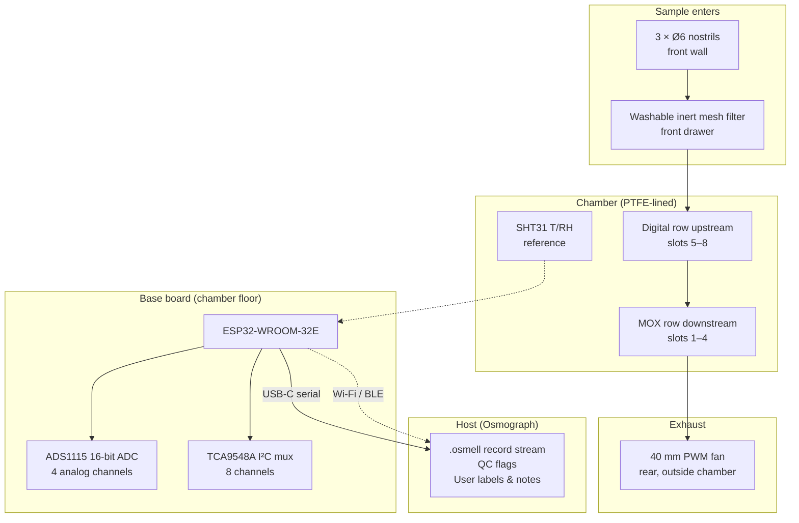

# OpenSmell Smell Monitor — User Manual

**Document:** OSM-UM-001  
**Revision:** A  
**Product:** Smell Monitor v1.1  
**Firmware:** v1.1  
**Companion software:** Osmograph desktop  
**Interface standard:** OSM-1 (OpenSmell Module Standard v1)

---

## Notice

This manual describes the Smell Monitor, an open-source, modular, sensor-agnostic
digital olfaction acquisition platform. The device is a **research instrument**,
not a calibrated safety monitor. It does not identify smells on its own and is
not intended for use in explosive atmospheres, life-safety applications, or as
a substitute for certified industrial hygiene equipment.

All wetted surfaces — the tray, the lid, and the filter drawer — are PTFE-lined
so that no smell memory builds up inside the chamber. The filter mesh is
permanent and washable; it is never a consumable.

---

## 1. System Overview



**What the device does.** Draws a controlled air sample through three front
nostrils, over interchangeable sensor cartridges, and records each response as a
`.osmell` record streamed over USB-C. Every record carries temperature,
humidity, slot index, flow position, module identity, calibration, and five
automatic quality flags.

**What it is not.** It does not classify smells. It does not measure pH in the
gas path (pH is a liquid measurement; an optional ISFET pH cartridge plugs into
any slot for fermentation, brine, and wort users).

---

## 2. What's in the Box

| Item | Qty | Purpose |
|------|-----|---------|
| Smell Monitor base unit (PCB + PTFE-lined tray + lid) | 1 | Main instrument |
| Washable inert mesh filter (sintered stainless steel or PTFE) | 1 | Stops dust/hair; permanent |
| USB-C data cable, 1 m | 1 | Power + data to host |
| USB-C panel pigtail, 0.3 m | 1 | Bulkhead feedthrough (seals rear wall hole) |
| M3 screws | 4 | Lid retention |
| Heat-set inserts | 4 | Lid threads in tray |
| Quick-reference card | 1 | PINout + cycle states |

**Not included:** sensor cartridges. You supply the modules that match your use
case (MOX, MEMS, NDIR, electrochemical, piezo, QCM — any OSM-1-conforming
cartridge fits any slot).

---

## 3. Hardware Tour

```
                    3 × Ø6 nostrils
                 (sample enters here)
                ┌─────────────────┐
                │   FILTER DRAWER │  ← washable inert mesh, slides in front
                │   (removable)   │
                ├─────────────────┤
                │  SLOT 1  SLOT 2 │  ← digital row (upstream)
                │  SLOT 3  SLOT 4 │     Qwiic + gas-cell socket each
                ├─────────────────┤
                │  SLOT 5  SLOT 6 │  ← MOX row (downstream)
                │  SLOT 7  SLOT 8 │
                ├─────────────────┤
                │   SHT31 T/RH    │  ← reference, fixed on base
                ├─────────────────┤
                │   ESP32 + ADC   │  ← base board = chamber floor
                └─────────────────┘
                         │
                    40 mm fan (exhaust)
                    out the rear wall
                         │
                    USB-C (power + data)
```

| Part | What it is |
|------|------------|
| **Nostrils** | Three Ø6 holes in the front wall. Air enters here. |
| **Filter drawer** | Slides into the front. Holds the permanent washable inert mesh. Remove, rinse, reinsert. |
| **Slots 1–8** | Keyed 1×6 gas-cell socket + Qwiic/STEMMA QT port on every slot. Any OSM-1 cartridge plugs in any slot. |
| **SHT31** | Fixed temperature/humidity reference on the base board, upstream of the MOX row. |
| **Base board** | ESP32, ADS1115 ADC, TCA9548A I²C mux. Its top face *is* the chamber floor. |
| **Fan** | 40 mm PWM exhaust on the rear wall, outside the chamber. Pulls air through. |
| **USB-C** | Power in, data out. Always-on serial at 115200 baud. Wi-Fi and BLE optional. |

---

## 4. 5-Minute Quick Start

**Step 1 — Power.** Plug the USB-C cable into the Smell Monitor and into your computer. The status LED gives one slow blink (idle).

**Step 2 — Open Osmograph.** Launch Osmograph on your computer. It opens the serial port at 115200 baud automatically.

**Step 3 — Insert cartridges.** Open the lid (four M3 screws). Plug your sensor cartridges into any slots. Close the lid.

**Step 4 — Measure.** Press the MEASURE button or click "Measure" in Osmograph. The LED breathes while sampling (≈40 s: 10 s intake / 10 s hold / 20 s purge), then goes solid when results are ready.

**Step 5 — Read the record.** Osmograph displays the `.osmell` record: slot values, temperature, humidity, and any QC flags. A red QC flag means "check this reading," not "the device is broken."

**First-time tip:** Run three clean-air cycles before your first measurement so the chamber and sensors reach a stable baseline.

---

## 5. Module Swapping Guide (OSM-1)

Every slot carries both interfaces side by side:

| Interface | Pinout (keyed 1×6, 2.54 mm) | Serves |
|-----------|------------------------------|--------|
| **Gas cell** | `+5V GND AO DO 3V3 ID` | MOX, electrochemical, NDIR-with-Vout, catalytic, PID |
| **I²C port** | Qwiic / STEMMA QT (`GND 3V3 SDA SCL`) | NDIR CO₂, T/RH, VOC index, particulate |

```
Gas-cell socket pinout (looking at the base):
  Pin 1: +5V   (heater rail, ≤150 mA per slot)
  Pin 2: GND
  Pin 3: AO    (cell output, 0–5 V, divided into ADC)
  Pin 4: DO    (comparator output or TTL serial RX, 3.3 V GPIO)
  Pin 5: 3V3   (≤50 mA for cell converter)
  Pin 6: ID    (1-Wire cartridge identity EEPROM)
```

**How to swap a cartridge:**
1. Power down (unplug USB-C).
2. Remove the four M3 lid screws; lift the lid.
3. Lift the cartridge straight out of its socket.
4. Align the new cartridge's pin-1 chamfer with the socket key; press straight down.
5. Replace the lid, tighten four M3 screws.
6. Power on. Osmograph detects the new module via its ID EEPROM within one cycle.

**No tools beyond a 2.5 mm hex key.** A swap takes under 60 seconds. Calibration and exposure history travel with the cartridge on its EEPROM; the base never needs re-calibration when you move cartridges between bases.

---

## 6. Understanding QC Flags

Osmograph evaluates every record and appends red QC flags to affected slots. Flags are **starting thresholds** — tune them against clean-air and known-bad data before making field claims.

| Flag | What it means | What to check |
|------|---------------|---------------|
| `adc_saturation` | Slot voltage at 0 V or 3.3 V rail for two consecutive cycles | Disconnected or shorted sensor; check wiring, reseat cartridge |
| `baseline_drift` | Hold-phase voltage slope exceeds 0.05 mV/s | Sensor warming up; allow 10 min warm-up; check for temperature changes |
| `sht31_out_of_range` | Temperature or humidity jumped more than threshold in one cycle | Fan failure, seal leak, or rapid ambient change; check fan is spinning |
| `eeprom_mismatch` | Readings present but no cartridge EEPROM ID | Blank or missing ID chip; data still works, flagged as uncalibrated |
| `flow_stagnation` | MOX resistance did not drop during intake (flat or rising) | Fan not spinning; filter mesh blocked; cartridge seated wrong |

**Rule of thumb:** A red flag means "verify before trusting." It does not mean the device is broken. Clear air + fan running + seated cartridges = no flags.

---

## 7. Maintenance

The Smell Monitor has **no recurring-cost consumables.**

| Task | Interval | How |
|------|----------|-----|
| Rinse filter mesh | When visibly dusty, or after smoke/dust exposure | Remove drawer, rinse mesh under tap water, air-dry, reinsert |
| Wipe chamber interior | Annually, or after strong odor events | Dry lint-free cloth only; no solvents |
| Check fan | If `flow_stagnation` appears | Verify fan spins freely; check connector |
| Recalibrate cartridge | Per its exposure-history log | Follow the cartridge maker's procedure; history lives on the EEPROM |

**Never:** use compressed air on the sensors, spray solvent into the chamber, or install silicone sealant/tape anywhere air touches. Silicone vapour permanently poisons SnO₂ MOX cells.

---

## 8. Specifications

| Parameter | Value |
|-----------|-------|
| Power | USB-C 5 V (≥1.5 A needed, 3 A source assumed) |
| Idle power | < 1 W |
| Loaded power | ≈ 5 W with four MOX modules (heaters dominate) |
| Sensor ports | 4 analog (5 V gas cell) + 4 digital (3.3 V Qwiic), any mix |
| Cycle time | ≈ 40 s (10 s intake / 10 s hold / 20 s purge) |
| Airflow | 15 L/min design purge |
| Filter | Permanent washable sintered stainless steel or PTFE mesh |
| Wetted surfaces | PTFE-lined tray, lid, filter drawer |
| Enclosure | 122 × 128 × 49 mm (including rear fan) |
| Mass | ≈ 240 g |
| Operating range | 5–40 °C, 20–80% RH |
| Serial | USB-C 115200 baud (always on) |
| Wireless | Wi-Fi 2.4 GHz + Bluetooth LE (optional, same data) |
| Data format | `.osmell` v1.0 (locked schema) |
| Safety | Research instrument; 5 V USB-C; not for explosive atmospheres; keep from liquids |

---

## 9. Warranty & Support

Open-source hardware under CERN-OHL-S. Firmware and software under MIT.
Documentation under CC BY-SA 4.0.

No manufacturer's warranty. Community support via the OpenSmell GitHub
repository: github.com/OpenSmell/smell-monitor

---

*End of manual — OSM-UM-001 Rev A*
