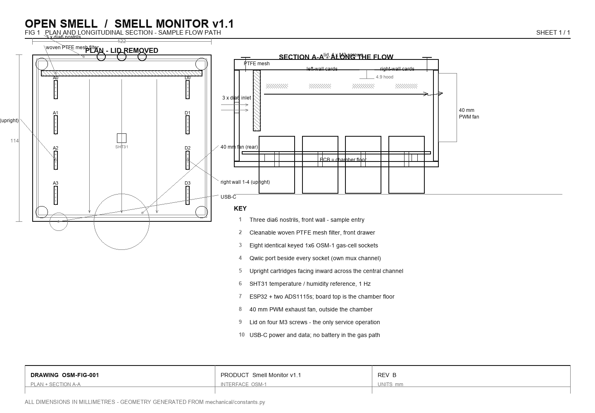

# OpenSmell Smell Monitor — User Manual

**Document:** OSM-UM-001  
**Revision:** C  
**Date:** 2026-11-23  
**Product:** Smell Monitor v1.1  
**Firmware:** v1.1  
**Companion software:** Osmograph desktop  
**Interface standard:** OSM-1 (OpenSmell Module Standard v1)

---

## Notice

This manual describes the Smell Monitor, an open-source, modular, sensor-agnostic
digital olfaction acquisition platform. The device is a **research instrument**,
not a calibrated safety monitor. It does not identify smells on its own and is
not intended for use in explosive atmospheres, life-safety applications, or as
a substitute for certified industrial hygiene equipment.

The tray and lid are sealed PETG; a PTFE liner is an optional upgrade. The inlet
filter is a **thin woven PTFE mesh** — cleanable, and replaced only if torn or
permanently clogged. The instrument is **headless**: there is no display on the
device, and all readings appear in Osmograph on the host.

---

## 1. System Overview

```mermaid
flowchart TB
    subgraph sample ["Sample enters"]
        N[3 × Ø6 nostrils<br/>front wall]
        F[Thin woven PTFE mesh filter<br/>front drawer]
    end

    subgraph chamber ["Sealed chamber"]
        LW[Left wall: slots 1–4 (J2–J5)<br/>upright, inward, 24 mm pitch]
        RW[Right wall: slots 5–8 (J6–J9)<br/>upright, inward, 24 mm pitch]
        S[SHT31 T/RH<br/>reference on base]
        CH[Central channel<br/>gas flows front to rear]
    end

    subgraph exhaust ["Exhaust"]
        Fan[40 mm PWM fan<br/>rear, outside chamber]
    end

    subgraph base ["Base board (chamber floor)"]
        MCU[ESP32-WROOM-32E]
        ADC[ADS1115 ×2<br/>8 analog channels]
        Mux[TCA9548A I²C mux<br/>8 channels]
    end

    subgraph host ["Host (Osmograph)"]
        UI[.osmell record stream<br/>QC flags<br/>User labels & notes]
    end

    N --> F --> CH --> Fan
    LW -.-> CH
    RW -.-> CH
    S -.-> MCU
    MCU --> ADC
    MCU --> Mux
    MCU -->|USB-C serial| UI
    MCU -.->|Wi-Fi / BLE| UI
```



**Figure 1.** The enclosure in plan (lid removed) and in section along the flow.
Air enters through three Ø6 nostrils centred on the channel, passes the cleanable
woven PTFE mesh, travels straight between two inward-facing rows of upright
breakout boards and exits through the rear 40 mm fan. Each card rises 32 mm and
has a 4.9 mm hood to the lid; 13 mm of wall clearance behind it leaves room for
rear pins. All eight sockets are identical and every header and pin is
silkscreened. The top face of the base board is the chamber floor. The vector
original is `figures/cad/manual_linework.svg`.

**What the device does.** Draws a controlled air sample through three front
nostrils, over eight interchangeable OSM-1 sensor cartridges, and records each
response as a `.osmell` stream over USB-C. Every record fuses gas + pH + T/H:
`ao[8]`, `adc[8]`, `do_[8]`, `digital[8]`, temperature, humidity, slot index and
QC flags. Gas values come from the eight slots; T/H comes from the soldered
SHT31; pH is reported only when an ISFET cartridge is fitted.

**What it is not.** It does not classify smells. It does not measure pH in the
gas path (pH is a liquid measurement; an optional ISFET pH cartridge plugs into
any slot for fermentation, brine and wort users) and is not on the base board.

---

## 2. What's in the Box

| Item | Qty | Purpose |
|------|-----|---------|
| Smell Monitor base unit (PCB + sealed PETG tray + lid) | 1 | Main instrument |
| Thin woven PTFE mesh filter | 1 | Stops droplets and dust; front drawer |
| USB-C data cable, 1 m | 1 | Power + data to host |
| USB-C panel pigtail, 0.3 m | 1 | Bulkhead feedthrough (seals rear wall hole) |
| M3 screws | 4 | Lid retention |
| Heat-set inserts | 4 | Lid threads in tray |
| Quick-reference card | 1 | Pinout + cycle states |

**Not included:** sensor cartridges. You supply the modules that match your use
case (MOX, MEMS, NDIR, electrochemical, piezo, QCM — any OSM-1-conforming
cartridge fits any slot).

---

## 3. Hardware Tour

Figure 1 shows the layout and the flow path; the parts are listed here.

All eight slots are identical: gas-cell socket **and** Qwiic port at every
position. Flow order is fixed front → rear; slot assignment is yours.

| Part | What it is |
|------|------------|
| **Nostrils** | Three Ø6 holes in the front wall. Air enters here. |
| **Filter drawer** | Holds the cleanable thin woven PTFE mesh. Lift out with the lid off; rinse, dry, reinsert. |
| **Slots 1–8** | Keyed 1×6 gas-cell socket `+5V GND AO DO 3V3 ID` + Qwiic/STEMMA QT port `GND 3V3 SDA SCL` at every slot. Any OSM-1 cartridge fits any slot. |
| **SHT31** | Fixed temperature/humidity reference on the base board, soldered to the main I²C bus, logged at 1 Hz. |
| **Base board** | ESP32-WROOM-32E, two ADS1115s (8 channels), TCA9548A (8 channels). Its top face *is* the chamber floor. |
| **Fan** | 40 mm PWM exhaust on the rear wall, outside the chamber. Pulls air through. |
| **USB-C** | Power in, data out. Always-on serial at 115200 baud. Wi-Fi and BLE optional. |

---

## 4. 5-Minute Quick Start

**Step 1 — Power.** Plug the USB-C cable into the Smell Monitor and into your computer. The status LED gives one slow blink (idle).

**Step 2 — Open Osmograph.** Launch Osmograph on your computer. It opens the serial port at 115200 baud automatically. There is no display on the device.

**Step 3 — Insert cartridges.** Open the lid (four M3 screws). Plug your sensor cartridges into any slots. Close the lid.

**Step 4 — Measure.** Press the MEASURE button or click "Measure" in Osmograph. The LED is solid while the ≈40 s cycle runs (10 s intake / 10 s hold / 20 s purge), then gives a brief fast blink and a buzzer beep when results are ready.

**Step 5 — Read the record.** Osmograph displays the `.osmell` record: slot values, temperature, humidity, and any QC flags. A red QC flag means "check this reading," not "the device is broken."

**First-time tip:** Run three clean-air cycles before your first measurement so the chamber and sensors reach a stable baseline.

### Customising timing, fan and buzzer

Osmograph can change these over the same serial / Wi-Fi / BLE link used for
readings. Send one command per line; settings persist across power cycles.
`status` reports the current values.

| Command | Effect |
|---------|--------|
| `fan intake <0-255>` | PWM duty while drawing the sample in (default `128`) |
| `fan hold <0-255>` | PWM duty while sensors equilibrate (default `0`, still air) |
| `fan purge <0-255>` | PWM duty while flushing the chamber (default `255`) |
| `rate <20-5000>` | ADC read interval during HOLD in ms (default `125`) |
| `timing <intake> <hold> <purge>` | Phase lengths in ms (defaults `10000 10000 20000`) |
| `mute` / `unmute` | Disable / enable the end-of-cycle beep |
| `status` | Report firmware version, radios and all current settings |

---

## 5. Module Swapping Guide (OSM-1)

Every slot carries both interfaces side by side:

| Interface | Pinout (keyed 1×6, 2.54 mm) | Serves |
|-----------|------------------------------|--------|
| **Gas cell** | `+5V GND AO DO 3V3 ID` | MOX, electrochemical, NDIR-with-Vout, catalytic, PID |
| **I²C port** | Qwiic / STEMMA QT (`GND 3V3 SDA SCL`) | NDIR CO₂, T/RH, VOC index, particulate |

```
Gas-cell socket pinout (looking at the base):
  Pin 1: +5V   (heater rail, ≤150 mA per slot)
  Pin 2: GND
  Pin 3: AO    (cell output, 0–5 V, divided 10k/10k into the ADC)
  Pin 4: DO    (comparator output or TTL serial RX, 3.3 V GPIO via 10k series)
  Pin 5: 3V3   (≤50 mA for cell converter)
  Pin 6: ID    (1-Wire shared bus; v1 firmware does not enumerate EEPROMs)
```

Each Qwiic port is one channel of the TCA9548A (channel *n* = slot *n*), so two
modules with the same I²C address can be used at once.

**How to swap a cartridge:**
1. Power down (unplug USB-C).
2. Remove the four M3 lid screws; lift the lid.
3. Lift the cartridge straight out of its socket.
4. Align the new cartridge's pin-1 chamfer with the socket key; press straight down.
5. Replace the lid, tighten four M3 screws.
6. Power on. The record carries the slot index; Osmograph attaches the sensor
   type and calibration from its slot map. No identity chip is required.

**No tools beyond a 2.5 mm hex key.** A swap takes under 60 seconds. Calibration
and exposure history are host-side data in v1: update the slot map when you move
a cartridge to a different slot. The base itself needs no re-calibration.

---

## 6. Understanding QC Flags

Osmograph evaluates every record and appends red QC flags to affected slots. Flags are **starting thresholds** — tune them against clean-air and known-bad data before making field claims.

| Flag | What it means | What to check |
|------|---------------|---------------|
| `adc_saturation` | Slot voltage sits at 0 V or the ADC rail (2.5 V at the ADC = 5 V at the slot) for two consecutive cycles | Disconnected or shorted sensor; check wiring, reseat cartridge |
| `baseline_drift` | Hold-phase voltage slope exceeds 0.05 mV/s | Sensor warming up; allow 10 min warm-up; check for temperature changes |
| `sht31_out_of_range` | Temperature or humidity jumped more than threshold in one cycle | Fan failure, seal leak, or rapid ambient change; check fan is spinning |
| `eeprom_mismatch` | Readings present but the host has no identity/calibration entry for that slot | Update Osmograph's slot map; data still works, flagged as uncalibrated |
| `flow_stagnation` | MOX resistance did not drop during intake (flat or rising) | Fan not spinning; filter mesh blocked; cartridge seated wrong |

**Rule of thumb:** A red flag means "verify before trusting." It does not mean the device is broken. Clear air + fan running + seated cartridges = no flags.

---

## 7. Maintenance

The Smell Monitor has **no scheduled consumables**; the inlet mesh is cleanable
and is replaced only if damaged or permanently clogged.

| Task | Interval | How |
|------|----------|-----|
| Rinse filter mesh | When visibly dusty, or after smoke/dust exposure | Lift the lid, remove the drawer, rinse the woven PTFE mesh under tap water, air-dry, reinsert |
| Wipe chamber interior | Annually, or after strong odor events | Dry lint-free cloth only; no solvents |
| Check fan | If `flow_stagnation` appears | Verify fan spins freely; check connector |
| Recalibrate cartridge | Per the host slot-map history | Follow the cartridge maker's procedure; update Osmograph's slot map |

**Never:** use compressed air on the sensors, spray solvent into the chamber, or install silicone sealant/tape anywhere air touches. Silicone vapour permanently poisons SnO₂ MOX cells.

---

## 8. Specifications

| Parameter | Value |
|-----------|-------|
| Power | USB-C 5 V (1.38 A worst case; 3 A source assumed) |
| Idle power | < 1 W |
| Loaded power | ≈ 5 W starter pack; up to ≈ 8 W worst case (MOX heaters dominate) |
| Sensor ports | **8 identical OSM-1 slots**: 1×6 gas-cell socket + Qwiic port at each; any mix |
| Acquisition | 2 × ADS1115 (8 channels), TCA9548A (8 channels), SHT31 at 1 Hz |
| Cycle time | ≈ 40 s (10 s intake / 10 s hold / 20 s purge) |
| Airflow | 15 L/min design purge |
| Filter | Thin woven PTFE mesh, cleanable; front drawer |
| Wetted surfaces | Sealed PETG tray, lid and filter drawer; PTFE liner optional |
| Enclosure | 122 × 114 × 49 mm (128 mm deep with rear fan) |
| Mass | ≈ 240 g |
| Operating range | 5–40 °C, 20–80% RH |
| Serial | USB-C 115200 baud (always on) |
| Wireless | Wi-Fi 2.4 GHz + Bluetooth LE (optional, same data) |
| Data format | `.osmell` v1.0 (gas + pluggable pH cartridge + T/H) |
| Safety | Research instrument; 5 V USB-C; not for explosive atmospheres; keep from liquids |

---

## 9. Warranty & Support

Open-source hardware under CERN-OHL-S. Firmware and software under MIT.
Documentation under CC BY-SA 4.0.

No manufacturer's warranty. Community support via the OpenSmell GitHub
repository: github.com/OpenSmell/smell-monitor

---

*End of manual — OSM-UM-001 Rev C*
