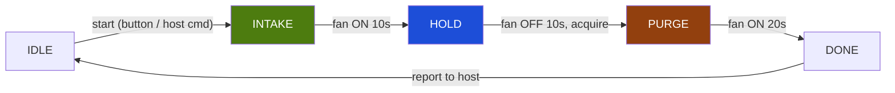

# Smell Monitor v1 — Architecture Specification

**Document:** `docs/architecture.md`
**Version:** 1.0 (LOCKED)
**Status:** Reference design — schematic v0.x, PCB layout in progress, enclosure pending
**License:** CERN-OHL-S (hardware) / MIT (firmware)
**Maintainer:** OpenSmell

This document is the authoritative reference for every design decision in the Smell Monitor. If anything in the repository contradicts this document, this document wins until it is deliberately amended.

---

## 1. Purpose and Goals

The Smell Monitor is an open-source, modular, sensor-agnostic electronic nose. It provides a standard multi-channel acquisition platform for analog (MOX / electrochemical / NDIR) and digital (MEMS / I2C) gas sensors, packaged so that:

1. **Anyone can build it** from a ~$50–150 BOM using standard parts and tools.
2. **Anyone can extend it** — plug in the sensor that fits their chemistry; the board does not care what it is.
3. **Measurements are defensible** — repeatable pneumatic exposure, controlled environment, logged temperature/humidity for compensation.
4. **It is manufacturable** — board files, BOM, Gerbers, enclosure STEP/STL, and an assembly guide that a fabricator (e.g., Seeed Fusion / JLCPCB) can execute without back-and-forth.

### Non-goals (v1)
- No on-device gas classification/prediction. Firmware acquires and streams; classification happens upstream (host, Osmograph).
- No battery management (USB-C powered only).
- No sample collection/concentration. Direct headspace sniffing via active flow.
- No certified ppm output. This is a qualitative/relative instrument.

### Design objectives (multi-objective, in priority order)

| # | Objective | Target |
|---|-----------|--------|
| O1 | Cost (BOM) | ≤ $60 at qty 10 |
| O2 | Modularity | 8 analog + 8 digital sensor slots, sensor-agnostic |
| O3 | Repeatability | Day-to-day baseline drift tracked; exposure cycle repeatable |
| O4 | Buildability | Standard tools, no custom parts beyond a 3D-printed/aluminium body |
| O5 | Power | USB-C, ≤ 2.5 W worst case (fan + MCU + sensors) |
| O6 | Reliability | Sensor swap without tools; chamber cleanable |

---

## 2. System Overview

```
             ┌─────────────────────────────────────────────────┐
             │                 Smell Monitor v1                │
             │                                                 │
  sample ──► │ INTAKE ─► [PTFE filter] ─► SENSING CHAMBER ─► [FAN] ─► exhaust
  air        │                                     ▲                │
             │                            SHT31 (T/RH)              │
             │                                                 │
             │   ANALOG BANK (8 slots)        DIGITAL BANK (8 slots) │
             │   J2–J9  · 4-pin 5V/2.54mm     J10–J17 · 6-pin 3.3V/I2C │
             └───────────────┬─────────────────────────────────────┘
                             │
        ┌────────────────────┼────────────────────┐
        ▼                    ▼                    ▼
  2x ADS1115 (16-bit)   TCA9548A (I2C mux)    ESP32-WROOM-32E
        │                    │                    │
        └──────── I2C bus ───┴── SHT31 / OLED ────┤
                                                 USB-C (power + serial to Osmograph)
```

---

## 3. Pneumatic Subsystem

### 3.1 Operating principle — active three-phase cycle

The device never "passively sniffs." Exposure is driven by a deterministic cycle so that each measurement sees the same pneumatic history. Passive detection introduces uncontrolled ambient variability that corrupts the comparison between samples.

| Phase | Fan | Duration | Purpose |
|-------|-----|----------|---------|
| Intake | ON (PWM ~50%) | 10 s | Draw sample through filter into chamber |
| Hold   | OFF | 10 s | Let sensors equilibrate; **data acquisition happens here** (high-rate reads) |
| Purge  | ON (PWM ~100%) | 20 s | Flush chamber with clean/ambient air, reset baseline |

Timings are firmware parameters (`docs/firmware`) and may later be tuned per sensor pack. The three-phase structure is fixed.

> Diagram source: `docs/figures/pneumatic_cycle.mmd` (+ `.svg`/`.png`). All figures live in `docs/figures/`.



### 3.2 Actuator — fan, not pump

A 5V 40×40×10 mm axial fan (exhaust, pulling air through the chamber) is used in preference to a diaphragm pump:

- Adequate airflow for a compact chamber at negligible pressure drop (10–40 Pa).
- Lower cost (<$4), lower power (≤1 W), PWM-speed controllable from one ESP32 GPIO through a low-side MOSFET.
- No pump head, valve, or pulsed-flow artifacts. Mode of failure is simple (stalled fan).

**Fan spec (v1):** 5V 40 mm axial, 10 mm thick, PWM speed control 0–100%, target delivered flow 0.7–2.0 L/min through the chamber at 40 Pa. Noise target ≤ 30 dBA at 1 m.

Intake and exhaust must not share a wall. Flow crosses the chamber once, front-to-rear.

### 3.3 Chamber geometry (v1 design values)

Design targets — to be re-verified against the final routed PCB outline and, if budget allows, a single CFD pass (see §9).

| Parameter | v1 value | Rationale |
|-----------|----------|-----------|
| Internal cavity (L × W × H) | 90 × 55 × 24 mm | Encloses both header rows + fan step-down |
| Cavity volume | ≈ 119 cm³ | Purge at 1 L/min ≈ 7× volume exchange / 20 s purge |
| Inlet aperture | 2 × Ø5 mm nostril holes | ~8 mm² each equivalent open area |
| Outlet | Ø40 mm into fan | Match fan swept area; step-down taper 24 → 10 mm |
| Sensor baffle | Perforated plate, sensors recessed 8 mm below baffle | Shields sensing elements from direct high-speed streaks (thermal perturbation mitigation) |
| Header pitch (in-row) | 17.5 mm centre-to-centre | Fits 2.54 mm headers + breakout skirt clearance |
| Row separation | 40 mm | Room for tallest common breakout (≈ 20 mm) |

**Flow discipline (non-negotiable):**

- Single pass, front (intake) → rear (fan). No internal baffles except the sensor screen.
- No sharp internal corners in the flow path. Radius ≥ 3 mm on any internal transition.
- Sensors are intentionally *not* in the high-velocity core of the duct. They sit in a low-convective zone so fan speed has minimal effect on their operating temperature (the dominant MOX error source).

### 3.4 Materials and sample-memory control

This section exists because sample *memory* (carry-over) is the silent killer of e-nose data. Every gas-contacting surface either adsorbs/outgasses VOCs or it doesn't; there is no middle ground worth shipping.

| Surface | Allowed | Forbidden (why) |
|---------|---------|-----------------|
| Chamber inner walls | PTFE sheet/insert, borosilicate glass liner, or PTFE-lined aluminium | PLA/ABS/PETG/TPU 3D prints (outgas + adsorb → permanent memory) |
| Outer structure | Aluminium, or any rigid plastic if fully lined | — |
| Tubing (if any) | PTFE, PFA, stainless steel | Silicone, PVC, Tygon (adsorb VOCs) |
| Filter to sensor path | Nothing adsorbing between filter and sensors | Porous carbon pre-filters (adsorb & bias every sample) |
| Chamber gaskets | PTFE-coated / FKM (Viton) | Natural rubber, EPDM (outgas) |

**Consequence for manufacturing:** the sensing cavity must either be (a) machined PTFE, (b) glass, or (c) aluminium an odization + PTFE liner. A plain 3D-printed plastic chamber is not acceptable regardless of cost. Cost mitigation: the chamber is a *separate insert* that drops into a cheap cosmetic outer shell. The insert is where quality lives.

### 3.5 Intake and filter

- **Filter:** hydrophobic PTFE membrane, pore ≤ 0.45 µm, ≥ 20 mm² effective area (two nostril apertures share one membrane), user-replaceable.
- Purpose: block liquid water and particulates; reduce humidity transients reaching the sensors (PTFE is hydrophobic). It does **not** remove water vapor — humidity compensation is handled by SHT31 data downstream.
- **Filter change protocol:** every 90 days or after suspected particulate exposure; documented in the manual.

---

## 4. Sensing Subsystem

### 4.1 Sensor-agnostic interface (the contract)

The platform defines two electrical slots. **It does not define sensor chemistry.** Anything that matches the electrical contract can be plugged in — MOX, MEMS, NDIR, electrochemical, piezo, photoionisation, you name it. Selection of chemistry is the user's problem; providing a clean, repeatable, instrumented electrical + pneumatic environment is ours.

#### Analog bank — J2..J9 (8 slots, 1×4 header)

| Pin | Name | Rail | Notes |
|-----|------|------|-------|
| 1 | `+5V` | 5V | Power for module logic + MOX heater |
| 2 | `GND` | GND | |
| 3 | `AO` | — | Analog out → **fixed 2:1 divider → ADS1115 input** (5 V → 2.5 V max) |
| 4 | `DO` | — | Digital out → ESP32 GPIO (input, pull-down) |

- Electrical limits per slot: 5 V, 250 mA max (heater budget accounted on the 5 V rail).
- The 2:1 divider is **fixed and always present** so a 0–5 V AO swing cannot exceed the 3.3 V ADC input range. ADC full-scale for the divider is 2.5 V.
- `DO` lines land on ESP32 digital inputs (see §5.4 for GPIO map).

#### Digital bank — J10..J17 (8 slots, 1×6 header)

| Pin | Name | Rail | Notes |
|-----|------|------|-------|
| 1 | `3V3` | 3.3V | Logic + sensor VDD |
| 2 | `GND` | GND | |
| 3 | `SDA` | I2C | Routed through **TCA9548A** channel (segmented bus) |
| 4 | `SCL` | I2C | same |
| 5 | `INT` | — | Interrupt / spare signal → ESP32 GPIO |
| 6 | `CTRL` | — | Enable / spare signal → ESP32 GPIO |

- Each digital slot owns a dedicated TCA9548A channel → **no I2C address collisions ever**, even for same-address sensors. Up to 8 independently addressed digital sensors.
- `INT`/`CTRL` are arbitrary spare GPIOs, documented per-slot.

**Rationale for the two voltage rails:** MOX/auto modules (analog bank) predominantly run at 5 V and drive a 0–5 V AO line; MEMS/I2C sensors (digital bank) are natively 3.3 V devices. Providing both rails, correctly credited, is the cheapest way to be truly sensor-agnostic.

### 4.2 Environmental sensing (compensation backbone)

- **SHT31-D** (`U5`) is placed in the gas path, **upstream of the MOX array**, before the sensing elements can warm the air. On the main I2C bus (not behind the mux — it is a master-side sensor).
- Firmware logs T/RH beside every acquisition record. No attempt is made to hard-correct in firmware; raw + environment data is the contract with the host (Osmograph) for compensation models.
- SHT31 reading cadence: 1 Hz during all phases.

### 4.3 Recommended starter sensor pack (not mandatory)

Orthogonal coverage of the most common "smell job" chemical families:

| Slot | Sensor | Family | Primary target |
|------|--------|--------|-----------------|
| J2 (A1) | MQ-135 | MOX | NH₃, smoke, benzene |
| J3 (A2) | MQ-136 | MOX | H₂S (reduced sulfur) |
| J4 (A3) | MQ-137 | MOX | NH₃ (amine family) |
| J5 (A4) | MQ-138 | MOX | VOCs (broad) |
| J10 (D1) | SGP30 | MEMS | TVOC / eCO₂ |
| J11 (D2) | BME688 | MEMS | T/RH + volatile profile + IAQ |
| J12 (D3) | SCD40 | NDIR | CO₂ co-measurement |
| J13 (D4) | (open) | — | future |

Eight populated slots is the practical maximum for a meaningful array without instrumenting headspace beyond v1's capability. The remaining 8 headers exist for experimentation.

---

## 5. Electrical Subsystem

### 5.1 Power tree

```
USB-C 5V ──┬──► 5V NET ──► fan (via PWM MOSFET)
           │           ├──► analog headers +5V (J2–J9)
           │           ├──► buzzer (via drive transistor)
           │           └──► LDO AMS1117-3.3
           │                        │
           │                        ▼
           │                    3.3V NET ──► ESP32, 2x ADS1115, TCA9548A,
           │                                             SHT31, OLED,
           │                                             digital headers 3V3
           └──► GND (common)
```

**Resolution of v0 BOM gap:** the v0 schematic/README referenced a 3.3 V rail but the BOM contained **no regulator**. This release adds `U7`:

| Ref | Value | Footprint | MPN | Notes |
|-----|-------|-----------|-----|-------|
| U7 | AMS1117-3.3 | SOT-223 | AMS1117-3.3 | 5V → 3.3V, 1 A, ceramic-cap stable |

Bypass: 100 nF on input, 10 µF on output (already in C1–C24 budget). Worst-case 3.3 V draw ≈ 0.6 A (ESP32 Wi-Fi TX burst + 8 I2C sensors) — inside rating, with margin.

**5 V rail budget** (≤ 2.1 A total at USB 500 mA is not required — USB-C PD source assumed 5 V/3 A): fan 0.2 A + buzzer 0.03 A + up to 8 analog modules × 0.2 A = ≤ 1.8 A. Within a 5 V/3 A USB-C supply; a 5 V/2 A supply supports up to 7 analog modules.

### 5.2 Microcontroller — ESP32-WROOM-32E (`U1`)

- Dual-core, Wi-Fi/BT, high-speed ADC not used (see 5.3).
- I2C master: GPIO 21 (SDA), GPIO 22 (SCL), 400 kHz.
- Developer serial: UART0 via USB-C to the host (Osmograph protocol).

### 5.3 Analog acquisition — 2× ADS1115 (`U2`, `U3`)

- 16-bit, 4-ch, I2C. Addresses `0x48` (U2), `0x49` (U3). 8 analog channels total, one per analog slot.
- All channels single-ended, AINn–GND, PGA = ±4.096 V, **input clamped to ≤ 2.5 V by onboard divider**.
- Sample rate 8–16 SPS per channel during the **hold** phase; firmware interleaves.

Why not the ESP32 ADC: built-in ADC is nonlinear and non-monotonic unless calibrated per-ESP32; two ADS1115s give linear, ratiometric, 16-bit readouts on a shared I2C bus for ~$3 total.

### 5.4 Digital bus — TCA9548A (`U4`)

- 8-channel I2C switch at `0x70`, one channel per digital slot (J10–J17).
- Master-side bus: ESP32 + U2 + U3 + SHT31 + OLED.
- Per-slot segment pull-ups: 4.7 kΩ on each channel's SDA/SCL (allow different address sets and sensor refresh rates without one slow sensor blocking another).

**ESP32 additional pin allocations:**

| Function | GPIO |
|----------|------|
| I2C SDA | 21 |
| I2C SCL | 22 |
| Fan PWM | 4 |
| Buzzer | 16 |
| Status LED | 17 |
| Button (measure) | 0 |
| DO0–DO3 (analog slots 1–4) | 32, 33, 25, 26 |
| DO4–DO7 (analog slots 5–8) | 12, 13, 14, 27 |
| INT0–INT7 / CTRL0–CTRL7 (digital slots) | 34, 35, 36, 39, 18, 19, 23, 5 |

> GPIO allocations are the **pending v1 target**; confirm no strapping-pin conflicts (GPIO 0, 12, 5 are strapping pins — used per the table above is valid but must be confirmed in KiCad ERC).

### 5.5 UI and indicators

- **OLED:** SSD1306, 0.96" 128×64 I2C (`U6`, addr `0x3C`) on the master bus. Shows: phase, elapsed time, live AO/TVOC readouts, T/RH, last sample summary.
- **Status LED (`LED1`):** heartbeat (idle), breathing (intake), solid (hold), fast blink (acquired → ready).
- **Buzzer (`BZ1`):** active 5V, audible end-of-measurement (configurable). Requires a drive transistor between GPIO16 and the 5 V buzzer (GPIO cannot sink 30 mA directly).

### 5.6 Connectors

| Connector | Type | Purpose |
|-----------|------|---------|
| J1 | USB-C 16P | Power + serial |
| J2–J9 | 1×4 2.54 mm female | Analog sensor slots |
| J10–J17 | 1×6 2.54 mm female | Digital sensor slots |
| J19 | JST-PH 2P | Fan |

All sensor headers are female so breakout boards plug straight in and are swappable without soldering.

---

## 6. Mechanical Layout

### 6.1 Front sensing module / rear service bay

The body is split by a sealed bulkhead at mid-depth:

```
                    o o o o o o o     <- anode intake (2x Ø5 nostrils)
      ┌───────────────────────────────┐
      │   SENSING MODULE (front)      │
      │  PTFE-lined cavity, filter,   │
      │  baffle, sensor breakout tops │
      ├───────────────────────────────┤  <- bulkhead (PCB seals here)
      │   SERVICE BAY (rear)          │
      │  ESP32, LDO, ADS1115, mux,    │
      │  OLED, buzzer, fan (exhaust)  │
      └──────[USB-C]──────────────────┘
```

- Electronics heat stays out of the sensing cavity (the dominant reason sensors drift during a run).
- The PCB **is** the seal: sensor headers poke through a gasket on the bulkhead; chamber inner walls bolt down over the gasket.
- Fan lives in the service bay, exhausting through the rear wall — pulling air through the chamber across the bulkhead pass-through.

### 6.2 Board outline and placement targets

| Feature | v1 target |
|---------|-----------|
| Board outline | 120 × 70 mm, two-zone (front 70×55 sensing / rear 50×70 service) |
| Analog header row (J2–J9) | 17.5 mm pitch, located near bulkhead, facing "up" into chamber |
| Digital header row (J10–J17) | 17.5 mm pitch, second row, 40 mm behind analog row |
| SHT31 | On board edge intruding into the intake stream (before the array) |
| Fan footprint (J19/FAN1) | Rear wall cutout Ø40 mm |

These are targets for PCB layout. The routed layout is authoritative for the enclosure interface; enclosure STEP is derived from the final board outline (`mechanical/freecad`).

### 6.3 Enclosure

- Outer shell: PLA/PETG cosmetics are fine (non-gas-contacting).
- Chamber insert: PTFE-lined (see §3.4) — the only "premium" cost center. Tooling-impressive but affordable: machined PTFE insert is a one-off CNC ticket.
- Captive screws on service bay lid; tool-free sensor access via top hatch.

---

## 7. Firmware Requirements

Structurally defined; timing is parameterised.

1. **Cycle state machine** — IDLE → INTAKE(10 s) → HOLD(10 s) → PURGE(20 s) → report. Driven by button (`GPIO0`) or host command over USB-UART.
2. **Analog acquisition** — during HOLD, interleave 8 ADS1115 channels at ~8 SPS/channel with per-channel sample averaging.
3. **Digital scan** — during HOLD, iterate TCA9548A channels 0–7, read whatever sensor reports (driver registry keyed by detected chip ID).
4. **Environmental logging** — SHT31 at 1 Hz, all phases.
5. **Comms** — simplified JSON-over-USB-UART records: `{ts, phase, ao[8], digital[8], t, rh, cycle_id}`; stream to Osmograph.
6. **UI** — OLED phase/values; LED state machine per §5.5.
7. **Self-test on boot** — fan tach (if present), I2C device enumeration, divider sanity check, SHT31 read. Report pass/fail on OLED.

Reference implementation target: Arduino-ESP32 core, single-file main loop + cyclic state machine (see `firmware/`).

---

## 8. Verification and Validation

### 8.1 Electrical
- KiCad **ERC** clean (0 errors, warnings reviewed) — gate for TCA9548A address/pull-up/strapping pins.
- KiCad **DRC** clean before Gerber export.
- Bench tests: rail integrity (5 V/3.3 V under max load), ADC linearity (divider 0–2.5 V), I2C enumeration of 8 simultaneous same-address sensors behind the mux.

### 8.2 Pneumatic
- Purge completeness: after a strong odor exposure, one full cycle should return all sensors to ≥ 95% of baseline. **This is the acceptance test for sample-memory.**
- Fan-speed invariance: repeat a fixed exposure at 40/70/100% PWM; sensor response must not shift (validates the recessed-baffle design).

### 8.3 Proposed CFD pass (optional but recommended once)
- Single steady-state simulation of the cavity at 1 L/min. Verify: no recirculation zone > 5% of volume upstream of any sensor; sensor-nose plane velocity ≤ 0.1 × duct-core velocity. Tools: OpenFOAM (free) via a scripted `simpleFoam` case. This is a *validation*, not a design driver — v1 geometry is already constrained by the rules in §3.3.

### 8.4 Delivery checklist for fabrication
- [ ] ERC 0 errors
- [ ] DRC 0 errors
- [ ] BOM with LCSC part numbers (JLCPCB/Seeed feedstock)
- [ ] Gerbers + drill, position file
- [ ] STEP of assembly + enclosure
- [ ] Assembly guide (this repo)
- [ ] Firmware binary + flash guide

---

## 9. BOM Deltas from v0

| Change | Reason |
|--------|--------|
| **Add U7 AMS1117-3.3** | v0 shipped no 3.3 V rail — architecture was incomplete |
| Analog headers pinout documented as `5V/GND/AO/DO` | Matches MQ module ecosystem reality |
| Digital headers pinout documented as `3.3V/GND/SDA/SCL/INT/CTRL` | Matches 3.3 V MEMS reality; README's old "3.3 V everywhere" was wrong |
| Analog AO → fixed 2:1 divider | Protects 3.3 V ADS1115 inputs from 0–5 V module outputs |
| OLED 0.96", active buzzer (per BOM) | v0 README said 0.91"/passive — BOM wins |

## 10. Tradeoffs, Risks, Future Iterations

| Risk | Mitigation |
|------|------------|
| PTFE insert cost | Only the chamber insert is PTFE; shell is cheap cosmetic plastic |
| 16 slots is more than users will fill | v1 proves the interface; populated packs sold/modelled later |
| Fan speed affects MOX temperature | Recessed baffle (§3.3); validated by §8.2 test |
| Sensor drift over months | Swappable sockets + SHT31 compensation data + shared open dataset |
| USB-C current limits | 5 V/3 A source assumed; budget table in §5.1 |

### Known future iterations
- **v1.1:** battery + charging (USB-PD), fan tachometer feedback, higher-flow option.
- **v2.0:** manifold switching / multi-compartment for robotics (pace-based sampling), integrated valved reference-air path for automatic zero/baseline calibration.

---

*This is the lock-in document. Changes require a version bump and a recorded decision in this section.*