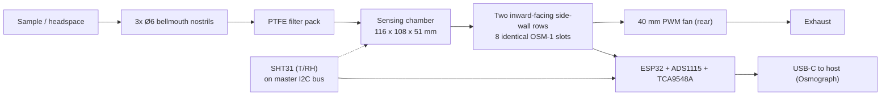
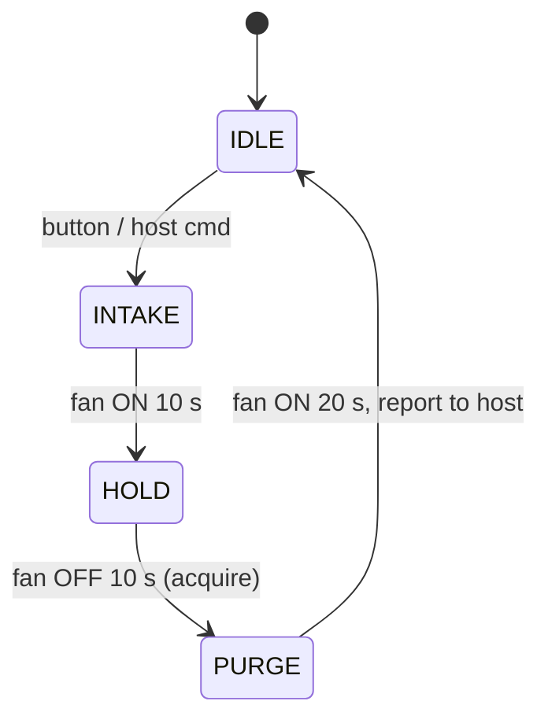
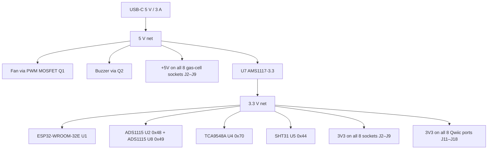

# Smell Monitor — Blueprint, Build & User Specification

| | |
|---|---|
| **Document** | OS-BP-001 |
| **Revision** | R |
| **Date** | 2026-11-22 |
| **Status** | Architecture locked and built to OSM-1: eight uniform slots, schematic ERC-clean, PCB routed/DRC-clean with a filled B.Cu GND return and fitted to the tray, headless firmware compiling. Enclosure CAD, dimensioned sheets, Gerbers and the assembly animation are generated and machine-verified. The CFD case is committed with corrected transient numerics; run and import with the two commands in `cfd/RESULTS.md`. Acceptance testing of a built unit follows §14. |
| **License** | Hardware: CERN-OHL-S-2.0 · Firmware: MIT |
| **Maintainer** | OpenSmell |


**Standards applied:** ASME Y14.100 (drawing practices) · ASME Y14.24 (types of
drawings) · ASME Y14.5 (dimensioning & tolerancing) · ISO 128 (lines) ·
ISO 5457 (sheet sizes) · ISO 2768 (general tolerances) · CERN-OHL-S / DIN SPEC
3105 (open-hardware documentation).

**How to read this document.** Every requirement traces upward to a success
criterion in §0.4 and downward to a design value and a verification test. A
number that traces to nothing does not belong here. §15 records why the
hard-to-vary choices are what they are, and which claims are proven, calculated
or untested. The module interface is `docs/module-standard.md`.

### Contents
0. Objective & Success Criteria · 1. System Overview · 2. Operating Principle ·
3. Pneumatic Design · 4. Sensing Interface · 5. Electrical Design ·
6. Mechanical Design · 7. Firmware Requirements · 8. Verification & Validation ·
9. Bill of Materials · 10. Assembly & Bring-up · 11. User Manual ·
12. Drawing Set · 13. Risks & Future · 14. Revision History ·
15. Design Decision Record

---

## 0. Objective & Success Criteria

### 0.1 What this is

An **open-hardware sensing platform** that presents a **controlled, repeatable
sample** (headspace) to a **user-selectable set of heterogeneous gas/odor
sensors** — MOX, NDIR, electrochemical, polymer, piezo, QCM — and emits a
**time-series sensory vector plus an open dataset**, so anyone can train
classifiers, swap components, and build vertical applications on top.

The hardware's entire job is to **remove confounders** (flow, temperature,
humidity, carryover, timing) so that cheap, cross-sensitive, drift-prone
sensors produce data that is *comparable and reproducible*. Sensing is
commodity; **reproducibility is the product.**

### 0.2 Why it exists

| Tier | Sampling | Sensing principles | Tooling |
|------|----------|--------------------|---------|
| Development boards | ambient air | one technology | closed |
| Laboratory instruments | controlled | several | closed |
| DIY projects | none specified | mixed | none |
| **This platform** | **controlled headspace** | **heterogeneous, swappable** | **open** |

The gap is the combination: controlled sample presentation, mixed sensor
technologies, and open reproducible data in one serviceable instrument.

### 0.3 Users

Makers/students (learn olfaction, build a first e-nose) · researchers
(repeatable sample presentation for comparative studies) · product developers
(de-risk a sensing use case) · integrators (consume the open dataset/API).

### 0.4 Success criteria (LOCKED)

The platform is judged on **repeatability**. All targets are measured against a
**sealed reference vial** (fixed ethanol-in-water ratio, fixed temperature).

| ID | Metric | Definition | Test method | Target |
|----|--------|-----------|-------------|--------|
| **P1** | Repeatability (primary) | CV of a sensor's response to N identical samples | N=5 repeats, same session | **CV ≤ 5%** intra-session; ≤ 10% day-to-day |
| **G1** | Carryover | blank-after-sample ÷ sample response | alternate reference ↔ blank | **≤ 5%** |
| **G2** | Cycle time | intake + hold + purge | timed | **≤ 60 s** |
| **G3** | Environment control | chamber temperature stability; RH measured & reported | logged thermistor / SHT31 | **±0.5 °C**; RH reported ±3% |
| **U1** | Interchangeability | any OSM-1 module in any of the eight slots, tool-free | swap test | **≤ 60 s, no tools** |
| **V1** | Proof-of-value | discrimination on one reference vertical | 3-class classifier (coffee/air/blank) | **≥ 90%**, ≫ chance |

**Coupled trade-offs:** repeatability ↑ with longer purge → cycle time ↑; carryover
↓ with longer purge / higher flow → cycle time ↑, ΔP ↑; environment stability ↑
with more thermal mass → mass, cost, volume ↑. MOX desorption time constants
(minutes) set a **hard floor under cycle time** — the chemistry cannot be beaten
by hardware, so P1 and G2 are traded, not both maximized.

### 0.5 What this is NOT

Not an ambient air-quality monitor · not a calibrated single-analyte instrument ·
not a substitute for lab GC/MS.

### 0.6 Design objectives (priority order)

| # | Objective | Target |
|---|-----------|--------|
| O1 | Understandable architecture | one board, eight identical slots, no per-slot expander or mux for identity |
| O2 | Modularity | 8 identical slots, each carrying a 5 V gas-cell socket and a 3.3 V Qwiic port (§4.9); sensors are plug-in breakouts, sensor-agnostic |
| O3 | Repeatability | §0.4 P1/G1 |
| O4 | Buildability | Standard tools; no custom parts beyond the printed shell + insert |
| O5 | Power | USB-C 5 V/3 A source (≥ 1.5 A needed); idle < 1 W, ≈ 5 W starter pack, up to ≈ 8 W worst case (MOX heaters dominate); §5.8 |
| O6 | Reliability | Sensor swap without tools; chamber cleanable |

### 0.7 Non-goals

No on-device classification (firmware acquires + streams; classification is
upstream) · no battery (USB-C only) · no sample concentration (direct headspace
via active flow) · no certified ppm output (qualitative/relative instrument).

---

## 1. System Overview

Three-phase, fan-driven, active sampling. A 40 mm axial fan pulls sample air
through 3×Ø6 nostrils, through a replaceable filter, across the two module rows
of interchangeable sensors, and out the rear.



**Signal path.** Any slot → its fixed 10 k/10 k AO divider → one of two ADS1115s
(16-bit; 0x48 for slots 0–3, 0x49 for slots 4–7), or its own TCA9548A channel →
ESP32 I²C when an I²C module is fitted, or its DO → 10 k series → ESP32 GPIO ·
all ID pins share one 1-Wire bus · SHT31 on the master bus · USB-C carries power
and serial data to the host. §4.9 defines the uniform slot; the board in the tree
is built to it (J2–J9 gas-cell sockets, J11–J18 Qwiic ports).

**Flow discipline (non-negotiable):** single pass front→rear; no internal
baffles except the sensor screen; no sharp internal corners (R ≥ 3 mm); sensors
sit in a low-convective zone, out of the high-velocity core, so fan speed has
minimal effect on their operating temperature (the dominant MOX error source).

---

## 2. Operating Principle — Three-Phase Cycle

The device never passively sniffs. Exposure is driven by a deterministic cycle
so every measurement sees the same pneumatic history; passive detection injects
uncontrolled ambient variability that corrupts comparison between samples.

| Phase | Fan | Duration | Purpose |
|-------|-----|----------|---------|
| **Intake** | ON (PWM ~50%) | 10 s | Draw sample through filter into chamber |
| **Hold** | OFF | 10 s | Sensors equilibrate; **acquisition happens here** |
| **Purge** | ON (PWM ~100%) | 20 s | Flush chamber with clean air, reset baseline |



Timings are firmware parameters and may be tuned per sensor pack; the
three-phase structure is fixed. Full cycle ≈ 40 s (meets **G2 ≤ 60 s**).

---

## 3. Pneumatic Design

> **Geometry note.** The element-loss table below was derived for the earlier
> closed-lane chamber (106 × 11 mm lane, eight wells, plate). The chamber is now
> the open tray of §6.1 (116 × 108 × 51, no lane, no wells), so the *distribution*
> of those losses has changed while the sizing conclusions have not: the filter
> and fan are still sized by the same flow and the same total ΔP, and the open
> chamber has strictly less restriction than the lane it replaces. NF1 (filter
> ΔP bench) and the CFD pass in §8.3 are what confirm the current numbers; treat
> the per-element split below as the derivation, not as a prediction for the new
> part.

Method: hand-calculation system model (pipe-flow / orifice / duct theory) against
datasheet-anchored fan and media figures, plus a validation plan. CFD is not
required to lock v1 (§8.3).

### 3.1 Requirements

| # | Requirement | Value | Reason |
|---|-------------|-------|--------|
| R1 | Purge completeness | ≥ 99% cavity exchange in 20 s | §8.2 acceptance |
| R2 | Sample throughput | Fresh-air flush of the whole ~0.57 L cavity | MOX baseline reset |
| R3 | Nose velocity (BME688-class) | ≥ 0.1 × Bosch guidance; slower accepted & logged | Bosch BME688 note |
| R4 | Fan static head | ≥ 3× system ΔP at operating point | fouling/age margin |
| R5 | Noise | ≤ 30 dBA @ 1 m (intent ≤ 20 dBA) | UX |
| R6 | Filter | hydrophobic woven PTFE mesh, particulate barrier, low clean ΔP (NF1) | sample-memory-free path |

### 3.2 Design operating point

Q_design = **15 L/min** = 2.5×10⁻⁴ m³/s. Cavity V ≈ 0.57 L ⇒ time constant
τ = V/Q = **2.28 s**. After 20 s purge, residual ≈ e^(−8.8) ≈ **0.015 %** ⇒ R1
met with ~10 theoretical exchanges.

### 3.3 Governing equations

```
ΔP_i     = K_i · ½·ρ·v_i²          (form / orifice)
ΔP_c     = f · (L/Dh) · ½·ρ·v²     (duct friction)
ΔP_media = R_media · Q / A         (porous media, laminar Darcy)
```
ρ = 1.2 kg/m³, μ = 1.81×10⁻⁵ Pa·s, ν = 1.5×10⁻⁵ m²/s. Continuity Q = v·A.

### 3.4 Element losses @ 15 L/min

| Element | ΔP |
|---|---|
| 3×Ø6 bellmouth nostrils (Re ≈ 1180 laminar, K ≈ 0.04) | 0.21 Pa (2.6 Pa if sharp — bellmouth mandatory) |
| Inlet plenum expansion (85 → 1680 mm²) | ~0.01 Pa |
| Thin woven PTFE mesh + 5–20 µm pre-screen (full inlet face) | measure by NF1; far below a 4 mm sintered panel |
| Chamber duct (106 × 11 mm lane, Re ≈ 160) | 0.03 Pa |
| Sensor wells (open-bottom, τ_well ≈ 1.2 s) | ~0.02 Pa |
| Fan inlet + exhaust grille | ~0.10 Pa |
| **System total** | **≈ 1.9 Pa + filter mesh ΔP (NF1)** (design ≤ 5 Pa, hard limit 10 Pa) |

Losses are friction/orifice-dominated ⇒ ΔP(Q) = K_sys·Q², K_sys ≈ 1.9 Pa @ 15 L/min for the non-filter elements; the woven mesh drop is measured by NF1.

### 3.5 Fan selection & operating point

40×40×10 mm 5 V axial, Sunon Super-Silence 4010-class anchor: free air
150–230 L/min, P_stall ≈ 17 Pa, 4500–5000 RPM, ~15 dBA. Design point 15 L/min
sits ≤ 10% of Q_max; at ~1.9–5 Pa the fan delivers **35–60 L/min at 20–30%
PWM**. Full-speed purge Q ≈ 100–150 L/min ⇒ cavity τ ≈ 0.4–0.7 s ⇒ 99%+ flush
in **< 3 s**; the 20 s window is then dominated by MOX desorption, not flush.
A pump (0.1–5 bar) overshoots pressure and defeats the low-noise/low-power goal.

### 3.6 Filter specification — the decision the physics forces

The inlet filter is a **thin woven PTFE mesh**, not a 4 mm sintered
stainless-steel panel: at 15 L/min a sintered panel costs roughly 3.8 kPa against
about 50 Pa of fan head, so it cannot flow. A fine poreless membrane is no better
— its area demand does not fit a 122 × 114 box. Locked spec:

| Property | Spec |
|---|---|
| Position | **series element** across the full inlet behind the nostrils, so no stream bypasses it |
| Form | thin woven PTFE mesh in the front drawer, held down by the lid |
| Hydrophobic PTFE | WEP ≥ 350 mbar |
| Particle-cut pre-screen | 5–20 µm nominal |
| ΔP | low clean ΔP, measured by NF1; well inside the ~50 Pa fan head |
| Service | lift out with the lid off; rinse and reinsert, or replace if torn |

The filter stops liquid droplets and coarse PM; it is **not** a sterile membrane
and does **not** remove water vapour (humidity is logged by the SHT31).

### 3.7 Noise budget

Fan @ ~25% ≈ 10–14 dBA · @ full ≈ 16–20 dBA · bellmouth inlet whistle ≤ 2 dBA ·
**total design intent ≤ 20 dBA** (R5).

### 3.8 Verification

| # | Test | Pass |
|---|------|------|
| NF1 | Filter ΔP vs Q (manometer) | ≤ 50 Pa @ 15 L/min, inside fan headroom |
| NF2 | Smoke ribbon, each phase | uniform front→rear; no vortex in wells |
| NF3 | Sound @ 1 m purge duty | ≤ 30 dBA |
| NF4 | Purge completeness (odor then cycle) | all sensors ≥ 95% baseline |
| NF5 | Well washout vs mainstream | τ_well ≈ mainstream ± 50% |
| NF6 (opt) | 2D steady `simpleFoam` | no recirculation zone > 5% in front of any card |

---

## 4. Sensing Interface — The Contract

The platform defines **one slot**, repeated eight times; it does **not** define
sensor chemistry. Sensors are ordinary plug-in modules; anything matching the
contract drops in. A clean, repeatable, instrumented electrical + pneumatic
environment is ours; chemistry choice is the user's. The contract itself is
**§4.9** and `docs/module-standard.md`; this section is the as-built
implementation.

**One slot design.** Every position carries a keyed 1×6 gas-cell socket
(`+5V GND AO DO 3V3 ID`) *and* a Qwiic/STEMMA QT port on the same footprint
(J2–J9 + J11–J18 on the board). There is no analog row and digital row to get
wrong: the host slot map says what each position holds, and the same socket
serves a MOX can, an electrochemical cell, an NDIR module or a smart I²C part on
a carrier.

Plan view. X = width (the two side walls), Y = depth; the sample flows
front → rear straight down the middle:

```
   front wall: 3 x Ø6 nostrils on the channel centreline ..... sample in
        |
        v       <---------------- flow, 108 mm ---------------->
   LEFT WALL x=16                |                RIGHT WALL x=106
   J2 J3 J4 J5  (slots 0..3)     |     J6 J7 J8 J9  (slots 4..7)
   24/48/72/96  upright ->       |       <- upright  24/48/72/96
        |                  central channel                  |
        v                       |                           v
   rear wall: D40 fan on the channel centreline .......... exhaust
```

One PCB, 114 × 105 mm, seated as the chamber **floor** (its top face is the
cavity floor, see §6.2). All eight sockets are 1×6 keyed receptacles with their
pin lines **front-to-back**: a breakout board plugged straight in stands
**upright** in the Y-Z plane and **faces inward** across the central channel.
The pin line is inset 13 mm from the inner face of each side wall (`WALL_GAP`),
so a board with pins or a tall part on its back never touches the wall. The
three nostrils and the fan share the channel centreline (x = 61 mm), so gas
travels straight from inlet to exhaust between the two facing rows.

**All slots are on the same four Y stations; assignment is not fixed.** Every
record carries its slot index and wall, so the host map can model any uptake
gradient between the left and right banks. The platform does not prescribe
which sensor goes where.

**Why both rails at every slot.** A MOX heater needs 5 V; a 3.3 V-native analog
or an I²C module needs 3V3. Carrying both on the socket, and a Qwiic port beside
it, is the cheapest way to make the slot genuinely sensor-agnostic. The cost is
one extra pin and one extra regulator share; the benefit is that a user never
buys the wrong board.

**Acquisition.** Each slot's `AO` passes through a fixed 10 k/10 k divider into
one of eight ADS1115 channels (two 16-bit ADCs: 0x48 for slots 0–3, 0x49 for
slots 4–7). Each `DO` goes through a 10 k series resistor to its own ESP32 GPIO.
Each `ID` pin joins one shared open-drain 1-Wire bus with a 4.7 k pull-up. Each
Qwiic port is one TCA9548A segment (channel *n* = slot *n*, 0x70), so eight
identical I²C modules can never collide.

### 4.1 The slot — J2..J9 (8 × 1×6 socket)

| Pin | Name | Rail | Notes |
|-----|------|------|-------|
| 1 | `+5V` | 5 V | Module logic + MOX heater (150 mA/slot budget, ≈0.9 W worst case) |
| 2 | `GND` | GND | |
| 3 | `AO` | — | Analog out → fixed 2:1 divider → ADS1115 (2.5 V full scale) |
| 4 | `DO` | — | Digital out → 10 k series → ESP32 GPIO (input) |
| 5 | `3V3` | 3.3 V | For 3.3 V-native analog modules |
| 6 | `ID` | — | shared 1-Wire bus (4.7 k pull-up); v1 does not enumerate EEPROMs |

Order is `+5V GND AO DO 3V3 ID` (frozen in `electrical/interface.py`). A naive
4-pin MQ-type module (VCC, GND, AO, DO) seats on pins 1–4 with power and ground
adjacent; the ID pin is last so no module signal can be mistaken for a rail.

The 2:1 divider is fixed and always present; a 0–5 V swing cannot exceed the ADC
range. A 3.3 V-output sensor reads at 66% of full scale — thousands of counts.
`DO` supports frequency-output sensors (piezo, QCM) by pulse counting.

### 4.2 The Qwiic port — J11..J18 (8 × JST-SH 4-pin)

| Pin | Name | Rail | Notes |
|-----|------|------|-------|
| 1 | `GND` | GND | |
| 2 | `3V3` | 3.3 V | Logic + sensor VDD |
| 3 | `SDA` | I²C | Through TCA9548A channel *n* (segmented bus) |
| 4 | `SCL` | I²C | same |

Channel *n* belongs to slot *n*, so **no I²C address collisions ever**, and a
cable on one slot cannot disturb another. The port is 3.3 V only: a 5 V I²C
module goes on a carrier through the socket's 5 V pin, never straight into
Qwiic.

### 4.3 Environmental sensing (compensation backbone)

SHT31-D (`U5`) sits on the board between the two side-wall socket rows, on the
master I²C bus (not behind the mux). It is soldered rather than plugged
in, so the reference T/RH is always present and never a module the user forgot.
Firmware logs T/RH at 1 Hz beside every record; no hard correction in firmware —
raw + environment data is the contract with the host for compensation models.

### 4.4 Recommended starter pack (matrix-derived)

Every slot has the same two interfaces (§4.1/§4.2), so `electrical/sensor_matrix.py`
no longer has to place a module in "the only bank that can host it". It
enumerates the market pool and solves a **minimum set-cover** over the required
chemical axes; the result is the fewest modules whose union covers every axis,
and each one simply goes into any free slot.

| Module connects by | Rail | Read-back | Typical parts |
|-------------------|------|-----------|---------------|
| 1×6 socket (AO/DO) | **5 V**/GND/3V3 | AO → divider → ADC, DO → GPIO | MOX heaters, MH‑Z19C/ZE03 Vout, 3.3 V analog |
| Qwiic port | **3V3**/GND | SDA/SCL on mux channel *n* | SCD40, SGP40, BME688, ENS160 |
| Carrier into a socket | as above | as above | bare SMD parts, non-2.54 connectors |

The recommended **starter pack** spans the union of all target personas:

| Slot | Module | Principle | Axes covered | Interface | Power |
|------|--------|-----------|--------------|-----------|-------|
| 1 (left wall) | MQ-135 | MOX | amine, reducing, VOC, alcohol | socket, AO | 0.90 W |
| 2 (left wall) | MQ-136 | MOX | sulfur (H₂S) | socket, AO | 0.95 W |
| 3 (left wall) | MICS-6814 carrier | MOX | reducing, oxidising, amine | socket, AO ×3 | 0.50 W |
| 4 (left wall) | ZE03-C2H4 | Electrochemical | ethylene | socket, AO | 0.03 W |
| 5 (right wall) | SCD40 carrier | NDIR | IR-active (CO₂) | socket or Qwiic | 0.015 W |
| — | *SHT31 (`U5`)* | T/RH | humidity, temperature | *base I²C* | — |
| 6–8 | — | — | free (specialisation, replication) | — | — |

**5 modules + soldered base · 4 transduction principles (MOX, electrochemical,
NDIR, T/RH) · all 10 axes · three slots free for replication or a new
chemistry.** Gate: `python tools/verify_sensor_matrix.py`.

The starter pack fills the left wall and leaves three right-wall slots free. That
is a convenience, not an electrical or flow constraint: every slot has the same
interfaces and faces the same central channel. Any module can be moved to any
slot; the record's slot index and wall travel with the data.

The same pool solves far smaller packs for individual personas — the platform is
over-provisioned for the casual user and exactly right for a lab:

| Persona | Modules needed | Pack |
|---------|----------------|------|
| Perfume / personal experiments | 2 | MQ-135 + MICS-6814 |
| Fermentation | 2 | MQ-135 + SCD40 |
| Breath analysis | 3 | MQ-135 + MICS-6814 + SCD40 |
| Kitchen / fridge / cold chain | 4 | MQ-135 + MQ-136 + SCD40 + ZE03-C2H4 |
| Lab researcher (broadest) | 4 | MQ-135 + MICS-6814 + MQ-136 + SCD40 |
| *Starter pack (all personas)* | *5 + base* | *the pack above* |

### 4.5 Why a standard, not a universal socket

The chamber cannot be sized from a table of "typical" breakout dimensions,
because for the parts this product recommends no such table exists. Auditing the
real ones (`mechanical/modules.py`, gate `tools/verify_module_fit.py`) turned up
five facts that the earlier "worst-case 22 × 35 × 23" assumption hid:

1. **The same sensor ships on different boards.** The MQ-135 today is a 32 × 20,
   32 × 22, 36 × 24 *or* 40 × 21 mm board depending on vendor. "Worst case 35"
   was a single vendor's number presented as a datasheet fact.
2. **The same breakout ships with a different pin order, and the published order
   is the *other* one.** MQ-135 breakouts are sold as `VCC GND AO DO` *and* as
   `VCC GND DO AO`; the widely-copied 32 × 20 board documents `VCC GND DO AO`,
   i.e. the reverse of §4.1's `+5V GND AO DO 3V3 ID`. That is exactly why the
   standard moves the pin order onto the OSM-1 cartridge and leaves identity to
   the host: the base never reads a vendor board directly.
3. **Several recommended parts are not plug-in modules at all.** MICS-6814,
   SCD40/41, SGP4x and BME688 are SMD packages; they are only pluggable because
   somebody else's *carrier board* exists, and carriers vary in size.
4. **MICS-6814 has three analog outputs**, while one slot reads one AO.
5. **Not every module uses a 2.54 mm header.** MH-Z19C is a 38.8 mm flat module
   with a 1.5 mm JST-ZH connector; DFRobot's Gravity modules use a 3-pin
   JST-PH 2.0; Adafruit STEMMA QT boards use 1.0 mm JST-SH (their unpopulated
   0.1 in holes make them 2.54-compatible); Figaro's TGS parts are bare TO-5 cans.
   The ZE03 is not a card at all but a Ø23.5 × 24.5 mm can.

The answer is not a bigger socket; it is a **defined unit of compatibility**.
The cartridge and the Qwiic port are that unit:

| Path | What the user does | What the base sees |
|------|--------------------|--------------------|
| Cartridge | build the sensing element into an OSM-1 cartridge (≤ 20 × 32 × 21 mm, keyed 1×6) | the standard pinout, whatever the vendor board looked like |
| Qwiic module | plug a native 3.3 V I²C module into any slot's port | one TCA9548A channel, no address conflicts |
| Carrier | put a bare SMD part or a non-2.54 module on a small carrier (with an ADC on the carrier if it has several outputs), then use one of the two paths above | as above |

`tools/verify_module_fit.py` classifies every database part on that model:

| Part class | Examples | Verdict |
|---|---|---|
| 32 × 20 MQ breakout | MQ-135 (openimpulse) | CONFORMS as a cartridge |
| larger MQ breakout | 36 × 24, 40 × 21 boards | CARRIER: re-house the can on a 20 mm cartridge |
| Ø23.5 can | Winsen ZE03 | CARRIER: Qwiic carrier (wider than the cartridge) |
| 2.54-compatible I²C carrier | Adafruit STEMMA QT, SEK-SCD41 | CONFORMS on the Qwiic port |
| bare SMD | SCD40, SGP40, BME688, MICS-6814, TGS2600 | CARRIER: build it onto a cartridge or Qwiic carrier |

Both verdicts are supported paths; the gate fails only when the as-built
hardware stops matching the standard. Numbers are in `mechanical/modules.py`
with a source per part, and `mechanical/standard.py` holds the same rules as
data.

### 4.6 Derived layout rules

| Rule | Value | Derivation |
|------|-------|-----------|
| Wall rows | **2 × 4 sockets** at shell x = 16 / 106 | inner side walls, mirrored about the channel |
| Y pitch | **24 mm** on stations 24 / 48 / 72 / 96 | 20 mm board along the wall + 4 mm gap |
| Row span (4) | 3×24 + 20 = **92 mm** | inside the 108 mm cavity depth |
| Wall clearance | **13 mm** behind each socket (`WALL_GAP`) | room for rear pins or tall parts |
| Card height | **32 mm** (top at z = 49.1 mm) | 8.5 mm socket + 32, leaving a 4.9 mm hood |
| Cell reach | **21 mm** into the channel | leaves a clear central stream between the rows |
| Insertion orientation | 1×6 pin line front-to-back; upright board, face inward | lifts out upward; nothing above it but the lid |
| Cavity inner height | **51 mm** | board top 8.6 to lid underside 54 |

> The wall rows are derived, not chosen: 24 mm is the narrowest pitch that
> carries a 20 mm board with a 4 mm service gap, and 13 mm of wall clearance is
> what a breakout with rear hardware needs. Uniform slots mean either wall can
> take any module; the pitch is service margin, not a second socket type.

### 4.7 Trade study — the slot count, derived

The literature is **mixed, and in a specific way**: the right number is a
*per-task* property set by response-matrix geometry, not a slogan.

- Pruning helps when channels are **redundant**: ISOEN 2026, Ren et al.
  (doi:10.1109/ISOEN68725.2026.11665159) 13 → **5** raised 83.59% → **89.69%**;
  *Sens. Actuators B* 2024 (S0925400524003083) 8 → **4**, 0.905; Kong et al.
  *Sensors* 2025 (PMC11902490) 6 → best 4; oyster cold-chain (PMC12730598)
  10 → 5–6, > 40% redundancy removed, still > 93%.
- Adding helps when channels are **orthogonal** or average noise: *PLOS ONE*
  2023 (doi:10.1371/journal.pone.0295703) replicated each of 6 types ×5,
  98.08% → 99.78% (noise averaging, **not** new information); Cyranose 320 ships
  a deliberately-redundant 32-sensor array and prunes at run time.
- Selectivity ranking (EPA / Boise State survey): NDIR > electrochemical > PID
  > MOX. MOX is high-sensitivity, low-selectivity, drift-prone — useful only
  *inside* an array.

So "more slots" is the wrong axis; **sensor count ≠ information**. `electrical/
orthogonality.py` makes it computable on `sensor_data.py`: build R[sensor × gas]
over the 17-analyte space, unit-normalise the rows, greedily add the channel
whose response has the largest component orthogonal to those already chosen
(its *marginal information*), and read the *effective rank* (participation
ratio). Two near-parallel rows add ≈ 0 no matter how many axes they name.

Order-independent anchors:

- the whole **45-module market spans only 8.21 independent dimensions** for the
  broad 17-gas set → slots beyond ≈ 8 add no independent information, only MOX
  self-heat;
- analog pool spans **7.93**, digital pool only **3.43** — **9 of 17 gases are
  analog-only** (NH₃, TMA, H₂S, mercaptan, ethylene, HCHO, CO, CH₄, SO₂); a
  digital-only bank (0A+9D) captures just **50%** of broad energy.

**Conclusion — the analog floor is five, and eight uniform slots clear it.**

- **Five 5 V analog channels** are the floor: four leave `kitchen_fridge` at
  93 %, five lifts the worst single-domain case to 96 %. Breath, indoor air and
  cold chain need four; fermentation one. Analog is where the orthogonal
  information and the nine analog-only gases live.
- **The whole 45-module market spans 8.21 independent dimensions**, so slots
  beyond eight add no independent information — they add MOX self-heat and
  blockage. Eight is the information-saturating count.
- **I²C modules are cheap in every sense** (≈ 0.05 W, tiny, one shared bus with
  eight mux channels) but their pool spans only 3.43, so they are replication
  and convenience, not a substitute for an analog channel.

The base therefore has **eight identical slots, every one able to be a 5 V
analog channel**: the 5-channel floor with three slots of headroom for
replication or a new chemistry, and no bank arithmetic for the user. Pin budget:
eight AO channels (two ADS1115), eight DO lines, one shared 1-Wire ID line,
three outputs and one button = 13 signals on 17 usable WROOM pins, no expander.
`tools/verify_orthogonality.py --banks` keeps the earlier bank comparisons as the
derivation of the floor, not as a description of the hardware.

### 4.8 Choosing a pack

`electrical/sensor_matrix.py` solves an exact minimum set-cover over the market
pool for each persona and for the union of all personas, under the uniform slot
count. `tools/verify_sensor_matrix.py` re-solves it, checks every persona axis is
covered, and checks the rail draw. The base is over-provisioned for a casual
user (two or three modules cover one persona) and exactly right for a lab that
wants five to eight orthogonal channels.

### 4.9 The module standard (OSM-1) — the decision that closes §4.5

§4.5 and the trade study in §4.7 both end at the same wall: the market sells one
socket contract (2.54 mm) and a size zoo (see `mechanical/modules.py`), so
"which modules fit" is not answerable in general. The answer adopted is to stop
chasing footprints and define the socket:

**One slot design, repeated.** Every slot carries a keyed 5 V gas-cell socket
(1×6) *and* a 3.3 V Qwiic/STEMMA QT port on the same footprint. There
is no analog row and digital row for the user to get wrong; all eight sockets
are electrically identical. The ID pin is a shared bus, and v1 leaves per-slot
identity to the host application rather than claiming an EEPROM can identify
which of eight parallel pins it sits on. The full rules — pinouts, the
upright inward-facing cartridge envelope, the wetted material bans and the conformance checklist
— are in **`docs/module-standard.md`**, with the same numbers as data in
`mechanical/standard.py` and the as-built conformance table printed by
`tools/verify_module_fit.py`.

Three consequences matter here:

| Decision | Why |
|----------|-----|
| **Upright inward-facing cartridge** (card in the Y-Z plane on a side-wall socket, 1×6 pin line front-to-back, sensing face across the channel, lifts out upward) | a MOX can's gas inlet is its **end face**, so facing the channel points it into the sample stream instead of at its neighbour; the 32 mm card plus an 8.5 mm socket leaves a 4.9 mm hood under the lid, and 13 mm of wall clearance leaves room for rear pins |
| **24 mm pitch, 8 slots, 2 walls of 4** | both walls clear the standard's 20 mm card + 4 mm gap; four slots span 92 mm inside the 108 mm cavity depth, so uniformity costs **no size**: the same 122 mm shell, built from one repeat unit instead of two different ones |
| **Host-managed identity in v1** | pin order stops being a hazard because every slot is identical; calibration and exposure hours are attached by the host to each slot, so drift stays a software problem. A future cartridge EEPROM map is reserved but not required |

The two side-wall rows face each other across one central channel: the three
centred nostrils flood that channel and the rear fan pulls the sample straight
out. Each record carries its slot index and wall so the host can model any
uptake gradient between the banks. The wall-to-wall uniformity and the 4.9 mm
hood over a card are what the CFD pass in §8.3 quantifies — §4.9 fixes the
hardware, the solve fixes the numbers.

Service access follows from the upright pose and is an enclosure requirement,
not a socket one: the cartridge comes out upward, and the flat screwed lid is
the only thing above it (§6.1).

---

## 5. Electrical Design

The board in the tree is the as-built **OSM-1** board: one slot design repeated
eight times. `electrical/interface.py` fixes the contract, `electrical/board.py`
is the netlist source, and `tools/verify_firmware_pins.py` checks
`firmware/esp32/smell_monitor/config.h` against it. There is no analog/digital
bank split.

### 5.1 Power tree



`U7` is an AMS1117-3.3 (SOT-223, 5→3.3 V, 1 A; 100 nF in, 10 µF out). The earlier
"3.3 V with no regulator" gap is closed; the 3 V3 rail feeds the MCU, both ADCs,
the mux, the SHT31 and every slot's 3V3/Qwiic pins.

### 5.2 Microcontroller — ESP32-WROOM-32E (`U1`)

Retained deliberately. Dual-core Wi-Fi/BT; onboard ADC unused (nonlinear).
I²C master GPIO 21 (SDA) / 22 (SCL) @ 400 kHz. UART0 over USB-C to host via
bridge `U3` (CH340C): TXD/RXD cross to the ESP32 RX0/TX0. Buttons: **SW1
MEASURE** (GPIO 16), **SW2 BOOT** (GPIO 0), **SW3 RESET** (EN) — flashing is
manual (hold BOOT, tap RESET), no auto-reset transistors. No boot-strapping pin
is used as IO, no input-only GPIO is driven as an output, and there is no GPIO
expander: eight DO lines plus one shared 1-Wire line fit the WROOM's usable pins.

A XIAO-class board was evaluated and rejected: it needs 11 GPIO plus an
expander, a 5 V VBUS trace, and a fixed-height USB-C edge that conflicts with the
sealed bulkhead, with no measurement benefit.

### 5.3 Analog acquisition — two ADS1115s (`U2`, `U8`)

Two 16-bit, 4-channel ADCs give **eight single-ended channels**, one per slot:
`U2` @ `0x48` reads slots 0–3 (left wall), `U8` @ `0x49` reads slots 4–7 (right
wall). Each slot's `AO` (pin 3 of J2–J9) passes through a fixed **10 k/10 k
divider**, so a 0–5 V slot output reaches the ADC as ≤ 2.5 V. Acquired during
HOLD with per-channel averaging.

### 5.4 I²C topology, DO and identity

`U4` is a TCA9548A 8-channel I²C switch @ `0x70`: **mux channel *n* = slot *n***,
so eight identical I²C modules cannot collide. There are 4.7 kΩ pull-ups on the
master bus and on every mux channel. `U5` (SHT31, `0x44`) is soldered to the
master bus, not behind the mux; each slot's Qwiic port (J11–J18, JST-SH:
`GND 3V3 SDA SCL`) is one mux channel.

Each slot's `DO` (pin 4) reaches its own ESP32 GPIO through a **10 kΩ series
resistor**. All eight `ID` pins (pin 6) share one open-drain **1-Wire** bus on
GPIO 33 with a single 4.7 kΩ pull-up. v1 firmware does not enumerate ROMs on
that bus; identity and calibration are host-side slot-map data.

### 5.5 GPIO map (from `electrical/interface.py`, mirrored in `config.h`)

| Function | GPIO |
|----------|------|
| I²C SDA / SCL | 21 / 22 |
| UART0 TX / RX (USB serial) | 1 / 3 |
| Fan PWM | 4 |
| Buzzer | 13 |
| Status LED | 14 |
| MEASURE button | 16 |
| DO0–DO7 (slots 0–7) | 17, 18, 19, 23, 25, 26, 27, 32 |
| ONEWIRE (shared ID bus) | 33 |

BOOT is GPIO 0 and RESET is EN; neither is used as IO. GPIO 34–39 are unused.
No expander. `BZ1` needs its drive transistor `Q2` (a GPIO cannot sink 30 mA),
and `D1` (SS14) clamps the coil's inductive kick so switching spikes stay off
the shared 5 V / ground used by the ADCs.

### 5.6 UI & indicators — headless

`U6` (OLED) is **removed** from the board: v1 has no display and the UI is
Osmograph on the host. The U8g2 dependency is gone from the firmware. The status
LED (`LED1`, GPIO 14) and active buzzer (`BZ1`, GPIO 13) remain on the board
inside the lid, reachable with the lid off; there is no display, button or
buzzer hole in the lid (§6.1).

### 5.7 Connectors

| Connector | Type | Purpose |
|-----------|------|---------|
| J1 | USB-C 16P | Power + serial (with 5.1 kΩ CC pulldowns) |
| J2–J9 | 1×6 keyed 2.54 mm female | All eight uniform slots: `+5V GND AO DO 3V3 ID` |
| J10 | JST-PH 2P | Fan |
| J11–J18 | JST-SH 1.0 mm 4-pin | Qwiic per slot: `GND 3V3 SDA SCL` |

Left wall = slots 0–3 = J2–J5 at shell x = 16 mm, Y stations 24 / 48 / 72 / 96.
Right wall = slots 4–7 = J6–J9 at shell x = 106 mm, same Y stations. Each
socket's 1×6 pin line runs front-to-back (along Y), so a straight-header
breakout stands upright and faces across the channel. Flow is front → rear.
All sensor connectors are female, so modules plug straight in. Every header and
pin is permanently silkscreened on the board.

### 5.8 Rail budgets

Two budgets, because they answer different questions: the **worst case** bounds
*any* pack (all 8 slots populated), while the **starter pack** is what ships.

| Rail | Worst case (every slot filled) | Starter pack (§4.4) | Supply |
|------|-------------------------------|---------------------|--------|
| 5 V | 8 × 0.15 + fan 0.15 + buzzer 0.03 = **1.38 A** | sensors 0.66 A incl. fan and buzzer | USB-C 5 V/3 A |
| 3.3 V | ESP32 0.15 + 8 × 0.025 + ADC/mux/SHT31 0.05 = **0.40 A** | **0.25 A** | AMS1117-3.3 1 A |

ESP32 draws 0.15 A average but peaks ~0.5 A transiently (Wi-Fi); the AMS1117
1 A rating absorbs that. Both budgets stay inside their supply. The 5 V trunk
uses 0.30 mm track, which rises ≈ 21 °C at 1.4 A by IPC-2221; the ground return
pour is not in the current fab files. Gates:
`python tools/verify_electrical.py` (worst case) and
`python tools/verify_sensor_matrix.py` (pack draw).

---

## 6. Mechanical Design

### 6.1 Envelope & layout

Shell (tray) **122 × 114 × 60 mm**, lid **122 × 114 × 6 mm**, assembled
**122 × 114 × 66 mm** (128 mm deep with the rear fan). 3 mm walls, 3 mm floor.
Board **114 × 105 mm** on four Ø6 standoffs, component side up, its top face at
z = 8.6 mm. The eight 1×6 sockets stand 8.5 mm above it in two inward-facing
side-wall rows; a breakout board plugs straight in, stands upright and reaches
into the central channel. Service is four M3 screws.

The architecture is deliberately the one a builder can hold in their head:

```
tray  ->  board on four standoffs  ->  eight side-wall sockets
      ->  breakout boards upright, facing inward across the centre
      ->  filter pad drops into the front  ->  flat lid, four M3 screws
```

There is **no baffle plate, no plenum, no flow lane, no well and no window**.
An earlier revision put a 2 mm plate 37 mm above the board with eight 20 × 20 mm
openings over the modules. It was dropped: it doubled the part count, made the
chamber 90 mm tall, required a machined PTFE insert to stay inert, and forced
every cartridge into a recess so the sensing face sat below the plate. None of
that was needed. A cartridge plugged into its side-wall socket faces straight
into the central sample stream; the only thing it needs is unobstructed channel
air in front of its sensing face.

| Part | Size | Process |
|------|------|---------|
| Shell (open tray) | 122 × 114 × 60 | PETG FDM, or AL 6061-T6 |
| Lid (flat plate) | 122 × 114 × 6 | PETG FDM, same spool |
| Filter mesh | thin woven PTFE, front drawer | rinse or replace if torn |
| Fan | Ø40 × 10 | any 5 V axial, mounted on the rear plate |
| Screws | M3 × 12, 4 off | into heat-set inserts |

The fan sits **outside** the rear face on a 4 mm plate, so motor heat never
enters the sample and the fan can be changed without opening the box. Its four
screws are blind: 6 mm of thread in plate + wall, and no hole into the chamber.

v1 is **headless**. There is no display window, no button hole and no buzzer
hole: those parts live on the board inside, reachable with the lid off, and the
UI is Osmograph. This removes the separate front-panel board, the ribbon, and
the entire class of "the panel does not line up with the chamber" defects.

> **The board is fitted to the enclosure (as built).** `Edge.Cuts` carries four
> r = 4.3 mm cut-outs for the lid bosses (`BOSS_D/2 + BOSS_CLEAR`), `J1` sits at
> (14, 6) behind the Ø12 bulkhead hole and `BZ1` moved to (12, 84). Re-routed,
> 0 unconnected, DRC clean; `tools/verify_pcb.py` measures 4.30 mm of material
> clearance at every boss on the real outline. The board is built to OSM-1
> (§4.9) and fits the tray.

### 6.2 Chamber geometry (locked)

| Parameter | Value |
|-----------|-------|
| Cavity inner (L×W×H) | 116 × 108 × 51 mm (≈ 0.64 L) |
| Floor | 3 mm printed, under the board |
| Board top (chamber floor) | z = 8.6 mm |
| Lid underside (chamber ceiling) | z = 54 mm |
| Clear height above the board | 45.4 mm |
| Inlet | 3 × Ø6 through the front wall at z = 33, x = 47 / 61 / 75 (pitch 14) |
| Outlet | Ø38 bore at z = 33, x = 61, into a Ø40 fan |
| Left wall sockets (slots 0–3, J2–J5) | shell x = 16, Y = 24 / 48 / 72 / 96; 24 mm pitch |
| Right wall sockets (slots 4–7, J6–J9) | shell x = 106, Y = 24 / 48 / 72 / 96; 24 mm pitch |
| Wall clearance behind each card | 13 mm (`WALL_GAP`) for rear pins/hardware |
| Filter | thin woven PTFE mesh in a drawer 10.8 mm behind the front wall (clear of the corner bosses), held down by the lid |
| USB-C | Ø12 bulkhead hole at x = 18, z = 10 (on `J1`'s axis) |

Flow is horizontal, front to rear: nostrils → filter mesh → straight down the
central channel between the two facing card rows → rear bore → fan. All slots
are identical; the record carries slot index and wall, and the host map decides
which sensing method applies.

The three nostrils and the fan share the channel centreline (x = 61 mm). Nostril
z = 33 mm is centred on the upright cards' sensing band (the cans reach inward
at roughly z = 23..42), so the jets enter the channel directly rather than
impinging on one card. The 14 mm pitch floods the 44 mm gap between the two
inward-facing can tips evenly.

Two other flow facts that are stated up front:

* the front slot **below** the filter pad (z 8.6..17, behind the bottom rail)
  is an 8.4 mm dead zone that connects to the chamber. The CFD case probes it:
  if it fills faster than the channel, it is a bypass around the filter and the
  bottom rail has to close it.
* the hood over an upright card's top edge is **4.9 mm** (card top at z = 49.1,
  lid underside at z = 54). That is a shallow channel by MOX practice (Winsen
  hoods are 5–10 mm), so it is the second thing the CFD measures, and the one
  parameter (`CH` 51 → 57) that would change if it is slow.

### 6.3 Materials & sample-memory control

Sample *memory* (carryover) is the silent killer of e-nose data. Every
gas-contacting surface either adsorbs/outgasses VOCs or it does not.

| Surface | Allowed | Forbidden (why) |
|---------|---------|-----------------|
| Chamber walls | PETG, sealed; optional PTFE liner sheet | silicone, PVC, bare zinc, paper, foam (adsorb/outgas) |
| Tubing | PTFE, PFA, stainless | silicone, PVC, Tygon (adsorb VOCs) |
| Filter→sensor path | mechanical media only | porous carbon in series (strips the analyte; carbon belongs on a reference-air line) |
| Gaskets | none in v1 | natural rubber, EPDM (outgas) |
| Conformal coat | acrylic or polyurethane | silicone (its vapour poisons SnO₂) |

**Manufacturing consequence:** the tray and lid are printed PETG, and the wetted
faces are sealed. That is a deliberate change from the earlier "machined PTFE
insert" plan: an open chamber with a small wetted area and no dead volumes
carries far less memory than a closed plate-and-liner assembly, at a fraction of
the cost. A PTFE liner remains an optional upgrade for trace-level work, not a
requirement for the base.

### 6.4 Mass estimate

| Item | Qty | Subtotal |
|------|-----|----------|
| PCB 114×105×1.6 FR4 | 1 | 36 g |
| MQ breakout | 4 | 36 g |
| MEMS/NDIR breakout | 4 | 9 g |
| Shell + lid (PETG, 3 mm) | 1 | 130 g |
| Fan + hardware | — | 25 g |
| **Total (worst case)** | | **≈ 240 g** |

---

## 7. Firmware Requirements

Structurally defined; timing parameterised. Reference target: Arduino-ESP32 core,
single serial main loop + cyclic state machine (see `firmware/`).

1. **Cycle state machine** — IDLE → INTAKE(10 s) → HOLD(10 s) → PURGE(20 s) →
   report; driven by the MEASURE button (`GPIO16`) or a host command over any
   transport. `GPIO0` is the BOOT/strapping button only.
2. **Analog acquisition** — during HOLD, read **all 8 ADS1115 channels**: U2
   (`0x48`) for slots 0–3 and U8 (`0x49`) for slots 4–7, through the 10 k/10 k
   AO dividers, with per-channel averaging.
3. **Digital / mux scan** — during HOLD, iterate **TCA9548A channels 0–7** (one
   per slot) and read `DO[8]` through the 10 k series resistors; I²C model
   detection per channel, with final sensor meaning supplied by the host slot map.
4. **Environmental logging** — SHT31 on the master bus at 1 Hz, all phases.
5. **Comms** — one `.osmell` record fusing gas + pH (an ISFET pH module is a
   pluggable OSM-1 cartridge, not a base-board sensor) + T/H, over three
   transports; **USB serial is the wired default and always on**:
   `{ts, phase, cycle_id, ao[8], adc[8], do_[8], digital[8], t, rh, ...}`
   - **USB-UART** @115200 baud → host (Osmograph). Carries power and data.
   - **Wi-Fi 2.4 GHz** — join (STA) using credentials set over serial or BLE,
     with a fallback soft-AP for first-time setup; publish records to **MQTT**
     (JSON topic) and serve a minimal **HTTP/JSON + WebSocket** live endpoint.
     Off by default, enabled by button or host command, so idle stays < 1 W.
   - **Bluetooth LE** — a GATT **notify** characteristic streams the same JSON
     frames for phone/field use, plus a write/command characteristic; BLE is also
     the credential-provisioning path.
   The radio is on the **ESP32-WROOM-32E** module (pre-certified; no BOM change);
   Wi-Fi TX peaks ~0.5 A, already inside the §6 power budget.
6. **UI** — headless: LED state machine + end-of-measurement buzzer (§5.6);
   Osmograph on the host is the user interface. No fitted display.
7. **Self-test on boot** — I²C enumeration (`0x48, 0x49, 0x70, 0x44`), divider
   sanity, SHT31 read; pass/fail reported on the LED/serial (no display).

**Proposed source layout:**

```
firmware/esp32/smell_monitor/     # arduino-cli sketch; build with:
                                  #   arduino-cli compile --profile default
├── smell_monitor.ino   # setup() / loop()
├── config.h            # pins + I2C addresses (checked vs interface.PINMAP)
├── proto.h/.cpp        # one JSON record shape (all transports)
├── sensors.h/.cpp      # ADS1115, TCA9548A, SHT31 (raw I2C, no extra libs)
├── ui.h/.cpp           # status LED + buzzer (headless, no display library)
├── net.h/.cpp          # USB serial + Wi-Fi (MQTT + HTTP) + BLE (GATT)
├── cycle.h/.cpp        # three-phase state machine + acquisition
├── sketch.yaml         # profile: esp32:esp32:esp32 (huge_app) + libs
└── test/               # unit tests for cycle state transitions
```

Target: **Arduino-ESP32 core 3.x** (`esp32:esp32:esp32`, partition scheme
`huge_app` — the radio stack needs > 1.3 MB). Builds clean against
PubSubClient 2.8.0; U8g2 was removed with the OLED. `tools/verify_firmware_pins.py`
checks the firmware pin map against `interface.PINMAP`.

**Non-goals:** no on-device classification; no hard sensor calibration.

---

## 8. Verification & Validation

### 8.1 Electrical
- KiCad **ERC** clean (0 errors; warnings reviewed) — gate for TCA9548A
  address/pull-up/strapping pins.
- KiCad **DRC** clean before Gerber export.
- Bench: rail integrity under max load; ADC linearity (divider 0–2.5 V); I²C
  enumeration of 8 simultaneous same-address sensors behind the mux.

### 8.2 Pneumatic (acceptance for sample-memory)
- **Purge completeness:** after strong odor, one full cycle returns all sensors to
  ≥ 95% baseline.
- **Fan-speed invariance:** fixed exposure at 40/70/100% PWM; response must not
  shift (validates the open chamber).
- Plus NF1–NF5 (§3.8).

### 8.3 CFD (one case, three numbers)

The case is written and committed: **`cfd/`** (OpenFOAM v10/v11; on Linux run
`cd cfd && python3 make_case.py && bash run.sh`). It meshes the tray cavity from
`constants.py`, carves the eight sockets and cartridges, models the filter mesh
as a Darcy sink, and runs `simpleFoam` at
15 L/min followed by a unit-step tracer (`scalarTransportFoam`). `report.py`
prints t63/t90 at a probe in the gap over every cartridge.

**Status:** the v2 case uses a transient ddt scheme, a bounded second-order
scalar scheme and a timestep that holds Courant ≤ 0.8. Run it on Linux with the
two commands in `cfd/RESULTS.md`; the importer writes the measured t63/t90
table, cell count, achieved Courant number and continuity error into that file
and archives the raw logs. The v1 result of ≈ 0.02 s was a discretisation error
(steady ddt, upwind at Courant ≈ 40) and is superseded.

It answers the three questions that the hand calculation cannot:

1. the exchange time at each wall — whether a 4.9 mm hood over the card top is
   adequately ventilated, or `CH` has to grow;
2. wall-to-wall uniformity — whether the centred nostrils flood both facing
   rows evenly, or the inlet pattern has to change;
3. whether a filled slot disturbs its neighbours (`bash run.sh --omit 3,6`).

The geometry is fixed by §3, §4 and §6. The result checks one parameter: if the
4.9 mm hood is slow, `CH` goes from 51 to 57 and the whole model regenerates from
the same constants.

### 8.4 Delivery checklist for fabrication
- [x] ERC 0 errors · [x] DRC 0 errors (`tools/verify_netlist.py`, `tools/verify_pcb.py`)
- [x] Gerbers + drill + CPL (`tools/export_fab.py` → `electrical/smell_monitor_v1_1/fab/`)
- [x] Supplier part numbers + build BOM (`bom-sourced.csv`; KiCad `electrical/bom.csv` stays the machine file)
- [x] STEP of assembly + enclosure (`mechanical/freecad/*.STEP`, `*.stl`)
- [ ] Assembly guide · [ ] Firmware binary + flash guide

---

## 9. Bill of Materials

Base electronics (representative; the KiCad-generated `electrical/bom.csv` is
designator/value/footprint/quantity, and `bom-sourced.csv` at the repo root
carries manufacturer part numbers and supplier notes):

| Ref | Part | Notes |
|-----|------|-------|
| U1 | ESP32-WROOM-32E | MCU, Wi-Fi/BT |
| U2, U8 | ADS1115 ×2 | 16-bit 4-ch ADCs; U2 `0x48` slots 0–3, U8 `0x49` slots 4–7 |
| U4 | TCA9548A | 8-ch I²C mux, channel *n* = slot *n* |
| U5 | SHT31-D | T/RH on the master bus |
| U6 | OLED SSD1306 | **removed** — headless v1 (§15 row 21) |
| U7 | AMS1117-3.3 | 5→3.3 V LDO, 1 A |
| Q1 | AO3400A (SOT-23) | Low-side fan PWM switch (GPIO 4) |
| Q2 | MMBT3904 (SOT-23) | Buzzer driver NPN (GPIO 13) |
| D1 | SS14 (SOD-123) | Flyback clamp across the buzzer coil; protects 5 V / GND from switching spikes |
| FAN1 | 40×40×10 mm 5 V PWM | Rear exhaust |
| BZ1, LED1 | Active buzzer, status LED | UI inside the lid |
| J1 / J2–J9 / J10 / J11–J18 | USB-C / 8× keyed 1×6 / JST-PH fan / 8× Qwiic JST-SH | Connectors |

As built, the OSM-1 board has eight keyed 1×6 sockets (J2–J9) with `ID`, a Qwiic
port per slot (J11–J18), a second ADS1115, 10 k/10 k AO dividers and 10 k DO
series resistors, one shared 1-Wire pull-up, and no OLED.

Source the build from the two BOMs above; this repository makes no commercial
offer and publishes no unit figure.

---

## 10. Assembly & Bring-up

Sources: PCB `electrical/smell_monitor_v1_1/` (routed, DRC-clean) · BOM
`electrical/bom.csv` · enclosure `mechanical/` · sensors user-supplied.

**Order of soldering (small → large):** 0603 passives → U7 (SOT-223 tab well
soldered) → U2/U4/U5/U8 → LED/buzzer → connectors (USB-C, JST, eight 1×6
sockets, eight Qwiic ports) → ESP32 module last.

**First-power tests:** 3.3 V rail at U7 = 3.35 ± 0.1 V · probe every slot rail ·
I²C scan expects `0x48, 0x49, 0x44, 0x70` (no `0x3C` — no OLED) · flash
firmware, confirm the LED/serial self-test.

**Chamber assembly:** PCB onto the four standoffs (component side up, top face is
the chamber floor) → eight sensor cartridges upright into their side-wall
headers, sensing faces toward the central channel → filter mesh into the front
drawer → lid on, four M3 screws → fan in the service bay (exhaust out the rear).

**Final integration:** power-on self-test `OK` · purge sanity (3 clean cycles,
baselines within a few %) · sample challenge (coffee; confirm response, then full
baseline return after one cycle).

---

## 11. User Manual

**What it does.** Draws a small air sample, exposes interchangeable gas sensors,
records each response, and streams the "smell signature" over USB. It does **not**
identify smells on its own and is **not** a calibrated safety instrument.

**Uses:** compare two samples; monitor a smell over time; archive signatures;
sensor research.

**Operating a measurement.** Place near (not touching) the sample → press
MEASURE → wait ≈ 40 s (10 intake / 10 hold / 20 purge). LED: slow blink = idle,
solid = sampling, brief fast blink + buzzer = results ready; Osmograph shows the
values. Results stream over the **USB-C cable** by default; the same readings can
be sent over **Wi-Fi** or **Bluetooth** once enabled (host command).

**Host commands.** The same parser serves serial, Wi-Fi and BLE; values are kept
in NVS. `fan intake|hold|purge <0-255>` sets phase PWM duty, `rate <20-5000>`
sets the HOLD ADC interval (ms), `timing <ms> <ms> <ms>` sets the three phase
lengths, `mute`/`unmute` controls the end-of-cycle beep, and `status` reports the
active settings. This lets Osmograph tune flow and sampling per sensor class
without reflashing.

**Slots.** Eight identical OSM-1 slots (`+5V|GND|AO|DO|3V3|ID` plus a Qwiic
`GND|3V3|SDA|SCL` port each) accept any matching module in any position; slots
0–3 stand on the left wall, slots 4–7 on the right, both facing the same central
channel. Swap is tool-free: undo four M3 screws, lift the lid, lift the card.

**Choosing modules.** Start with the recommended pack (§4.4, 5 modules + base);
add or swap singly for a specific job. Ammonia/amine → MQ-135/137 · sulfur →
MQ-136 · general VOC → MQ-138/SGP40 · CO₂ → SCD40 (I²C) or MH-Z19C (5 V, needs a
free analog slot) · ethylene → ZE03-C2H4 · RH + profile → BME688.

**Maintenance.** Clean cavity with a dry lint-free cloth (no solvents unless
instructed) · lift out the thin woven PTFE filter mesh, rinse under tap water,
dry and reinsert; replace if torn or permanently clogged · firmware update over
USB via Osmograph.

**Troubleshooting.** No serial data → power/cable · fan fault → check
fan/connector · no sensors → install/reseat · stuck reading → clean/replace
sensor · all-day drift → warm up 10 min and log temperature · lingering smell →
rinse the PTFE mesh, wipe the sealed chamber with a dry lint-free cloth · bad
data → check cable, 115200 baud.

**Safety.** Experimental/research instrument, 5 V USB-C, do not open the service
bay while powered, keep from liquids, not for explosive atmospheres.

**Specifications.** Power USB-C 5 V/3 A (1.38 A worst case — §5.8) · idle
< 1 W, ≈ 5 W starter pack (up to ≈ 8 W worst case) · eight uniform OSM-1 slots · cycle ≈ 40 s · airflow
15 L/min design purge · thin woven PTFE mesh filter · 122 × 114 × 49 mm
(128 mm deep with the rear fan) · ≈ 240 g · 5–40 °C, 20–80% RH · USB-C serial
115200 baud · Wi-Fi 2.4 GHz + Bluetooth LE (same data).

---

## 12. Drawing Set (CAD, editable)

Drawings are generated from the single parametric 3D model, not hand-drawn, and
are provided in **two forms**: an editable **CAD source** (DXF / native) and a
plotted **PDF** for the record — per ASME Y14.100 / ISO 5457 practice.

| Sheet | Content | Status |
|-------|---------|--------|
| OS-000 | Assembly — exploded isometric with balloons + BOM + **section B-B** (the full stack at x = 61: lid, board, sockets, filter, fan) + isometric | **produced** |
| OS-001 | Shell — **front** (intake face) / **section A-A** at x = 61 / isometric, fully dimensioned | **produced** |
| OS-002 | Lid — **plan at 1:1** (hole pattern, print-and-check template) / **section C-C** at 1.5:1 through the counterbores / isometric | **produced** |
| OS-003 | PCB mechanical floor plan — board 114×105, header rows, corner notches | planned |
| OS-004 | Pneumatic schematic — flow path, ΔP, fan operating point | planned |

Projection is performed by the CAD kernel's hidden-line-removal (`TechDraw.projectEx`
returns true visible/hidden edges measured off the solid), so the views are
faithful, not schematic boxes. Sheet format: A3 landscape, ISO 7200 title block,
first-angle projection. The sheets are emitted as an editable **DXF** source and
a plotted vector **PDF** in `mechanical/drawings/sheets/`.

The set covers three parts and nothing else. There is no baffle sheet, because
there is no baffle; OS-002 is the lid, which is a plate with four counterbored
holes and is drawn at 1:1 so it can be printed and laid on the real part.

**Sections are cut, not drawn.** Each section view is the solid cut by a half
space, and the builder extracts the planar faces that cut created (outer wire
first, then islands) and ships them as `cuts` in the HLR record. The sheet
generator hatches exactly those polygons with ANSI31 and draws their boundary as
a heavy line, so the fill cannot drift off the part and a section can never
silently become a wireframe. `tools/verify_cad.py` requires HATCH entities on
both part sheets.

**A plan view is not a section.** Where a plan would project the cavity, the
board and the bosses onto each other as hidden lines, the sheet uses a real cut:
OS-001's section A-A is a vertical cut at x = 61 (through an intake, the filter
seat and the exhaust bore) and OS-000's section B-B is the same plane through
the whole assembly, so it shows the stack — lid, board, sockets, filter pad,
rear wall, fan. Isometric views are rotated by −30° so the model +Z is vertical —
TechDraw's projector puts +Y vertical, which makes an unrotated isometric lie on
its back and hides the fact that the parts are stacked in Z.

**Dimensioning.** Dimensions are true DIMENSION entities (`dimlfac = 1/s`, so the
displayed value is the model millimetre size) and they are attached to the real
features they name. That is possible because the builder also measures, per view,
the (u, v) components of the global +X/+Y/+Z axes *in that projection* — the same
projector is aimed at a 100 mm reference line along each axis — and stores them
as `axes` in the HLR record. An orthographic projection is linear, so the sheet
generator inverts it exactly and can put a dimension on a model feature instead
of on a hand-guessed paper coordinate. `tools/verify_cad.py` refuses a view with
no measured axes, checks the dimension *values* against `constants.py`, requires
a minimum number of dimensions on each part sheet, and fails any text that would
print past the sheet border.

**Sources & build (all checked in):**
- `mechanical/constants.py` — locked parametric dimensions (single source).
- `mechanical/freecad/build_smell_monitor.py` — headless model build + HLR +
  measured projection axes (`FreeCADCmd.exe .../build_smell_monitor.py`) →
  `.FCStd`, `.STEP`, `.stl`, and `mechanical/drawings/model_hlr.json`. The
  exploded arrangement is built here too (parts offset along the assembly axis,
  offsets stored with the geometry so the drawing's balloons point at the real
  exploded positions).
- `mechanical/freecad/style_smell_monitor.py` — paints the model for GUI viewing.
- `mechanical/drawings/gen_dxf_sheets.py` — places the HLR geometry on A3 sheets,
  dimensions it, writes `OS-000/001/002.dxf` and plots
  `OpenSmell_v1.1_sheets.pdf`.
- `tools/verify_cad.py` — numeric CAD gate over all of the above (must exit 0).

**Two-stage pipeline:** FreeCAD (model + HLR) → system Python (ezdxf sheet
composition + plot). OS-003/004 remain to be authored (§14).

### 12.1 PCB deliverables (routed output)

The board is generated, not hand-drawn, and every generator refuses to overwrite
a board that already carries copper without an explicit `--force`, so routing can
never be silently destroyed or faked:

- `electrical/board.py` — parts + nets (the netlist source of truth).
- `electrical/gen_schematic.py` → `smell_monitor_v1_1.kicad_sch` (ERC-clean).
- `electrical/gen_pcb.py` — placement only: outline, footprints, netclasses.
  The eight sensing sockets J2–J9 are placed from `interface`'s row coordinates,
  exactly the as-built OSM-1 positions (§5.7).
- `electrical/route_pcb.py` — export Specctra DSN → FreeRouting (`java -jar`,
  `-mp 12`) → import SES. Refuses to save unless 0 unconnected remain. The
  autorouter is multi-threaded and not bit-reproducible; the *outcome* is
  (0 unconnected, 0 DRC violations).
- `tools/export_fab.py` → `electrical/smell_monitor_v1_1/fab/` — the exact fab
  layer set (F/B Cu, mask, silkscreen, paste, Edge.Cuts), Excellon drill and one
  CPL; any stray layer in the folder is deleted.
- `tools/verify_pcb.py` — numeric gate on the routed board (headers on contract,
  outline, minimum track width, via stack, 0 unconnected, DRC clean).

---

## 13. Risks & Future

| Risk | Mitigation |
|------|------------|
| Wetted-material cost | sealed PETG tray + lid; optional PTFE liner, no recurring cost |
| Most slots unfilled at first | v1 exercises the interface; packs modelled later |
| Fan speed affects MOX temperature | Fan outside the chamber; validated by §8.2 |
| Sensor drift over months | Swappable sockets + SHT31 data + shared open dataset |
| USB-C current limits | 5 V/3 A source assumed; §5.8 |
| MOX cross-sensitivity | Cannot be fixed in hardware; platform removes confounders only |
| Silicone poisoning of MOX in the field (the classic irreversible death) | Assembly ban: no silicone or PVC anywhere the gas touches (§5). Per-cell exposure hours and peak-temperature history are kept in the host slot map (§4.9), so a cell that has been through a silicone event can be de-rated or refused instead of quietly trusted. Carbon belongs on a **reference-air** line, never in series with the sample — it would strip the analyte (§3.6, §6.3). |

**Future:** v1.1 — battery/USB-PD, fan tach, higher-flow option · v2.0 —
manifold switching / multi-compartment robotics sampling, valued reference-air
path for automatic zero/baseline calibration.

---

## 14. Revision History & Open Items

| Rev | Date | Change |
|-----|------|--------|
| A | 2026-10-13 | First consolidated blueprint: objective, architecture, pneumatics, manual and assembly. |
| B | 2026-10-14 | Smaller sealed-chamber architecture; shell reduced to 122 mm; electrical contract moved into `electrical/interface.py`. |
| C | 2026-10-15 | Slot count derived from the response matrix; market-pool set-cover selector added. |
| D | 2026-10-15 | 5 V modules repacked onto 5 V-capable sockets; exact set cover and rail checks added. |
| E | 2026-10-15 | 17-analyte response space audited; orthogonality gate added; per-part source and basis recorded. |
| F | 2026-10-15 | §4 written as a product specification; slot counts derived from geometry. |
| G | 2026-10-15 | Sensor pool re-derived against datasheets; trade-study figures re-synced. |
| H | 2026-10-15 | Netlist model `board.py` added; slot pin order fixed; USB bridge, buttons and CC resistors recorded. |
| I | 2026-10-16 | Generated schematic (ERC clean), three-transport firmware, firmware pin-map gate. |
| J | 2026-10-17 | Routed PCB (DRC clean), board seated as chamber floor, flow order and series filter fixed. |
| K | 2026-10-17 | Module envelope checked against real breakouts; carrier path documented. |
| L | 2026-10-18 | OSM-1 module standard defined: one slot type, eight positions, no bank split. §15 added. |
| M | 2026-10-21 | Enclosure rebuilt as open tray + flat lid; baffle, wells and lane retired; drawing set rebuilt. |
| N | 2026-11-17 | Build BOM with supplier part numbers; pH restated as a pluggable ISFET module; solid-to-solid clearance gate added. |
| O | 2026-11-19 | Board outline cut-outs for lid bosses; routed on the real Edge.Cuts; 4.30 mm clearance measured. |
| P | 2026-11-22 | Documentation synced to the as-built OSM-1 board: eight uniform slots, two ADS1115s, 10 k AO dividers and DO series resistors, mux channel = slot, shared 1-Wire bus with host-managed identity, headless firmware (no OLED/U8g2), correct rail budgets, woven PTFE mesh filter. |
| Q | 2026-11-23 | Identity text corrected to host-managed v1 behaviour (no per-slot EEPROM claim); user docs trimmed to engineering content; assembly visuals regenerated from the routed board; CFD run status and report importer added. |
| R | 2026-11-23 | CFD case corrected to a transient, bounded second-order scheme with Courant <= 0.8 and an automated quality gate; black-and-white plan/section drawing added to the manual; stale baffle artifact and hedge wording removed; permanent F.SilkS branding added and fab package regenerated. |

**Remaining gates (hardware acceptance, §14):**

- **CFD.** Case v2 is committed with corrected numerics. Run and import with the
  two commands in `cfd/RESULTS.md`. The importer rejects a run with Courant > 1.
- **Unit acceptance.** Execute `docs/VALIDATION_PLAN.md` on a built unit: filter
  ΔP, tracer exchange at all eight slots, purge completeness/carryover and
  fan-speed invariance. Its §3 thresholds are the release gate.
- **Electrical detail:** the 5 V trunk is 0.30 mm track (≈ 21 °C rise at 1.4 A,
  IPC-2221) and the B.Cu GND return pour is filled in the board and in the
  exported Gerbers; both are checked by `tools/verify_pcb.py`.
- **Module side:** the base board is complete; three caliper numbers per module
  are a module maker's conformance check, and bare SMD parts, TO-5 cans and
  Ø23.5 mm Winsen cans use an OSM-1 carrier.

---

## 15. Design Decision Record

Why each hard-to-vary choice is what it is, the alternative that was considered,
and why it was rejected. **Parameters** are deliberately not recorded here — slot
spacing, row spacing, slot count, cartridge envelope and cycle timings are set by
`mechanical/constants.py` and the calculations in §3–§6, and change without a
revision. **Invariants** (the socket contract, the physics layer, host-managed
identity, the record shape) change only through §14.

| # | Decision | Alternative considered | Rejected because |
|---|----------|------------------------|------------------|
| 1 | The platform's job is the **controlled sample**, not the sensor list | support every module on the market | There is one socket (2.54 mm) and a size zoo: the same MQ-135 is sold as 32×20, 32×22, 36×24 and 40×21 mm boards in two different pin orders (`mechanical/modules.py`). |
| 2 | **8 identical slots**, two rows of four | a row per electrical kind; a single row of eight | One row of eight needs 8 × 22 = 176 mm of the 116 mm cavity. Splitting by kind makes the bank a user decision and retires the analog advantage: 9 of 17 analytes are analog-only, the analog pool spans 7.93 independent dimensions against digital's 3.43, and a digital-only bank captures 50 % (`tools/verify_orthogonality.py`). |
| 3 | **Both interfaces at every slot** (5 V gas cell + 3.3 V I²C) | one bank per interface | A wrong-bank insertion becomes an unsupported failure mode, and a 5 V I²C sensor has nowhere to go. Both connectors are fixed, explainable hardware with no per-slot identity part. |
| 4 | **Qwiic / STEMMA QT** for the I²C side | design a connector; Grove-first | Qwiic is what the sensor vendors ship. Grove and Gravity carry the same four signals and bridge with an adapter cable, so nothing is excluded. |
| 5 | Keyed **1×6** gas cell (`+5V GND AO DO 3V3 ID`) | the 4-pin vendor order; an 8-pin universal header | A common MQ breakout (`VCC GND DO AO`) puts a 0–5 V output on a 3.3 V GPIO; an 8-pin header is wider than the slot it serves and still has no identity pin. |
| 6 | **Host-managed identity in v1** | identity EEPROM on the cartridge; ID resistor; identity on the base | Eight ID pins share one bus, so a ROM cannot name its slot. A resistor identifies a part number, not a specimen. The host slot map carries calibration and exposure hours; a future EEPROM map is reserved, not required (§4.9). |
| 7 | **Upright inward-facing cards** on two side-wall rows, 1×6 pin line front-to-back | flat cards; cable everything | A breakout plugs straight into a wall socket and stands in the Y-Z plane facing the channel; its sensing can reaches 21 mm in, leaving a clear central stream. Rear pins get 13 mm of wall clearance. Cable-only would need an adapter for every bare MQ card. |
| 8 | **Board is the chamber floor**, with sealed wetted faces | board outside the chamber; bare FR4 wetted | FR4, solder mask and component plastics sorb and re-release VOC — that is carryover — and the 0603 dividers run ≈ 10 K above ambient so their tempco reaches the readings (§6.3). A PTFE liner stays optional. |
| 9 | **Thin woven PTFE mesh filter**, full inlet face, no carbon | a 4 mm sintered panel; a carbon scrubber | At 15 L/min a sintered panel drops ≈ 3.8 kPa against ≈ 50 Pa of fan head; a bypassable filter is not a filter, and carbon removes the analyte along with the interferent (§3.6, §6.3). |
| 10 | **Eight uniform slots on two inward-facing wall rows** (left slots 0–3, right slots 4–7) | an analog row and a digital row, with MOX last | The as-built board has one slot type; the host slot map decides how a slot is read. Every record carries its slot index and wall so any uptake gradient can be modelled (§4). |
| 11 | **Every record says where the slot is** — wall and station | treat the slots as independent | Two facing rows share one channel, so uptake by one card can affect the air its neighbour sees. Reporting slot index and wall lets the host model any gradient (§4.9). |
| 12 | **Driven three-phase cycle** | continuous streaming | Passive sampling injects uncontrolled ambient variability; comparability is the product (§2). |
| 13 | Hand calculation plus gates first, **CFD once** | CFD before freezing the interface | The interface is what blocks hardware; the CFD tunes parameters, not invariants (§8.3). |
| 14 | **pH is a pluggable ISFET module**, never a base-board sensor | a pH slot inside the gas array; a soldered pH front-end | pH is a property of an aqueous phase, so a probe in the gas path measures nothing. The users who need it (fermentation, brine, wort) need it in the *liquid*, not the headspace, so pH travels as its own cartridge: ISFET plus reference on a lead, calibration and wet-storage cap carried by the module, occupying one slot and reporting through the same record. The base board stays gas + T/H, and nobody buys a wet probe they will not use. |
| 15 | **No battery on the base** — USB-C 5 V in | LiPo + charger + fuel gauge | A cell adds cost, a lithium shipping/compliance burden and a heat source next to MOX heaters, and it makes the enclosure a battery compartment. A USB power bank gives hours of runtime with no design or certification burden. |
| 16 | **UI lives off the chamber-floor board** — host UI in v1, an optional front-panel board later | OLED + buttons on the main board | The main board's top face *is* the chamber floor: anything on it is either in the sample air (sorbing, heating, corroding) or behind a wall. The front face is the only surface a display can face the user from, and one Qwiic cable is cheaper than a windowed lid plus a re-laid main board. v1 is headless (row 21), so the first version ships the host UI and keeps the front-panel door open for v2. |
| 17 | **SHT31 soldered to the master bus**, always present | a socketed Qwiic reference module | A soldered reference cannot be left out or plugged into the wrong mux channel; raw T/RH is logged with every record, so drift is handled by the host. The eight Qwiic channels stay free for the modules being measured. |
| 18 | **No breakout-board coating mandate** | silicone conformal coat; acrylic/PU coat | Breakout boards are supplied by the module maker. The base's only wetted surface is its top face (the chamber floor), sealed with the enclosure; a PTFE liner is optional. Any board-level conformal coating is a module-maker decision, so the base ships uncoated. |
| 19 | **Open tray, board on four standoffs, flat screwed lid, sealed wetted faces** — no baffle, no plenum, no flow lane, no well, no window | the plate-with-eight-openings + machined PTFE insert | It doubles the part count and the envelope (90 mm tall, 1.25 L), needs a machined insert to stay inert, and forces every cartridge into an 8 mm recess so its sensing face sits *below* the plate. The plate bought nothing a plugged-in cartridge does not already have: unobstructed air over its sensing face. The tray prints on any FDM machine, is sealed so no smell memory builds up, and comes apart with four screws; a PTFE liner remains optional. |
| 20 | **Fan outside the rear face**, on a 4 mm printed plate | fan inside the chamber on the rear wall | The fan's motor and plastics would sit in the sample, adding heat and sorption right where the gas leaves the array, and its 40 × 40 × 10 body would cut through the board's rear edge. Outside, it is downstream of everything, keeps its heat out of the box, and is serviceable without opening the lid. Its four screws are blind, so no hole enters the chamber. |
| 21 | **Headless v1** — no display window, no panel buttons, no buzzer hole; UI is Osmograph | a small front-panel board (OLED + 3 buttons + Qwiic link) | A second board, a ribbon and a sealed feedthrough cost more than they return, and they create the whole class of defects where the panel and the chamber disagree about where the board is. The MEASURE button, LED and buzzer stay on the board inside, reachable with the lid off; day-to-day use is Osmograph on the host. |
| 22 | **Retain ESP32-WROOM-32E** | a XIAO-class module | It needs 11 GPIO plus an expander, a 5 V VBUS trace and a fixed-height USB-C edge that conflicts with the sealed bulkhead, with no measurement benefit. |

### 15.1 Evidence status

Proven means a gate re-derives it and fails the build if it stops being true.
A gate is not a measurement.

| Claim | Checked by | Status |
|-------|-----------|--------|
| Netlist ≡ schematic ≡ firmware pin map (8 slots, two ADS1115s, no expander) | `tools/verify_netlist.py` (ERC 0/0/0), `tools/verify_electrical.py`, `tools/verify_firmware_pins.py` | proven, machine-checked |
| Routed board on the chamber contract, DRC-clean | `tools/verify_pcb.py` (real Edge.Cuts polygon, 4.30 mm boss clearance, 0 unconnected, DRC) | proven, machine-checked |
| Chamber, shell and drawings derive from one constants file | `tools/verify_cad.py` | proven, machine-checked |
| Separately-built solids do not occupy the same space | `tools/verify_clearance.py` (FreeCAD solids) + `tools/verify_pcb.py` (real Edge.Cuts) | proven — filter drawer 0.000 mm³, modelled board 0.000 mm³, fabricated board 4.30 mm clearance at every boss |
| Slot count is information-optimal for the modelled pool | `tools/verify_orthogonality.py` | proven within the model's sourced data |
| Real modules fit the chamber | `tools/verify_module_fit.py` | partly — pose settled by §4.9; three caliper numbers remain a module maker's conformance check |
| Slot exchange time and wall-to-wall uniformity | hand calculation (τ = V/Q ≈ 2.28 s, 20 s purge ≈ 9 exchanges); `cfd/` v2 with Courant check | calculated; CFD case committed with corrected numerics, run and import per `cfd/RESULTS.md` |
| Filter ΔP and fan operating point | hand calculation against datasheet anchors | calculated; unit acceptance §14 |
| Purge completeness ≥ 99 %, carryover ≤ 5 % | §8.2 acceptance test | unit acceptance §14 |
| Rail budgets (5 V 1.38 A, 3.3 V 0.40 A worst case) | arithmetic from `interface.RAILS` | calculated; 5 V trunk ≈ 21 °C rise at 1.4 A, B.Cu GND pour verified |
| Absolute concentration accuracy | — | not claimed (§0.5) |

---

*Changes to a locked section require a revision bump and a row in the revision
table (§14).*
