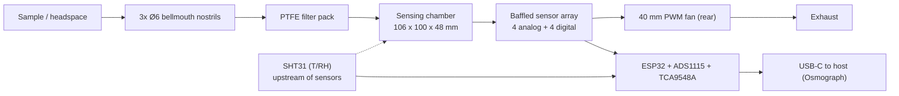
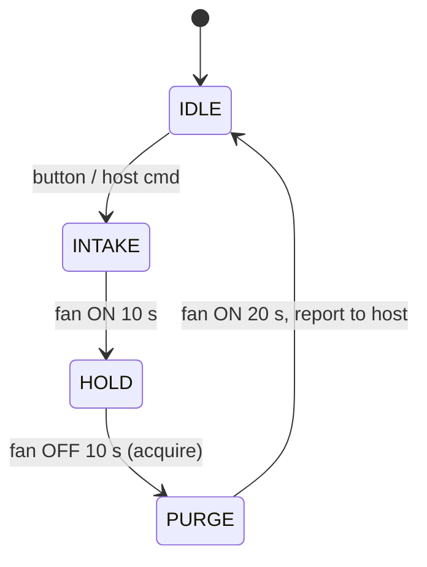
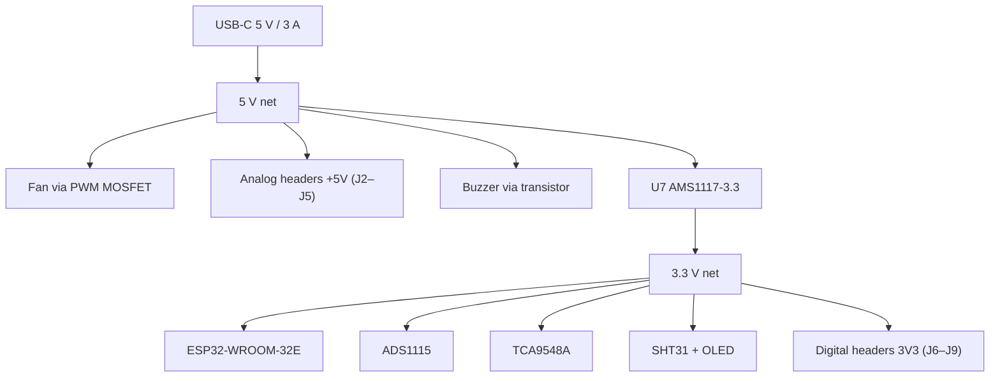

# Smell Monitor — Blueprint, Build & User Specification

| | |
|---|---|
| **Document** | OS-BP-001 |
| **Revision** | H |
| **Date** | 2026-10-15 |
| **Status** | Objective & architecture locked; electrical/mechanical detail in progress |
| **License** | Hardware: CERN-OHL-S-2.0 · Firmware: MIT |
| **Maintainer** | OpenSmell |


**Standards applied:** ASME Y14.100 (drawing practices) · ASME Y14.24 (types of
drawings) · ASME Y14.5 (dimensioning & tolerancing) · ISO 128 (lines) ·
ISO 5457 (sheet sizes) · ISO 2768 (general tolerances) · CERN-OHL-S / DIN SPEC
3105 (open-hardware documentation).

**How to read this document.** Every requirement traces upward to a success
criterion in §0.4 and downward to a design value and a verification test. A
number that traces to nothing does not belong here.

### Contents
0. Objective & Success Criteria · 1. System Overview · 2. Operating Principle ·
3. Pneumatic Design · 4. Sensing Interface · 5. Electrical Design ·
6. Mechanical Design · 7. Firmware Requirements · 8. Verification & Validation ·
9. Bill of Materials · 10. Assembly & Bring-up · 11. User Manual ·
12. Drawing Set · 13. Risks & Future · 14. Revision History

---

## 0. Objective & Success Criteria

### 0.1 What this is

An **open-hardware sensing platform** that presents a **controlled, repeatable
sample** (headspace) to a **user-selectable set of heterogeneous gas/odor
sensors** — MOX, NDIR, electrochemical, polymer, piezo, QCM — and emits a
**time-series sensory vector plus an open dataset**, so anyone can train
classifiers, swap components, and build vertical applications on top.

The hardware's entire job is to **remove confounders** (flow, temperature,
humidity, carryover, timing) so that cheap, cross-sensitive, drift-prone
sensors produce data that is *comparable and reproducible*. Sensing is
commodity; **reproducibility is the product.**

### 0.2 Why it exists — positioning

| Tier | Examples | Sampling | Sensing principles | Tooling | Cost |
|------|----------|----------|--------------------|---------|------|
| Cheap dev tier | Bosch BME688 + AI-Studio, Sensirion SGP4x/SEN6x, Renesas ZMOD | ambient air | one (MOX) | closed | $20–100 |
| Lab instruments | Alpha MOS, Sensigent, Aryballe, zNose | controlled | several | closed | $10k–100k |
| DIY | scattered projects | none | mixed | none | low |
| **This platform** | — | **controlled headspace** | **heterogeneous, swappable** | **open** | **low** |

**Gap filled:** controlled sampling **and** mixed technology **and** open. The
one-line differentiator used verbatim in all external material:

> *Controlled headspace, multiple sensing principles, open reproducible data,
> swappable modules.*

### 0.3 Users

Makers/students (learn olfaction, build a first e-nose) · researchers
(repeatable sample presentation for comparative studies) · product developers
(de-risk a sensing use case) · integrators (consume the open dataset/API).

### 0.4 Success criteria (LOCKED)

The platform is judged on **repeatability**. All targets are measured against a
**sealed reference vial** (fixed ethanol-in-water ratio, fixed temperature).

| ID | Metric | Definition | Test method | Target |
|----|--------|-----------|-------------|--------|
| **P1** | Repeatability (primary) | CV of a sensor's response to N identical samples | N=5 repeats, same session | **CV ≤ 5%** intra-session; ≤ 10% day-to-day |
| **G1** | Carryover | blank-after-sample ÷ sample response | alternate reference ↔ blank | **≤ 5%** |
| **G2** | Cycle time | intake + hold + purge | timed | **≤ 60 s** |
| **G3** | Environment control | chamber temperature stability; RH measured & reported | logged thermistor / SHT31 | **±0.5 °C**; RH reported ±3% |
| **U1** | Interchangeability | any breakout module in any slot of its bank, tool-free | swap test | **≤ 60 s, no tools** |
| **V1** | Proof-of-value | discrimination on one reference vertical | 3-class classifier (coffee/air/blank) | **≥ 90%**, ≫ chance |

**Coupled trade-offs:** repeatability ↑ with longer purge → cycle time ↑; carryover
↓ with longer purge / higher flow → cycle time ↑, ΔP ↑; environment stability ↑
with more thermal mass → mass, cost, volume ↑. MOX desorption time constants
(minutes) set a **hard floor under cycle time** — the chemistry cannot be beaten
by hardware, so P1 and G2 are traded, not both maximized.

### 0.5 What this is NOT

Not an ambient air-quality monitor · not a calibrated single-analyte instrument ·
not a substitute for lab GC/MS.

### 0.6 Design objectives (priority order)

| # | Objective | Target |
|---|-----------|--------|
| O1 | Cost (BOM) | ≤ $60 at qty 10 (base electronics) |
| O2 | Modularity | 4 analog + 4 digital fixed slots (8 total); sensors are plug-in breakouts, sensor-agnostic |
| O3 | Repeatability | §0.4 P1/G1 |
| O4 | Buildability | Standard tools; no custom parts beyond the printed shell + insert |
| O5 | Power | USB-C 5 V/2 A; idle < 1 W, ≈ 5 W loaded (MOX heaters dominate); §5.8 |
| O6 | Reliability | Sensor swap without tools; chamber cleanable |

### 0.7 Non-goals

No on-device classification (firmware acquires + streams; classification is
upstream) · no battery (USB-C only) · no sample concentration (direct headspace
via active flow) · no certified ppm output (qualitative/relative instrument).

---

## 1. System Overview

Three-phase, fan-driven, active sampling. A 40 mm axial fan pulls sample air
through 3×Ø6 bellmouth nostrils, through a PTFE filter, across a baffled array
of interchangeable sensors, and out the rear.



**Signal path.** Analog slots → fixed 2:1 divider → ADS1115 (16-bit) · digital
slots → per-slot TCA9548A channel → ESP32 I²C · SHT31 + OLED on the master bus ·
USB-C carries power and serial data to the host.

**Flow discipline (non-negotiable):** single pass front→rear; no internal
baffles except the sensor screen; no sharp internal corners (R ≥ 3 mm); sensors
sit in a low-convective zone, out of the high-velocity core, so fan speed has
minimal effect on their operating temperature (the dominant MOX error source).

---

## 2. Operating Principle — Three-Phase Cycle

The device never passively sniffs. Exposure is driven by a deterministic cycle
so every measurement sees the same pneumatic history; passive detection injects
uncontrolled ambient variability that corrupts comparison between samples.

| Phase | Fan | Duration | Purpose |
|-------|-----|----------|---------|
| **Intake** | ON (PWM ~50%) | 10 s | Draw sample through filter into chamber |
| **Hold** | OFF | 10 s | Sensors equilibrate; **acquisition happens here** |
| **Purge** | ON (PWM ~100%) | 20 s | Flush chamber with clean air, reset baseline |



Timings are firmware parameters and may be tuned per sensor pack; the
three-phase structure is fixed. Full cycle ≈ 40 s (meets **G2 ≤ 60 s**).

---

## 3. Pneumatic Design

Method: hand-calculation system model (pipe-flow / orifice / duct theory) against
datasheet-anchored fan and media figures, plus a validation plan. CFD is not
required to lock v1 (§8.3).

### 3.1 Requirements

| # | Requirement | Value | Reason |
|---|-------------|-------|--------|
| R1 | Purge completeness | ≥ 99% cavity exchange in 20 s | §8.2 acceptance |
| R2 | Sample throughput | Fresh-air flush of the whole ~0.51 L cavity | MOX baseline reset |
| R3 | Nose velocity (BME688-class) | ≥ 0.1 × Bosch guidance; slower accepted & logged | Bosch BME688 note |
| R4 | Fan static head | ≥ 3× system ΔP at operating point | fouling/age margin |
| R5 | Noise | ≤ 30 dBA @ 1 m (intent ≤ 20 dBA) | UX |
| R6 | Filter | hydrophobic, particulate barrier, ≤ 2 Pa clean | sample-memory-free path |

### 3.2 Design operating point

Q_design = **15 L/min** = 2.5×10⁻⁴ m³/s. Cavity V ≈ 0.51 L ⇒ time constant
τ = V/Q = **2.0 s**. After 20 s purge, residual = e^(−10) ≈ **0.005 %** ⇒ R1
met with ~10 theoretical exchanges.

### 3.3 Governing equations

```
ΔP_i     = K_i · ½·ρ·v_i²          (form / orifice)
ΔP_c     = f · (L/Dh) · ½·ρ·v²     (duct friction)
ΔP_media = R_media · Q / A         (porous media, laminar Darcy)
```
ρ = 1.2 kg/m³, μ = 1.81×10⁻⁵ Pa·s, ν = 1.5×10⁻⁵ m²/s. Continuity Q = v·A.

### 3.4 Element losses @ 15 L/min

| Element | ΔP |
|---|---|
| 3×Ø6 bellmouth nostrils (Re ≈ 1180 laminar, K ≈ 0.04) | 0.21 Pa (2.6 Pa if sharp — bellmouth mandatory) |
| Inlet plenum expansion (85 → 1680 mm²) | ~0.01 Pa |
| Filter pack (hydrophobic PTFE + prefilter, ~100 cm²) | 1.5 Pa clean / ≤ 3 fouled |
| Chamber duct (106 × 11 mm lane, Re ≈ 160) | 0.03 Pa |
| Sensor wells (open-bottom, τ_well ≈ 1.2 s) | ~0.02 Pa |
| Fan inlet + exhaust grille | ~0.10 Pa |
| **System total** | **≈ 1.9 Pa** (design ≤ 5 Pa, hard limit 10 Pa) |

Losses are friction/orifice-dominated ⇒ ΔP(Q) = K_sys·Q², K_sys ≈ 1.9 Pa @ 15 L/min.

### 3.5 Fan selection & operating point

40×40×10 mm 5 V axial, Sunon Super-Silence 4010-class anchor: free air
150–230 L/min, P_stall ≈ 17 Pa, 4500–5000 RPM, ~15 dBA. Design point 15 L/min
sits ≤ 10% of Q_max; at ~1.9–5 Pa the fan delivers **35–60 L/min at 20–30%
PWM**. Full-speed purge Q ≈ 100–150 L/min ⇒ cavity τ ≈ 0.4–0.7 s ⇒ 99%+ flush
in **< 3 s**; the 20 s window is then dominated by MOX desorption, not flush.
A pump (0.1–5 bar) overshoots pressure and defeats the low-noise/low-power goal.

### 3.6 Filter specification — the decision the physics forces

A 0.45 µm PTFE membrane needs ~0.16–0.2 m² of media to stay ≤ 5 Pa at this flow
— physically incompatible with a < 10 Pa axial fan in a 122×114 box. Locked spec:

| Property | Spec |
|---|---|
| Hydrophobic PTFE mesh / coating | WEP ≥ 350 mbar |
| Particle-cut pre-filter | 5–20 µm nominal |
| Effective area | ≥ 70 cm² clean, target 100 cm² |
| ΔP budget | ≤ 2 Pa clean; ≤ 5 Pa fouled |
| Swappable | tool-free, 90-day interval |

The filter stops liquid water/droplets and coarse PM; it is **not** a sterile
membrane and does **not** remove water vapor (humidity compensation is via SHT31
downstream).

### 3.7 Noise budget

Fan @ ~25% ≈ 10–14 dBA · @ full ≈ 16–20 dBA · bellmouth inlet whistle ≤ 2 dBA ·
**total design intent ≤ 20 dBA** (R5).

### 3.8 Verification

| # | Test | Pass |
|---|------|------|
| NF1 | Filter ΔP vs Q (manometer) | ≤ 3 Pa @ 15 L/min |
| NF2 | Smoke ribbon, each phase | uniform front→rear; no vortex in wells |
| NF3 | Sound @ 1 m purge duty | ≤ 30 dBA |
| NF4 | Purge completeness (odor then cycle) | all sensors ≥ 95% baseline |
| NF5 | Well washout vs mainstream | τ_well ≈ mainstream ± 50% |
| NF6 (opt) | 2D steady `simpleFoam` | no recirc zone > 5% upstream of any sensor |

---

## 4. Sensing Interface — The Contract

The platform defines **two kinds of slot**; it does **not** define sensor
chemistry. Sensors are ordinary plug-in breakout modules; anything matching a
contract drops in. A clean, repeatable, instrumented electrical + pneumatic
environment is ours; chemistry choice is the user's.

The board has **8 slots in two rows — 4 analog + 4 digital**:

```
   front (3 nostrils)                    rear (fan exhaust)
        |                                      |
        v                                      v
   J2/A1   J3/A2   J4/A3   J5/A4      <-- ANALOG row   (5 V,  AO/DO)
   J6/D1   J7/D2   J8/D3   J9/D4      <-- DIGITAL row  (3.3 V, I2C)

        one PCB (114 x 105 mm); all 8 sockets face up
```

Two rows, because the two kinds of sensor need different electricity:

- **Analog row (4):** 5 V for heaters and analog-output cells (MOX,
  electrochemical), read through the ADS1115 ADC. These are the wide parts
  (≈ 22 mm) and the ones that carry the chemically distinct (orthogonal)
  information.
- **Digital row (4):** 3.3 V I²C for smart chips (digital NDIR, VOC-index,
  humidity). Small parts (≈ 18 mm), each on its own mux channel, so I²C
  addresses can never collide.

4 + 4 is where the 106 mm chamber lands at the wide-row pitch (§4.6), and it
covers every real application (§4.7).

### 4.1 Analog bank — J2..J5 (4 × 1×5 header)

| Pin | Name | Rail | Notes |
|-----|------|------|-------|
| 1 | `+5V` | 5 V | Module logic + MOX heater (250 mA/slot budget) |
| 2 | `3V3` | 3.3 V | For 3.3 V-native analog modules |
| 3 | `GND` | GND | |
| 4 | `AO` | — | Analog out → fixed 2:1 divider → ADS1115 (2.5 V full scale) |
| 5 | `DO` | — | Digital out → ESP32 GPIO (input, pull-down) |

The 2:1 divider is fixed and always present; a 0–5 V swing cannot exceed the ADC
range. A 3.3 V-output sensor reads at 66% of full scale — thousands of counts.
`DO` supports frequency-output sensors (piezo, QCM) by pulse counting.

### 4.2 Digital bank — J6..J9 (4 × 1×6 header)

| Pin | Name | Rail | Notes |
|-----|------|------|-------|
| 1 | `3V3` | 3.3 V | Logic + sensor VDD |
| 2 | `GND` | GND | |
| 3 | `SDA` | I²C | Through TCA9548A channel (segmented bus) |
| 4 | `SCL` | I²C | same |
| 5 | `INT` | — | Interrupt / spare GPIO |
| 6 | `CTRL` | — | Enable / spare GPIO |

Each digital slot owns a dedicated TCA9548A channel ⇒ **no I²C address
collisions ever**. Both rails on the analog bank (5 V + 3V3) are the cheapest way
to be truly sensor-agnostic.

### 4.3 Environmental sensing (compensation backbone)

SHT31-D (`U5`) sits in the gas path **upstream of the MOX array**, on the master
I²C bus (not behind the mux). Firmware logs T/RH at 1 Hz beside every record; no
hard correction in firmware — raw + environment data is the contract with the
host for compensation models.

### 4.4 Recommended starter pack (matrix-derived)

The base has a **4 analog + 4 digital** slot bank (§4; the split is justified in
§4.6–§4.7). `electrical/
sensor_matrix.py` enumerates the market sensor pool and solves an **exact**
minimum set-cover under the two bank contracts — the fewest plug-in modules
whose union covers every required chemical axis, each module placed in the only
bank that can electrically host it.

| Bank contract | Rail | Read-back | Hosts |
|---------------|------|-----------|-------|
| Analog J2–J5 | **5 V**/GND/3V3 | AO + DO | 5 V modules read via analog Vout (MOX heaters, MH‑Z19C/ZE03 Vout) |
| Digital J6–J9 | **3V3**/GND | SDA/SCL/INT/CTRL | 3.3 V I²C modules only — **no 5 V** |

The recommended **starter pack** spans the union of all target personas:

| Slot | Sensor | Principle | Axes covered | Read via | Power | ~Cost |
|------|--------|-----------|--------------|----------|-------|-------|
| A1 | MQ-135 | MOX | amine, reducing, VOC, alcohol | AO | 0.90 W | $2 |
| A2 | MQ-136 | MOX | sulfur (H₂S) | AO | 0.95 W | $3 |
| A3 | MICS-6814 | MOX | reducing, oxidising, amine | AO | 0.50 W | $12 |
| A4 | ZE03-C2H4 | Electrochemical | ethylene | AO (Vout) | 0.03 W | $20 |
| D1 | SCD40 | NDIR | IR-active (CO₂) | I²C | 0.015 W | $25 |
| — | *SHT31 (`U5`)* | T/RH | humidity, temperature | *base I²C* | — | $4 |
| D2–D4 | — | — | spare (specialisation) | — | — | — |

**5 slot modules + soldered base · 4 transduction principles (MOX,
electrochemical, NDIR, T/RH) · all 10 axes · analog bank full, 3 digital slots
free.** Gate: `python tools/verify_sensor_matrix.py`.

Why CO₂ lands on **SCD40 (I²C, digital)** and not MH‑Z19C: ethylene exists only
on the 5 V electrochemical ZE03‑C2H4, and oxidising only on 5 V MOX, so the
analog bank is fully spent (MQ‑135, MQ‑136, MICS‑6814, ZE03‑C2H4). MH‑Z19C is
also 5 V and would need a fifth analog slot — it does not exist. SCD40 is
3.3 V I²C, so it takes a digital slot instead (MH‑Z19C stays a valid swap-in
choice for a persona that frees an analog slot).

The same pool solves far smaller packs for individual personas — the platform is
over-provisioned for the casual user and exactly right for a lab:

| Persona | Modules needed | Pack |
|---------|----------------|------|
| Perfume / personal experiments | 2 | MQ-135 + MICS-6814 |
| Fermentation | 2 | MQ-135 + SCD40 |
| Breath analysis | 3 | MQ-135 + MICS-6814 + SCD40 |
| Kitchen / fridge / cold chain | 4 | MQ-135 + MQ-136 + SCD40 + ZE03-C2H4 |
| Lab researcher (broadest) | 4 | MQ-135 + MICS-6814 + MQ-136 + SCD40 |
| *Starter pack (all personas)* | *5 + base* | *the pack above* |

### 4.5 Sensor module footprints (datasheet-derived)

**Worst-case analog module:** 22 × 35 × **23 mm** tall (MQ family).
**Worst-case digital module:** ≤ 26 × 23 × 8 mm (Adafruit STEMMA QT class).

| Module | L×W (mm) | Bank | Fits |
|--------|-----------|------|------|
| MQ-135/136/137/138 breakout | 35 × 22 | Analog (26) | Yes, 4 mm gap |
| Winsen MH-Z19B NDIR | 33 × 20 | Analog (26) | Yes |
| CM1106H-NS NDIR | 33 × 19.7 | Analog (26) | Yes |
| Sensirion SCD30 NDIR | 35 × 23 | Analog (26) | Yes (widest) |
| SCD40/41 | 10.1² / ≈25 × 17 | Digital (21) | Yes |
| BME688 / SGP30 / SGP40 | ≤ 25 | Digital (21) | Yes |
| Piezo film DT1-028K | 41 × 30 film | Analog (via amp) | Yes |
| QCM / quartz rig | 8–10 crystal | Digital | Custom, freq on GPIO |

### 4.6 Derived layout rules

| Rule | Value | Derivation |
|------|-------|-----------|
| Analog in-row pitch | **26 mm** | worst in-row width 22 mm + ≥ 4 mm gap |
| Digital in-row pitch | **21 mm** | worst 17.6–22.8 mm + ≥ 3 mm gap |
| Analog row span (4) | 3×26 + 22 = **100 mm** | dictates chamber length ≈ 106 mm |
| Digital row span (4) | 3×21 + 18 = **81 mm** | |
| Chamber inner depth | **≈ 100 mm** | module depth 35 + lane ≥ 30 + digital 26 |
| Module height allowance | **29 mm** | 22 body + 5 socket + 2 clearance |
| Baffle plane | **37 mm** above board | sensor recess 8 mm below flow |
| Cavity inner height | **48 mm** | 37 baffle + 11 mm air lane |

> 17.5 mm pitch (older spec) is **discarded** — it cannot seat two MQ modules
> (17.5 < 22). The 26 mm analog lane is the "wide-body" lane; a narrow lane
> would exclude four of eight common families. 26/21 is a deliberate pitch
> choice, not a hard constraint: §4.7 shows that tightening the analog row to
> ≈ 21 mm would fit a **fifth** analog slot (5 × 21 = 105 ≤ 106 mm), which the
> information analysis says is worth having.

### 4.7 Trade study — the slot count, derived

The literature is **mixed, and in a specific way**: the right number is a
*per-task* property set by response-matrix geometry, not a slogan.

- Pruning helps when channels are **redundant**: ISOEN 2026, Ren et al.
  (doi:10.1109/ISOEN68725.2026.11665159) 13 → **5** raised 83.59% → **89.69%**;
  *Sens. Actuators B* 2024 (S0925400524003083) 8 → **4**, 0.905; Kong et al.
  *Sensors* 2025 (PMC11902490) 6 → best 4; oyster cold-chain (PMC12730598)
  10 → 5–6, > 40% redundancy removed, still > 93%.
- Adding helps when channels are **orthogonal** or average noise: *PLOS ONE*
  2023 (doi:10.1371/journal.pone.0295703) replicated each of 6 types ×5,
  98.08% → 99.78% (noise averaging, **not** new information); Cyranose 320 ships
  a deliberately-redundant 32-sensor array and prunes at run time.
- Selectivity ranking (EPA / Boise State survey): NDIR > electrochemical > PID
  > MOX. MOX is high-sensitivity, low-selectivity, drift-prone — useful only
  *inside* an array.

So "more slots" is the wrong axis; **sensor count ≠ information**. `electrical/
orthogonality.py` makes it computable on `sensor_data.py`: build R[sensor × gas]
over the 17-analyte space, unit-normalise the rows, greedily add the channel
whose response has the largest component orthogonal to those already chosen
(its *marginal information*), and read the *effective rank* (participation
ratio). Two near-parallel rows add ≈ 0 no matter how many axes they name.

Order-independent anchors:

- the whole **45-module market spans only 8.21 independent dimensions** for the
  broad 17-gas set → slots beyond ≈ 8 add no independent information, only MOX
  self-heat;
- analog pool spans **7.93**, digital pool only **3.43** — **9 of 17 gases are
  analog-only** (NH₃, TMA, H₂S, mercaptan, ethylene, HCHO, CO, CH₄, SO₂); a
  digital-only bank (0A+9D) captures just **50%** of broad energy.

Per-use-case **analog floor** (greedy certificate; an upper bound on the true
minimum — if the greedy set works, that many analog slots suffice):

| use case | A-floor (D=9) | 4A+4D | 5A+3D | 6A+2D |
|----------|:---:|:---:|:---:|:---:|
| indoor_air | 4 | 100% | 100% | 100% |
| fermentation | 1 | 100% | 100% | 100% |
| cold_chain | 4 | 96% | 100% | 100% |
| kitchen_fridge | 5 | 93% | 96% | 100% |
| breath | 4 | 100% | 100% | 100% |
| perfume | 3 | 100% | 100% | 100% |
| broad (multi-domain) | 10 | 61% | 55% | 60% |

**Conclusion — analog and digital are different currencies; the optimum is
asymmetric.**

- **Analog is scarce and valuable.** It carries the orthogonal information and
  the 9 analog-only gases; it is the *only* way to reach breath / kitchen /
  cold-chain. Its floor is **5** (4 analog leaves `kitchen` at 93%; 5 lifts the
  worst single-domain case to 96%). Each analog slot costs
  a 5 V rail, ≈ 0.9 W self-heat, an ADC channel (4 per ADS1115) and a *wide*
  module.
- **Digital is abundant and cheap.** ≈ 0.05 W, tiny modules, one shared I²C bus
  (TCA9548A, 8 channels). Extra digital slots add little *new* information
  (digital pool rank 3.43) but cost almost nothing and host the NDIR-CO₂ /
  VOC-index / NOx parts plus replication headroom (the *PLOS ONE* noise-averaging
  result). They **cannot** substitute for the 5th analog — the gap is
  analog-only gases.
- **Pins** (17): analog = 1 each, digital = 2 each; 5A+4D = 17/17 MCU-only,
  5A+6D needs the MCP23017 expander.

Candidate frontier (broad capture / worst single-domain case):

| bank | pins | MCU-only? | broad | worst case | note |
|------|:---:|:---:|:---:|:---:|------|
| 4A+4D (as-built) | 16 | yes | 61% | 93% | kitchen starved |
| **5A+4D** | 17 | yes | **64%** | **96%** | info-optimal |
| 5A+3D | 15 | yes | 55% | 96% | 2 spare pins |
| 6A+3D | 16 | yes | 64% | 100% | 16.8 mm pitch — infeasible full-width |
| 6A+4D | 18 | expander | 73% | 100% | +9% broad; needs expander |
| 5A+6D | 21 | expander | 69% | 96% | more digital, cheap |

**Information-optimal bank: 5 analog + 4 digital (9 slots), 17/17 MCU-only.**
The product is the as-built **4A+4D** (§4.6): the 106 mm analog lane holds four
full-width (22 mm) modules, so a 5th is a mechanical decision, not a count one.

Caveat (feasibility, not information): a 5th *full-width* analog module needs
21 mm pitch < the 22 mm MQ body, so the 106 mm lane holds 4 full-width analog
unless the analog modules are narrower (Alphasense 20, MICS 10, bare MOX can
18) or the lane is staggered in depth (the bay has 54 mm of depth — enough for
two 18 mm sub-rows). That — plus the 5-MOX thermal check (≈ 4.5 W, versus the
stated ≤ 2.5 W system figure that 4 MOX already exceeds) — is the open
mechanical/thermal question, *not* the slot count. As-built is 4A+4D (§4.6);
re-banking to 5A+4D changes the analog pitch and needs the NF2/NF6 flow/thermal
pass. The 17-gas "broad" research set needs 8 analog and deliberately does
**not** fit. Gate: `python tools/verify_orthogonality.py --banks`.

### 4.8 Open items

MQ module mass from a physical sample · fan derating through the real filter
(flow bench / scaled CFD) · sensor-matrix upkeep as new market sensors appear
(add a row in `electrical/sensor_matrix.py`; the gate re-solves the pack).

---

## 5. Electrical Design

### 5.1 Power tree



v0 gap resolved: the earlier design referenced 3.3 V with **no regulator** —
this revision adds `U7` AMS1117-3.3 (SOT-223, 5→3.3 V, 1 A; 100 nF in, 10 µF out).

### 5.2 Microcontroller — ESP32-WROOM-32E (`U1`)

Dual-core Wi-Fi/BT; onboard ADC unused (nonlinear). I²C master GPIO 21 (SDA) /
22 (SCL) @ 400 kHz. UART0 over USB-C to host via bridge `U3` (CH340C): TXD/RXD
cross to the ESP32 RX0/TX0 and its 3V3 tap is the 3.3 V logic reference.
Three buttons: **SW1 MEASURE** (GPIO 23), **SW2 BOOT** (GPIO 0), **SW3 RESET**
(EN) — flashing is manual (hold BOOT, tap RESET), no auto-reset transistors.

### 5.3 Analog acquisition — ADS1115 (`U2`)

16-bit, 4-ch, I²C @ `0x48`. 4 single-ended channels (AINn–GND), PGA ±4.096 V,
input clamped ≤ 2.5 V by the divider. 8–16 SPS/channel during HOLD — one channel
per analog slot.

### 5.4 Digital bus — TCA9548A (`U4`)

8-channel I²C switch @ `0x70`, one channel per digital slot. Per-channel 4.7 kΩ
pull-ups so one slow sensor cannot block another. Master bus: ESP32 + U2 +
SHT31 + OLED.

### 5.5 GPIO map (generated by `electrical/interface.py`)

| Function | GPIO |
|----------|------|
| I²C SDA / SCL | 21 / 22 |
| UART0 TX / RX (USB serial) | 1 / 3 |
| Fan PWM | 4 |
| Buzzer | 13 |
| Status LED | 14 |
| Measure button | 23 |
| DO0–DO3 (analog 1–4) | 33, 34, 35, 36 |
| INT0–INT3 (digital) | 25, 26, 27, 32 |
| CTRL0–CTRL3 (digital) | 16, 17, 18, 19 |

> This is the **native 4+4** map. It uses no boot-strapping pin, and no
> input-only pin as an output (DO1–DO3 are read-only on GPIO 34–36). One ADC
> plus one mux closes the ESP32's usable pins; §4.7 shows why the bank is fixed
> at 4+4. Buzzer needs a drive transistor (GPIO cannot sink 30 mA).

### 5.6 UI & indicators

OLED SSD1306 0.96" (`U6`, `0x3C`) — phase, time, live AO/TVOC, T/RH, last
summary. Status LED: heartbeat/breathing/solid/fast-blink. Active 5 V buzzer
(`BZ1`) for end-of-measurement.

### 5.7 Connectors

| Connector | Type | Purpose |
|-----------|------|---------|
| J1 | USB-C 16P | Power + serial |
| J2–J5 | 1×5 2.54 mm female | Analog slots (`5V GND AO DO 3V3`) |
| J6–J9 | 1×6 2.54 mm female | Digital slots |
| J10 | JST-PH 2P | Fan |

All sensor headers female ⇒ breakouts plug straight in, swappable without
soldering.

### 5.8 Rail budgets

Two budgets, because they answer different questions: the **worst case** bounds
*any* pack (all 8 slots populated), while the **starter pack** is what ships.

| Rail | Worst case (every slot filled) | Starter pack (§4.4) | Supply |
|------|-------------------------------|---------------------|--------|
| 5 V | 4 × MOX 0.60 + fan 0.15 + buzzer 0.03 = **0.78 A** | sensors 0.476 + fan 0.15 + buzzer 0.03 = **0.66 A** | USB-C 5 V/3 A |
| 3.3 V | ESP32 0.15 + 4 × digital 0.20 + ADC/mux/OLED/SHT31 0.10 = **0.45 A** | sensors 0.005 + ESP32 0.15 + periph 0.10 = **0.25 A** | AMS1117-3.3 1 A |

ESP32 draws 0.15 A average but peaks ~0.5 A transiently (Wi-Fi); the AMS1117
1 A rating absorbs that. Both budgets stay inside their supply, with the gates
enforcing ≤ 80 % of each rail: `python tools/verify_electrical.py` (worst case)
and `python tools/verify_sensor_matrix.py` (pack draw).

---

## 6. Mechanical Design

### 6.1 Envelope & layout

Shell **122 × 114 × 90 mm** (8 mm walls + feet + fan + inlet plenum). Board
**114 × 105 mm**, two zones: front sensing module, rear service bay, separated by
a sealed bulkhead. Electronics heat stays out of the sensing cavity (the dominant
reason sensors drift during a run). The **PCB is the seal**: sensor headers poke
through a gasket on the bulkhead; the chamber inner walls bolt down over it. The
fan lives in the service bay exhausting out the rear.

### 6.2 Chamber geometry (locked)

| Parameter | Value |
|-----------|-------|
| Cavity inner (L×W×H) | 106 × 100 × 48 mm (≈ 0.51 L) |
| Inlet aperture | 3 × Ø6 mm bellmouthed |
| Outlet | Ø40 mm into fan (48→10 taper) |
| Baffle plane | 37 mm above board; recess 8 mm |
| Header pitch | 26 mm analog / 21 mm digital |
| PCB lid | 114 × 105 × 1.6 mm |

### 6.3 Materials & sample-memory control

Sample *memory* (carryover) is the silent killer of e-nose data. Every
gas-contacting surface either adsorbs/outgasses VOCs or it does not.

| Surface | Allowed | Forbidden (why) |
|---------|---------|-----------------|
| Chamber walls | PTFE insert, borosilicate glass, PTFE-lined Al | PLA/ABS/PETG/TPU prints (outgas + adsorb) |
| Outer structure | Aluminium, or rigid plastic if fully lined | — |
| Tubing | PTFE, PFA, stainless | Silicone, PVC, Tygon (adsorb VOCs) |
| Filter→sensor path | Nothing adsorbing | Porous carbon pre-filters (bias every sample) |
| Gaskets | PTFE-coated / FKM (Viton) | Natural rubber, EPDM (outgas) |

**Manufacturing consequence:** the cavity is machined PTFE, glass, or PTFE-lined
Al — never a plain print. Cost mitigation: the chamber is a **separate insert**
dropping into a cheap cosmetic shell. The insert is where quality lives.

### 6.4 Mass estimate

| Item | Qty | Subtotal |
|------|-----|----------|
| PCB 114×105×1.6 FR4 | 1 | 36 g |
| MQ breakout | 4 | 36 g |
| MEMS/NDIR breakout | 4 | 9 g |
| Shell (PETG ~3 mm) | 1 | 200 g |
| Fan + OLED/buzzer/hardware | — | 55 g |
| **Total (worst case)** | | **≈ 340 g** |

Enclosure dominates ⇒ 2 mm shell or lightweight PETG/aluminium cuts 80–150 g.
Stationary desktop device; mass is a UX non-issue but still optimised.

---

## 7. Firmware Requirements

Structurally defined; timing parameterised. Reference target: Arduino-ESP32 core,
single serial main loop + cyclic state machine (see `firmware/`).

1. **Cycle state machine** — IDLE → INTAKE(10 s) → HOLD(10 s) → PURGE(20 s) →
   report; driven by button (`GPIO0`) or host command over USB-UART.
2. **Analog acquisition** — during HOLD, interleave 8 ADS1115 channels at
   ~8 SPS/ch with per-channel averaging.
3. **Digital scan** — during HOLD, iterate TCA9548A channels 0–7; driver registry
   keyed by detected chip ID.
4. **Environmental logging** — SHT31 at 1 Hz, all phases.
5. **Comms** — JSON-over-USB-UART at 115200 baud:
   `{ts, phase, ao[8], digital[8], t, rh, cycle_id}` → host (Osmograph).
6. **UI** — OLED phase/values; LED state machine (§5.6).
7. **Self-test on boot** — fan tach (if present), I²C enumeration, divider sanity,
   SHT31 read; pass/fail on OLED.

**Proposed source layout:**

```
firmware/esp32/
├── src/
│   ├── main.cpp          # init + loop
│   ├── cycle.h/.cpp      # three-phase state machine
│   ├── sensors/          # ADS1115, TCA9548A drivers, digital sensor registry
│   ├── ui/               # OLED, LED, buzzer
│   └── serial_proto.cpp  # JSON records out
├── platformio.ini        # ESP32-WROOM-32E target
└── test/                 # unit tests for cycle state transitions
```

**Non-goals:** no on-device classification; no hard sensor calibration.

---

## 8. Verification & Validation

### 8.1 Electrical
- KiCad **ERC** clean (0 errors; warnings reviewed) — gate for TCA9548A
  address/pull-up/strapping pins.
- KiCad **DRC** clean before Gerber export.
- Bench: rail integrity under max load; ADC linearity (divider 0–2.5 V); I²C
  enumeration of 8 simultaneous same-address sensors behind the mux.

### 8.2 Pneumatic (acceptance for sample-memory)
- **Purge completeness:** after strong odor, one full cycle returns all sensors to
  ≥ 95% baseline.
- **Fan-speed invariance:** fixed exposure at 40/70/100% PWM; response must not
  shift (validates the recessed baffle).
- Plus NF1–NF5 (§3.8).

### 8.3 CFD (optional, once)
Single steady-state cavity sim at 15 L/min (and a 150 L/min full-speed case).
Verify no recirculation zone > 5% of volume upstream of any sensor; sensor-nose
velocity ≤ 0.1 × duct core. Tool: OpenFOAM `simpleFoam`. This is *validation*,
not a design driver — v1 geometry is already locked by the rules of §3 and §4.

### 8.4 Delivery checklist for fabrication
- [ ] ERC 0 errors · [ ] DRC 0 errors · [ ] BOM with LCSC numbers
- [ ] Gerbers + drill + position file · [ ] STEP of assembly + enclosure
- [ ] Assembly guide · [ ] Firmware binary + flash guide

---

## 9. Bill of Materials

Base electronics (representative; full line-item list with LCSC part numbers in
`electrical/bom.csv`):

| Ref | Part | Notes |
|-----|------|-------|
| U1 | ESP32-WROOM-32E | MCU, Wi-Fi/BT |
| U2 | ADS1115 | 16-bit 4-ch ADC (4 analog channels) |
| U4 | TCA9548A | 8-ch I²C mux, one channel per digital slot |
| U5 | SHT31-D | T/RH, upstream |
| U6 | OLED SSD1306 0.96" | UI |
| U7 | AMS1117-3.3 | 5→3.3 V LDO (added this revision) |
| Q1 | AO3400A (SOT-23) | Low-side fan PWM switch (GPIO 4) |
| Q2 | MMBT3904 (SOT-23) | Buzzer driver NPN (GPIO 13) |
| FAN1 | 40×40×10 mm 5 V PWM | Rear exhaust |
| BZ1, LED1 | Active buzzer, status LED | UI |
| J1 / J2–J5 / J6–J9 / J10 | USB-C / 1×5 / 1×6 / JST-PH | Connectors |

BOM deltas from v0: **add U7** (v0 had no 3.3 V rail) · analog headers
`5V/GND/AO/DO/3V3` · digital headers `3.3V/GND/SDA/SCL/INT/CTRL` · fixed 2:1
divider on AO · OLED 0.96" + active buzzer.

---

## 10. Assembly & Bring-up

Sources: PCB `electrical/smell_monitor_v0/` · BOM `electrical/bom.csv` ·
enclosure `mechanical/` · sensors user-supplied.

**Order of soldering (small → large):** 0603 passives → U7 (SOT-223 tab well
soldered) → U2/U4/U5 → OLED/LED/buzzer → connectors (USB-C, JST, 8 headers)
→ ESP32 module last.

**First-power tests:** 3.3 V rail at U7 = 3.35 ± 0.1 V · probe every slot rail ·
I²C scan expects `0x48, 0x44, 0x70, 0x3C` · flash firmware, confirm
self-test screen.

**Chamber assembly:** PTFE insert against PCB bulkhead gasket → baffle over
sensor area → filter + retainer behind intake → fan in service bay (exhaust out)
→ seal bulkhead, fix halves. Insert sensor breakouts before closing the hatch,
sensing elements facing up through the baffle.

**Final integration:** power-on self-test `OK` · purge sanity (3 clean cycles,
baselines within a few %) · sample challenge (coffee; confirm response, then full
baseline return after one cycle).

---

## 11. User Manual

**What it does.** Draws a small air sample, exposes interchangeable gas sensors,
records each response, and streams the "smell signature" over USB. It does **not**
identify smells on its own and is **not** a calibrated safety instrument.

**Uses:** compare two samples; monitor a smell over time; archive signatures;
sensor research.

**Operating a measurement.** Place near (not touching) the sample → press measure
→ wait ≈ 40 s (10 intake / 10 hold / 20 purge). LED: slow blink = idle, breathing
= sampling, solid = analysing, fast blink = results ready.

**Slots.** 4 analog (`5V|GND|AO|DO|3V3`) for MOX/e-chem/NDIR-5V; 4 digital
(`3V3|GND|SDA|SCL|INT|CTRL`) for MEMS/NDIR-I²C. Any matching breakout module
plugs straight in; swap is tool-free (open hatch, seat module) and
auto-detected at power-on.

**Choosing modules.** Start with the recommended pack (§4.4, 5 modules + base);
add or swap singly for a specific job. Ammonia/amine → MQ-135/137 · sulfur →
MQ-136 · general VOC → MQ-138/SGP40 · CO₂ → SCD40 (I²C) or MH-Z19C (5 V, needs a
free analog slot) · ethylene → ZE03-C2H4 · RH + profile → BME688.

**Maintenance.** Clean cavity with dry lint-free cloth (no solvents unless
instructed) · replace intake filter every 90 days or after clogging/smoke/dust
(PTFE side toward incoming air) · firmware update over USB via Osmograph.

**Troubleshooting.** Dark screen → power/cable · fan fault → check fan/connector ·
no sensors → install/reseat · stuck reading → clean/replace sensor · all-day drift
→ warm up 10 min and log temperature · lingering smell → 2–3 purge cycles, else
clean · bad data → check cable, 115200 baud.

**Safety.** Experimental/research instrument, 5 V USB-C, do not open the service
bay while powered, keep from liquids, not for explosive atmospheres.

**Specifications.** Power USB-C 5 V/2 A · idle < 1 W, ≈ 5 W loaded with four
MOX modules (their heaters dominate — see §5.8) · 4+4 sensor ports · cycle
≈ 40 s · airflow 15 L/min design purge (> 100 L/min flush) · intake filter
replaceable PTFE · 122 × 114 × 90 mm · ≈ 340 g · 5–40 °C, 20–80% RH · USB-C
serial 115200 baud.

---

## 12. Drawing Set (CAD, editable)

Drawings are generated from the single parametric 3D model, not hand-drawn, and
are provided in **two forms**: an editable **CAD source** (DXF / native) and a
plotted **PDF** for the record — per ASME Y14.100 / ISO 5457 practice.

| Sheet | Content | Status |
|-------|---------|--------|
| OS-000 | Assembly — isometric general arrangement + BOM | **produced** |
| OS-001 | Shell — front / plan / section B-B + iso | **produced** |
| OS-002 | Baffle — plan (16 wells) / section A-A + iso | **produced** |
| OS-003 | PCB mechanical floor plan — board 114×105, header rows | planned |
| OS-004 | Pneumatic schematic — flow path, ΔP, fan operating point | planned |

Projection is performed by the CAD kernel's hidden-line-removal (`TechDraw.projectEx`
returns true visible/hidden edges measured off the solid), so the views are
faithful, not schematic boxes. Sheet format: A3 landscape, ISO 7200 title block,
first-angle projection. The sheets are emitted as an editable **DXF** source and
a plotted vector **PDF** in `mechanical/drawings/sheets/`.

**Sources & build (all checked in):**
- `mechanical/constants.py` — locked parametric dimensions (single source).
- `mechanical/freecad/build_smell_monitor.py` — headless model build + HLR
  (`FreeCADCmd.exe .../build_smell_monitor.py`) → `.FCStd`, `.STEP`, `.stl`, and
  `mechanical/drawings/model_hlr.json`.
- `mechanical/freecad/style_smell_monitor.py` — paints the model for GUI viewing.
- `mechanical/drawings/gen_dxf_sheets.py` — places the HLR geometry on A3 sheets,
  writes `OS-000/001/002.dxf` and plots `OpenSmell_v1.1_sheets.pdf`.
- `tools/verify_cad.py` — numeric CAD gate over all of the above (must exit 0).

**Two-stage pipeline:** FreeCAD (model + HLR) → system Python (ezdxf sheet
composition + plot). OS-003/004 remain to be authored (§14).

---

## 13. Risks & Future

| Risk | Mitigation |
|------|------------|
| PTFE insert cost | Only the insert is PTFE; shell is cheap cosmetic plastic |
| Most slots unfilled at first | v1 proves the interface; packs modelled later |
| Fan speed affects MOX temperature | Recessed baffle; validated by §8.2 |
| Sensor drift over months | Swappable sockets + SHT31 data + shared open dataset |
| USB-C current limits | 5 V/3 A source assumed; §5.8 |
| MOX cross-sensitivity | Cannot be fixed in hardware; platform removes confounders only |

**Future:** v1.1 — battery/USB-PD, fan tach, higher-flow option · v2.0 —
manifold switching / multi-compartment robotics sampling, valued reference-air
path for automatic zero/baseline calibration.

---

## 14. Revision History & Open Items

| Rev | Date | Change |
|-----|------|--------|
| A | 2026-10-13 | Consolidation of all prior docs into this single blueprint. Objective + success criteria locked (§0). Drop-in of architecture, component analysis, pneumatics, manual, assembly. Best-practice stds adopted (ASME Y14.100/24/5, ISO 128/5457). |
| B | 2026-10-14 | **Architecture pivot to native 4 analog + 4 digital (8 slots, expandable to 8+8).** Driven by: GPIO closure (4+4 = 16 signals ≤ 17 ESP32 pins, no expander; 8+8 = 28, requires one), repeatability/carryover physics (smaller chamber), bulk, and cost. Shell 226→122 mm, cavity 210→106 mm, PCB 218→114 mm, board recentred. §4.5/§5.5/§5.7 regenerated. Added machine-checked contract `electrical/interface.py` + `tools/verify_electrical.py`. |
| C | 2026-10-15 | **Slot count settled by evidence.** Base keeps a fixed 4+4 (8-slot) bank of plug-in breakout slots. E-nose array-optimisation literature shows fewer orthogonal sensors beat more redundant ones (ISOEN 2026 13→5 sensors, 83.6→89.7%; S&AB 2024 8→4 sensors, 0.905), so a **6-module recommended pack** (4 principles, all 10 axes) is the starter set. Added `electrical/sensor_matrix.py` (21-sensor market pool, 10 axes, 7 personas, set-cover selector) + gate `tools/verify_sensor_matrix.py`. §0.6 O2, §1, §4, §9, §11 updated. |
| D | 2026-10-15 | **Corrected pack slot placement (Rev C electrical error).** Rev C placed MH‑Z19C and ZE03‑C2H4 in *digital* slots, but the digital bank carries only 3V3 + I²C (no 5 V); both are 5 V modules. Repacked → **A1 MQ‑135 · A2 MQ‑136 · A3 MICS‑6814 · A4 ZE03‑C2H4** (5 V, read via AO) + **D1 SCD40** (3.3 V I²C CO₂), SHT31 stays base `U5`: 5 slot modules + base, 4 principles, all 10 axes, 3 digital slots free. `sensor_matrix.py` now records each module's bank and solves an **exact** minimum set cover under 4+4; gate adds iface↔bank, per-bank cap, pack rail draw (5 V 0.66 A / 3.3 V 0.25 A) and *starter pack ⊇ every persona* checks. Fixed `verify_electrical.py` hardcoded check count. Header revision A→D; §4.4/§4.7/§5.8/§9/§11 updated. |
| E | 2026-10-15 | **Slot count now derived, not asserted; data provenance audited.** Added `electrical/orthogonality.py` (response matrix R[sensor×gas], greedy max-marginal-information, effective rank) + `tools/verify_orthogonality.py`, and extended `sensor_data.py` to a 46-sensor market pool with per-gas response profiles (`basis`: datasheet \| inferred). Audit found `so2`/`cl2` profile keys missing from `GASES` (silently dropped → `ZE03-SO2`/`SO2-A4` invisible); fixed by adding **`so2` as a 17th analyte** and a hard closure guard in `verify_sensor_matrix.py`. Findings (17-gas space): market spans **8.21 independent dimensions** (broad); analog pool 7.93 vs digital 3.43 and **9 of 17 gases are analog-only**; a digital-only bank captures just **50%**. Greedy certificate gives a **5-analog floor** to serve every single-domain use case (4 analog leaves kitchen 93%). **Information-optimal bank = 5 analog + 4 digital** (9 slots, 17/17 MCU-only); analog is the scarce currency, digital is cheap. As-built stays 4+4 (26 mm analog pitch) pending the mechanical change (pitch → ≈ 21 mm or a staggered depth bay + NF2/NF6 re-check). Flagged: the stated ≤ 2.5 W system figure is already exceeded by 4 MOX (3.6 W). Corrected Rev C's over-claim "more slots add redundancy, not information", the initial under-reasoned "3 digital", and stale hard-coded numbers in `slots_report`. §4.4/§4.7 rewritten; header D→E. **Datasheet re-audit:** every sensor row now carries a citable `source` (family- or part-level) and `basis` is the honest taxonomy **table \| curve \| list \| inferred** — only Alphasense EC + MiniPID publish cross-sensitivity *tables*; MOX datasheets (MQ/TGS/MICS) publish gas lists + sensitivity *curves*; NDIR is CO₂-only and Winsen ZE03/ME3 publish target+range only — so verbatim tables exist for a minority, and profiles are labelled accordingly. The verify gate rejects any `UNSOURCED` row. Verified contradictions fixed (MQ-136 is H₂S+CO, not H₂/toluene; MICS-6814 is a 3-element part). Figaro TGS curves and Ion Science MiniPID response factors (TA-02, 10.6 eV) folded in; unbacked profile keys are now machine-flagged `inferred` (guard: subset of profile). Final anchors: broad 8.21, analog 7.93 vs digital 3.43, 50% digital-only; 5A+4D info-optimal (as-built 4A+4D). |
| F | 2026-10-15 | **§4 reads as a product spec.** Added a board diagram and a plain explanation of the 4 analog / 4 digital split (two rows because the two sensor kinds need different electricity). Removed all internal editing instructions from the user-facing text. Engineering note (maintainers only): `sensor_matrix.BANK_CAP` and `verify_sensor_matrix.SLOT_COUNT` now derive from `CONST["A_X"]`/`["D_X"]` instead of a hard-coded 4/4, so the two counts cannot drift; the 8+8 contract (`build_pinmap(8,8)`) remains the growth path. |
| G | 2026-10-15 | **Whole 46-row sensor pool re-derived against datasheets; trade-study numbers re-synced (final).** Every row now carries `basis` + citable `src` with unbacked keys machine-flagged `inferred`. Corrections: MQ-3 replaced unsupported toluene/acetone with datasheet-curve gases (CH₄, CO), methanol flagged inferred; MQ-2 dropped unsupported toluene; MQ-8 added curve alcohol and range corrected to 100–1000 ppm (Winsen ver1.6); MQ-9 H₂ range added; MQ-131 identified as the low-concentration variant (Cl₂/NO₂ cross); MQ-138 added H₂, range 5–500 ppm; MICS-2714 replaced unsupported O₃ with documented H₂ (NO noted); MICS-5524 added documented NH₃; SGP30/40/41 non-reference keys flagged `inferred`. Gates re-run (all PASS) → §4.7 re-synced: broad **8.21**, analog pool **7.93** vs digital 3.43, digital-only **50%**; A-floor and candidate-frontier tables updated. Header F→G. |
| H | 2026-10-15 | **rev-B board model + analog-slot fix.** Added `electrical/board.py`: the fitted parts and the net every pin lands on (**63 parts / 50 nets / 225 connections**), derived from `interface.py` + §5 and machine-checked against the real KiCad symbol library, so the schematic/PCB/BOM generators share one source. **Analog slot reordered to `5V GND AO DO 3V3`** (was `5V 3V3 GND AO DO`) so a 4-pin MQ-type module (VCC,GND,AO,DO) seats straight onto pins 1–4 with power and ground adjacent — the old order put a naive 4-pin plug's GND onto 3V3. Filled three spec/BOM gaps as recorded `DECISIONS`: **U3 CH340C** USB↔UART bridge (blueprint says USB-C carries serial; the BOM had none), **BOOT/RESET/MEASURE buttons**, and **USB-C CC 5.1 kΩ** pulldowns. `bom.csv` passive counts are no longer authoritative — the BOM is regenerated from the schematic. Header G→H. |

**Open items (need measurement or decision):**
- Electrical: board model done (`electrical/board.py`, netlist gate green); next generate the ERC-clean schematic from it → route to DRC → rev-B board (§8.1). The v0 schematic predates this architecture (old 8 analog + 8 digital with 2× ADS1115) and is discarded.
- Mechanical: OS-003 (PCB floor plan) and OS-004 (pneumatic schematic) sheets (§12).
- Pneumatic: NF1 filter ΔP bench + final media vendor; fan P/N confirmation.
- CFD: one optional `simpleFoam` pass at 15 and 150 L/min (§8.3).
- Mass: MQ module mass from a physical sample.

*Changes to a locked section require a revision bump and a row in this table.*
