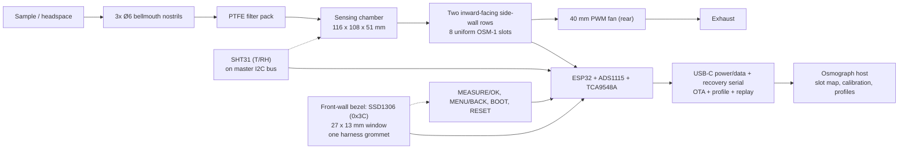
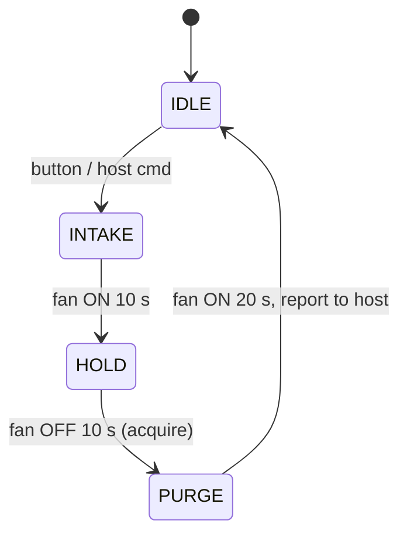
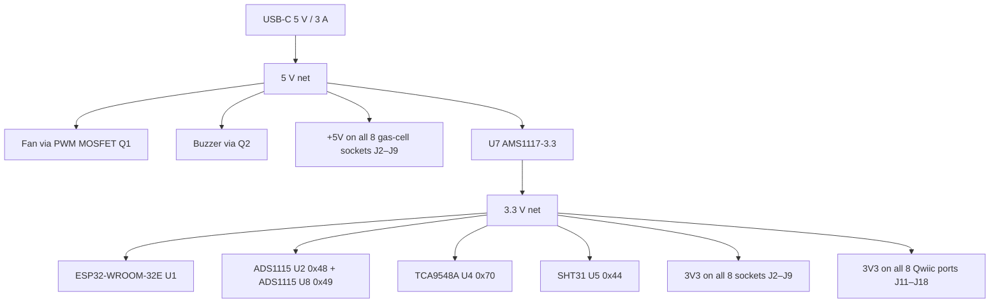

# Smell Monitor — Blueprint, Build & User Specification

| | |
|---|---|
| **Document** | OS-BP-001 |
| **Revision** | T |
| **Date** | 2026-11-26 |
| **Status** | One SKU to OSM-1: eight uniform slots, schematic ERC-clean, PCB routed/DRC-clean with a filled B.Cu GND return, sealed SSD1306 display in a shallow bezel on the fixed front wall with four reachable buttons and one harness grommet, device-verified signed OTA, versioned interpretation profiles and hardened telemetry. The lid is a plain flat plate with four M3 screws and no wires or holes. Enclosure CAD, dimensioned sheets, Gerbers and the assembly animation are generated and machine-verified. The stable side-wall-v2 CFD solve is reported in `cfd/RESULTS.md`; nostril geometry is unchanged and physical tracer/purge acceptance of a built unit follows `docs/VALIDATION_PLAN.md`. |
| **License** | Hardware: CERN-OHL-S-2.0 · Firmware: MIT |
| **Maintainer** | OpenSmell |


**Standards applied:** ASME Y14.100 (drawing practices) · ASME Y14.24 (types of
drawings) · ASME Y14.5 (dimensioning & tolerancing) · ISO 128 (lines) ·
ISO 5457 (sheet sizes) · ISO 2768 (general tolerances) · CERN-OHL-S / DIN SPEC
3105 (open-hardware documentation).

**How to read this document.** Every requirement traces upward to a success
criterion in §0.4 and downward to a design value and a verification gate. A
number that traces to nothing does not belong here. Machine-checked claims are
listed in §8.5. The module interface is `docs/module-standard.md`.

### Contents
0. Objective & Success Criteria · 1. System Overview · 2. Operating Principle ·
3. Pneumatic Design · 4. Sensing Interface · 5. Electrical Design ·
6. Mechanical Design · 7. Firmware Requirements · 8. Verification & Validation ·
9. Bill of Materials · 10. Assembly & Bring-up · 11. User Manual ·
12. Drawing Set · 13. Revision History

---

## 0. Objective & Success Criteria

### 0.1 What this is

An **open-hardware sensing platform** that presents a **controlled, repeatable
sample** (headspace) to a **user-selectable set of heterogeneous gas/odor
sensors** — MOX, NDIR, electrochemical, polymer, piezo, QCM — and emits a
**time-series sensory vector plus an open dataset**, so anyone can train
classifiers, swap components, and build vertical applications on top.

The hardware's entire job is to **remove confounders** (flow, temperature,
humidity, carryover, timing) so that cheap, cross-sensitive, drift-prone
sensors produce data that is *comparable and reproducible*. Sensing is
commodity; **reproducibility is the product.**

### 0.2 Users

Makers/students (learn olfaction, build a first e-nose) · researchers
(repeatable sample presentation for comparative studies) · product developers
(de-risk a sensing use case) · integrators (consume the open dataset/API).

### 0.4 Success criteria (LOCKED)

The platform is judged on **repeatability**. All targets are measured against a
**sealed reference vial** (fixed ethanol-in-water ratio, fixed temperature).

| ID | Metric | Definition | Test method | Target |
|----|--------|-----------|-------------|--------|
| **P1** | Repeatability (primary) | CV of a sensor's response to N identical samples | N=5 repeats, same session | **CV ≤ 5%** intra-session; ≤ 10% day-to-day |
| **G1** | Carryover | blank-after-sample ÷ sample response | alternate reference ↔ blank | **≤ 5%** |
| **G2** | Cycle time | intake + hold + purge | timed | **≤ 60 s** |
| **G3** | Environment control | chamber temperature stability; RH measured & reported | logged thermistor / SHT31 | **±0.5 °C**; RH reported ±3% |
| **U1** | Interchangeability | any OSM-1 module in any of the eight slots, tool-free | swap test | **≤ 60 s, no tools** |
| **V1** | Proof-of-value | discrimination on one reference vertical | 3-class classifier (coffee/air/blank) | **≥ 90%**, ≫ chance |

### 0.3 Design objectives (priority order)

| # | Objective | Target |
|---|-----------|--------|
| O1 | Understandable architecture | one board, eight identical slots, no per-slot expander or mux for identity |
| O2 | Modularity | 8 identical slots, each carrying a 5 V gas-cell socket and a 3.3 V Qwiic port (§4.9); sensors are plug-in breakouts, sensor-agnostic |
| O3 | Repeatability | §0.4 P1/G1 |
| O4 | Buildability | Standard tools; no custom parts beyond the printed shell + insert |
| O5 | Power | Plug-in USB-C 5 V/3 A source (≥ 1.5 A needed); idle < 1 W, ≈ 5 W starter pack, up to ≈ 8 W worst case (MOX heaters dominate). No battery; stable power is the installer's responsibility; §5.8 |
| O6 | Reliability | Sensor swap without tools; chamber cleanable; OTA activation with rollback; per-record persistence and replay |

---

## 1. System Overview

Three-phase, fan-driven, active sampling. A 40 mm axial fan pulls sample air
through 3×Ø6 nostrils, through a replaceable filter, across the two module rows
of interchangeable sensors, and out the rear.



**Signal path.** Any slot → its fixed 10 k/10 k AO divider → one of two ADS1115s
(16-bit; 0x48 for slots 0–3, 0x49 for slots 4–7), or its own TCA9548A channel →
ESP32 I²C when an I²C module is fitted, or its DO → 10 k series → ESP32 GPIO ·
all ID pins share one 1-Wire bus · SHT31 and the sealed front-wall SSD1306
display (`0x3C`) are on the master bus · USB-C carries power and serial data,
with serial flashing reserved for recovery. §4.9 defines the uniform slot; the
board in the tree is built to it (J2–J9 gas-cell sockets, J11–J18 Qwiic ports).
The display is non-slot hardware: its bezel window and gasket sit outside the
sample path, and the lid carries no wires or holes.

**Flow discipline:** single pass front→rear; no baffles except the sensor screen;
no sharp corners (R ≥ 3 mm); sensors
sit in a low-convective zone, out of the high-velocity core, so fan speed has
minimal effect on their operating temperature (the dominant MOX error source).
The gas path carries inert gas only, with acrylic or polyurethane conformal
coat and no silicone.

---

## 2. Operating Principle — Three-Phase Cycle

Exposure is driven by a deterministic cycle so every measurement sees the same
pneumatic history. Sample presentation is direct headspace under active flow;
there is no sample-concentration stage. The instrument reports qualitative and
relative values; it does not report certified ppm concentrations.

| Phase | Fan | Duration | Purpose |
|-------|-----|----------|---------|
| **Intake** | ON (PWM ~50%) | 10 s | Draw sample through filter into chamber |
| **Hold** | OFF | 10 s | Sensors equilibrate; **acquisition happens here** |
| **Purge** | ON (PWM ~100%) | 20 s | Flush chamber with clean air, reset baseline |



Timings are firmware parameters set per sensor pack; the
three-phase structure is fixed. Full cycle ≈ 40 s (meets **G2 ≤ 60 s**).

---

## 3. Pneumatic Design

Method: hand-calculation system model (pipe-flow / orifice / duct theory) against
datasheet-anchored fan and media figures, plus the acceptance tests in §8.2.
CFD results are reported in §8.3.

### 3.1 Requirements

| # | Requirement | Value | Reason |
|---|-------------|-------|--------|
| R1 | Purge completeness | ≥ 99% cavity exchange in 20 s | §8.2 acceptance |
| R2 | Sample throughput | Fresh-air flush of the whole ~0.57 L cavity | MOX baseline reset |
| R3 | Nose velocity (BME688-class) | ≥ 0.1 × Bosch guidance; lower values logged | Bosch BME688 note |
| R4 | Fan static head | ≥ 3× system ΔP at operating point | fouling/age margin |
| R5 | Noise | ≤ 30 dBA @ 1 m (intent ≤ 20 dBA) | UX |
| R6 | Filter | hydrophobic woven PTFE mesh, particulate barrier, low clean ΔP (NF1) | sample-memory-free path |

### 3.2 Design operating point

Q_design = **15 L/min** = 2.5×10⁻⁴ m³/s. Cavity V ≈ 0.57 L ⇒ time constant
τ = V/Q = **2.28 s**. After 20 s purge, residual ≈ e^(−8.8) ≈ **0.015 %** ⇒ R1
met with ~10 theoretical exchanges.

### 3.3 Governing equations

```
ΔP_i     = K_i · ½·ρ·v_i²          (form / orifice)
ΔP_c     = f · (L/Dh) · ½·ρ·v²     (duct friction)
ΔP_media = R_media · Q / A         (porous media, laminar Darcy)
```
ρ = 1.2 kg/m³, μ = 1.81×10⁻⁵ Pa·s, ν = 1.5×10⁻⁵ m²/s. Continuity Q = v·A.

### 3.4 Element losses @ 15 L/min

| Element | ΔP |
|---|---|
| 3×Ø6 bellmouth nostrils (Re ≈ 1180 laminar, K ≈ 0.04) | 0.21 Pa (2.6 Pa if sharp — bellmouth mandatory) |
| Inlet plenum expansion (85 → 1680 mm²) | ~0.01 Pa |
| Thin woven PTFE mesh + 5–20 µm pre-screen (full inlet face) | measured by NF1; well inside fan headroom |
| Fan inlet + exhaust grille | ~0.10 Pa |
| **System total** | **design ≤ 5 Pa, hard limit 10 Pa; filter mesh ΔP measured by NF1** |

Losses are friction/orifice-dominated ⇒ ΔP(Q) = K_sys·Q²; the woven mesh drop is measured by NF1.

### 3.5 Fan selection & operating point

40×40×10 mm 5 V axial, Sunon Super-Silence 4010-class anchor: free air
150–230 L/min, P_stall ≈ 17 Pa, 4500–5000 RPM, ~15 dBA. Design point 15 L/min
sits ≤ 10% of Q_max; at the design ΔP (≤ 5 Pa) the fan delivers **35–60 L/min at
20–30% PWM**. Full-speed purge Q ≈ 100–150 L/min ⇒ cavity τ ≈ 0.4–0.7 s ⇒ 99%+
flush in **< 3 s**; the 20 s window is then dominated by MOX desorption, not
flush.

### 3.6 Filter specification

The inlet filter is a **thin woven PTFE mesh** across the full inlet. Locked spec:

| Property | Spec |
|---|---|
| Position | **series element** across the full inlet behind the nostrils, so no stream bypasses it |
| Form | thin woven PTFE mesh in the front drawer, held down by the lid |
| Hydrophobic PTFE | WEP ≥ 350 mbar |
| Particle-cut pre-screen | 5–20 µm nominal |
| ΔP | low clean ΔP, measured by NF1; well inside the ~50 Pa fan head |
| Service | lift out with the lid off; rinse and reinsert, or replace if torn |

The filter stops liquid droplets and coarse PM. Humidity is logged by the SHT31.

### 3.7 Noise budget

Fan @ ~25% ≈ 10–14 dBA · @ full ≈ 16–20 dBA · bellmouth inlet whistle ≤ 2 dBA ·
**total design intent ≤ 20 dBA** (R5).

### 3.8 Verification

| # | Test | Pass |
|---|------|------|
| NF1 | Filter ΔP vs Q (manometer) | ≤ 50 Pa @ 15 L/min, inside fan headroom |
| NF2 | Smoke ribbon, each phase | uniform front→rear; no recirculation ahead of any card |
| NF3 | Sound @ 1 m purge duty | ≤ 30 dBA |
| NF4 | Purge completeness (odor then cycle) | all sensors ≥ 95% baseline |
| NF5 | Card-top hood washout vs mainstream | τ_hood ≈ mainstream ± 50% |
| NF6 | 2D steady `simpleFoam` | no recirculation zone > 5% in front of any card |

---

## 4. Sensing Interface — The Contract

The platform defines **one slot**, repeated eight times; it does **not** define
sensor chemistry. Sensors are ordinary plug-in modules; anything matching the
contract drops in. The base supplies the electrical and pneumatic environment;
sensor chemistry is selected by the host. The contract itself is
**§4.9** and `docs/module-standard.md`; this section is the as-built
implementation.

**One slot design.** Every position carries a keyed 1×6 gas-cell socket
(`+5V GND AO DO 3V3 ID`) *and* a Qwiic/STEMMA QT port on the same footprint
(J2–J9 + J11–J18 on the board). There is no analog row and digital row to get
wrong: the host slot map says what each position holds, and the same socket
serves a MOX can, an electrochemical cell or an NDIR module; a smart I²C module
uses the Qwiic port at the same slot.

Plan view. X = width (the two side walls), Y = depth; the sample flows
front → rear straight down the middle:

```
   front wall: 3 x Ø6 nostrils on the channel centreline ..... sample in
        |
        v       <---------------- flow, 108 mm ---------------->
   LEFT WALL x=16                |                RIGHT WALL x=106
   J2 J3 J4 J5  (slots 0..3)     |     J6 J7 J8 J9  (slots 4..7)
   24/48/72/96  upright ->       |       <- upright  24/48/72/96
        |                  central channel                  |
        v                       |                           v
   rear wall: D40 fan on the channel centreline .......... exhaust
```

One PCB, 114 × 105 mm, seated as the chamber **floor** (its top face is the
cavity floor, see §6.2). All eight sockets are 1×6 keyed receptacles with their
pin lines **front-to-back**: a breakout board plugged straight in stands
**upright** in the Y-Z plane and **faces inward** across the central channel.
The pin line is inset 13 mm from the inner face of each side wall (`WALL_GAP`),
so a board with pins or a tall part on its back never touches the wall. The
three nostrils and the fan share the channel centreline (x = 61 mm), so gas
travels straight from inlet to exhaust between the two facing rows.

**All slots are on the same four Y stations; assignment is not fixed.** Every
record carries its slot index and wall, so the host map can model any uptake
gradient between the left and right banks. The platform does not prescribe
which sensor goes where.

**Both rails at every slot.** A MOX heater needs 5 V; a 3.3 V-native analog
or I²C module needs 3V3. The socket carries both rails, with a Qwiic port beside
it, so every slot accepts either class of module. The extra pin and regulator
share remove the need for a different adapter at each slot.

**Acquisition.** Each slot's `AO` passes through a fixed 10 k/10 k divider into
one of eight ADS1115 channels (two 16-bit ADCs: 0x48 for slots 0–3, 0x49 for
slots 4–7). Each `DO` goes through a 10 k series resistor to its own ESP32 GPIO.
Each `ID` pin joins one shared open-drain 1-Wire bus with a 4.7 k pull-up. Each
Qwiic port is one TCA9548A segment (channel *n* = slot *n*, 0x70), so eight
identical I²C modules can never collide.

### 4.1 The slot — J2..J9 (8 × 1×6 socket)

| Pin | Name | Rail | Notes |
|-----|------|------|-------|
| 1 | `+5V` | 5 V | Module logic + MOX heater (150 mA/slot budget, ≈0.9 W worst case) |
| 2 | `GND` | GND | |
| 3 | `AO` | — | Analog out → fixed 2:1 divider → ADS1115 (2.5 V full scale) |
| 4 | `DO` | — | Digital out → 10 k series → ESP32 GPIO (input) |
| 5 | `3V3` | 3.3 V | For 3.3 V-native analog modules |
| 6 | `ID` | — | shared 1-Wire bus (4.7 k pull-up); v1 does not enumerate EEPROMs |

Order is `+5V GND AO DO 3V3 ID` (frozen in `electrical/interface.py`). A naive
4-pin MQ-type module (VCC, GND, AO, DO) seats on pins 1–4 with power and ground
adjacent; the ID pin is last so no module signal can be mistaken for a rail.

The 2:1 divider is fixed and always present; a 0–5 V swing cannot exceed the ADC
range. A 3.3 V-output sensor reads at 66% of full scale — thousands of counts.
`DO` supports frequency-output sensors (piezo, QCM) by pulse counting.

### 4.2 The Qwiic port — J11..J18 (8 × JST-SH 4-pin)

| Pin | Name | Rail | Notes |
|-----|------|------|-------|
| 1 | `GND` | GND | |
| 2 | `3V3` | 3.3 V | Logic + sensor VDD |
| 3 | `SDA` | I²C | Through TCA9548A channel *n* (segmented bus) |
| 4 | `SCL` | I²C | same |

Channel *n* belongs to slot *n*, so **no I²C address collisions ever**, and a
cable on one slot cannot disturb another. The port is 3.3 V only: a 5 V I²C
module uses an adapter to the socket's 5 V pin, never straight into Qwiic.

### 4.3 Environmental sensing (compensation backbone)

SHT31-D (`U5`) sits on the board between the two side-wall socket rows, on the
master I²C bus (not behind the mux). It is soldered rather than plugged
in, so the reference T/RH is always present and never a module the user forgot.
Firmware logs T/RH at 1 Hz beside every record; no hard correction in firmware —
raw + environment data is the contract with the host for compensation models.

### 4.4 Starter pack

All eight slots have the same two interfaces (§4.1/§4.2); a module goes into any
free slot. The build exercises five modules plus the soldered SHT31 reference:

| Slot | Module | Principle | Interface | Power |
|------|--------|-----------|-----------|-------|
| 1 (left wall) | MQ-135 | MOX | socket, AO | 0.90 W |
| 2 (left wall) | MQ-136 | MOX | socket, AO | 0.95 W |
| 3 (left wall) | MICS-6814 module | MOX | socket, AO ×3 | 0.50 W |
| 4 (left wall) | ZE03-C2H4 | Electrochemical | socket, AO | 0.03 W |
| 5 (right wall) | SCD40 module | NDIR | socket or Qwiic | 0.015 W |
| — | SHT31 (`U5`) | T/RH | base I²C | — |
| 6–8 | — | — | free slots | — |

Four transduction principles (MOX, electrochemical, NDIR, T/RH) are exercised by
the configured modules. Gate: `python tools/verify_sensor_matrix.py` checks
channel coverage and rail draw. Any module can move to any slot; the record's
slot index and wall travel with the data.

### 4.6 Derived layout rules

| Rule | Value | Derivation |
|------|-------|-----------|
| Wall rows | **2 × 4 sockets** at shell x = 16 / 106 | inner side walls, mirrored about the channel |
| Y pitch | **24 mm** on stations 24 / 48 / 72 / 96 | 20 mm board along the wall + 4 mm gap |
| Row span (4) | 3×24 + 20 = **92 mm** | inside the 108 mm cavity depth |
| Wall clearance | **13 mm** behind each socket (`WALL_GAP`) | room for rear pins or tall parts |
| Card height | **32 mm** (top at z = 49.1 mm) | 8.5 mm socket + 32, leaving a 4.9 mm hood |
| Cell reach | **21 mm** into the channel | leaves a clear central stream between the rows |
| Insertion orientation | 1×6 pin line front-to-back; upright board, face inward | lifts out upward; nothing above it but the lid |
| Cavity inner height | **51 mm** | board top 8.6 to lid underside 54 |

The 24 mm pitch carries a 20 mm board with a 4 mm service gap; 13 mm of wall
clearance leaves room for rear hardware. All eight sockets are identical.

### 4.9 The module standard (OSM-1)

**One slot design, repeated.** Every slot carries a keyed 5 V gas-cell socket
(1×6) *and* a 3.3 V Qwiic/STEMMA QT port on the same footprint. There
is no analog row and digital row; all eight sockets are electrically identical.
The ID pin is a shared bus, and identity and calibration are supplied by the
host application. The full rules — pinouts, the upright inward-facing cartridge
envelope, the wetted material bans and the conformance checklist — are in
**`docs/module-standard.md`**, with the same numbers as data in
`mechanical/standard.py` and the as-built conformance table printed by
`tools/verify_module_fit.py`.

| Property | Configuration |
|----------|---------------|
| Upright inward-facing cartridge | card in the Y-Z plane on a side-wall socket, 1×6 pin line front-to-back, sensing face across the channel, lifts out upward; the 32 mm card plus an 8.5 mm socket leaves a 4.9 mm hood under the lid, and 13 mm wall clearance leaves room for rear pins |
| 24 mm pitch, 8 slots, 2 walls of 4 | both walls clear the 20 mm card + 4 mm gap; four slots span 92 mm inside the 108 mm cavity depth |
| Host-managed identity | calibration and exposure hours are attached by the host to each slot |

The two side-wall rows face each other across one central channel: the three
centred nostrils flood that channel and the rear fan pulls the sample straight
out. Each record carries its slot index and wall so the host can model any
uptake gradient between the banks. Wall-to-wall uniformity and the 4.9 mm hood
over a card are measured by the solve in §8.3.

Service access follows from the upright pose: the cartridge comes out upward,
and the flat screwed lid is the only thing above it (§6.1).

### 4.10 Host-owned interpretation and canonical records

The host owns the slot map, module type, specification and calibration.
Firmware emits null identity and calibration fields; it does not enumerate the
shared 1-Wire bus for per-slot EEPROM identity. Raw `ao`, `adc`, `do_` and
environment fields stay canonical in every `.osmell` record.

Osmograph pushes a **versioned interpretation profile** over the same serial,
Wi-Fi or BLE command path. When a profile is present, firmware computes additive
derived fields with bounded arithmetic and threshold logic and marks them
`derived` in the record; the local values screen shows them. Without a profile,
derived values are null and the device keeps its raw-only behavior. Heavy ML
runs on the host, not in the firmware.

---

## 5. Electrical Design

The board in the tree is the as-built **OSM-1** board: one slot design repeated
eight times. `electrical/interface.py` fixes the contract, `electrical/board.py`
is the netlist source, and `tools/verify_firmware_pins.py` checks
`firmware/esp32/smell_monitor/config.h` against it. There is no analog/digital
bank split.

### 5.1 Power tree



`U7` is an AMS1117-3.3 (SOT-223, 5→3.3 V, 1 A; 100 nF in, 10 µF out). The 3 V3
rail feeds the MCU, both ADCs, the mux, the SHT31 and every slot's 3V3/Qwiic
pins.

### 5.2 Microcontroller — ESP32-WROOM-32E (`U1`)

Dual-core Wi-Fi/BT; onboard ADC unused (nonlinear).
I²C master GPIO 21 (SDA) / 22 (SCL) @ 400 kHz. UART0 over USB-C to host via
bridge `U3` (CH340C): TXD/RXD cross to the ESP32 RX0/TX0. On the fixed front
wall, **MEASURE/OK** (GPIO 17) and **MENU/BACK** (GPIO 18) are debounced user
buttons; **BOOT** (GPIO 0) and **RESET** (EN) are also on that panel for serial
recovery. All four are reachable without opening the box. Routine firmware
updates are OTA, so the lid is not opened to flash; USB-C serial flashing is
recovery only. No boot-strapping pin is used as IO, no input-only GPIO is driven
as an output, and there is no GPIO expander: eight DO lines, four front-panel
buttons (MEASURE/OK, MENU/BACK, BOOT, RESET) and one shared 1-Wire line fit the
WROOM's budget.

### 5.3 Analog acquisition — two ADS1115s (`U2`, `U8`)

Two 16-bit, 4-channel ADCs give **eight single-ended channels**, one per slot:
`U2` @ `0x48` reads slots 0–3 (left wall), `U8` @ `0x49` reads slots 4–7 (right
wall). Each slot's `AO` (pin 3 of J2–J9) passes through a fixed **10 k/10 k
divider**, so a 0–5 V slot output reaches the ADC as ≤ 2.5 V. Acquired during
HOLD with per-channel averaging.

### 5.4 I²C topology, DO and identity

`U4` is a TCA9548A 8-channel I²C switch @ `0x70`: **mux channel *n* = slot *n***,
so eight identical I²C modules cannot collide. There are 4.7 kΩ pull-ups on the
master bus and on every mux channel. `U5` (SHT31, `0x44`) and the sealed
front-wall SSD1306 display (`0x3C`) are on the master bus, not behind the mux;
each slot's Qwiic port (J11–J18, JST-SH: `GND 3V3 SDA SCL`) is one mux channel.
The display is not a slot and never consumes a mux channel.

Each slot's `DO` (pin 4) reaches its own ESP32 GPIO through a **10 kΩ series
resistor**. All eight `ID` pins (pin 6) share one open-drain **1-Wire** bus on
GPIO 33 with a single 4.7 kΩ pull-up. v1 firmware does not enumerate ROMs on
that bus; identity and calibration are host-side slot-map data.

### 5.5 GPIO map (from `electrical/interface.py`, mirrored in `config.h`)

| Function | GPIO |
|----------|------|
| I²C SDA / SCL | 21 / 22 |
| UART0 TX / RX (USB serial) | 1 / 3 |
| Fan PWM | 4 |
| Buzzer | 13 |
| Status LED | 14 |
| ONEWIRE (shared ID bus) | 16 |
| MEASURE / OK button | 17 |
| MENU / BACK button | 18 |
| DO0–DO7 (slots 0–7) | 19, 23, 25, 26, 27, 32, 33, 34 |

BOOT is GPIO 0 and RESET is EN; neither is used as IO. GPIO 34–39 are unused.
No expander. `BZ1` needs its drive transistor `Q2` (a GPIO cannot sink 30 mA),
and `D1` (SS14) clamps the coil's inductive kick so switching spikes stay off
the shared 5 V / ground used by the ADCs.

### 5.6 UI & indicators — fixed front panel plus host

The local SSD1306 128×64 OLED is on the master I²C bus at `0x3C`, in a shallow
sealed bezel on the fixed front wall. Its 27 × 13 mm window is centred at shell
(x = 61, z = 45); four buttons sit on the same panel — MEASURE/OK (88,49),
MENU/BACK (100,49), BOOT (88,39) and RESET (100,39) — all reachable without
opening the box. One sealed 6 mm grommet at (82,45) carries the display and
button harnesses into the chamber; the lid stays plain. Four 16-character rows
show cycle status, temperature/humidity, profile-derived values and faults;
MENU/BACK cycles the screens. MEASURE/OK starts a cycle, acknowledges faults and
confirms resets. BOOT/RESET are recovery-only; routine updates are OTA and USB-C
serial flashing is the recovery path. The status LED (`LED1`, GPIO 14) and active
buzzer (`BZ1`, GPIO 13) remain on the board inside the chamber. The display
occupies no OSM-1 slot and adds no wetted surface (§6.1).

### 5.7 Connectors

| Connector | Type | Purpose |
|-----------|------|---------|
| J1 | USB-C 16P | Power + serial (with 5.1 kΩ CC pulldowns) |
| J2–J9 | 1×6 keyed 2.54 mm female | All eight uniform slots: `+5V GND AO DO 3V3 ID` |
| J10 | JST-PH 2P | Fan |
| J11–J18 | JST-SH 1.0 mm 4-pin | Qwiic per slot: `GND 3V3 SDA SCL` |

Left wall = slots 0–3 = J2–J5 at shell x = 16 mm, Y stations 24 / 48 / 72 / 96.
Right wall = slots 4–7 = J6–J9 at shell x = 106 mm, same Y stations. Each
socket's 1×6 pin line runs front-to-back (along Y), so a straight-header
breakout stands upright and faces across the channel. Flow is front → rear.
All sensor connectors are female, so modules plug straight in. Every header and
pin is permanently silkscreened on the board.

### 5.8 Rail budgets

Two budgets, because they answer different questions: the **worst case** bounds
*any* pack (all 8 slots populated), while the **starter pack** is what ships.

| Rail | Worst case (every slot filled) | Starter pack (§4.4) | Supply |
|------|-------------------------------|---------------------|--------|
| 5 V | 8 × 0.15 + fan 0.15 + buzzer 0.03 = **1.38 A** | sensors 0.66 A incl. fan and buzzer | USB-C 5 V/3 A |
| 3.3 V | ESP32 0.15 + 8 × 0.025 + ADC/mux/SHT31 0.05 = **0.40 A** | **0.25 A** | AMS1117-3.3 1 A |

ESP32 draws 0.15 A average but peaks ~0.5 A transiently (Wi-Fi); the AMS1117
1 A rating absorbs that. Both budgets stay inside their supply. The 5 V trunk
uses 0.30 mm track, which rises ≈ 21 °C at 1.4 A by IPC-2221; the B.Cu ground
return pour is filled in the board and the exported Gerbers. Gates:
`python tools/verify_electrical.py` (worst case) and
`python tools/verify_sensor_matrix.py` (pack draw).

---

## 6. Mechanical Design

### 6.1 Envelope & layout

Shell (tray) **122 × 114 × 60 mm**, lid **122 × 114 × 6 mm**, assembled
**122 × 114 × 66 mm** (128 mm deep with the rear fan). 3 mm walls, 3 mm floor.
Board **114 × 105 mm** on four Ø6 standoffs, component side up, its top face at
z = 8.6 mm. The eight 1×6 sockets stand 8.5 mm above it in two inward-facing
side-wall rows; a breakout board plugs straight in, stands upright and reaches
into the central channel. Service is four M3 screws.

Assembly sequence:

```
tray  ->  board on four standoffs  ->  eight side-wall sockets
      ->  breakout boards upright, facing inward across the centre
      ->  filter pad drops into the front  ->  flat lid, four M3 screws
```

There is **no baffle plate, no plenum, no flow lane, no well and no chamber
window**. The front-wall display window is outside the sample path behind its
bezel gasket. A cartridge plugged into its side-wall socket faces straight into
the central sample stream, with unobstructed channel air in front of its sensing
face.

| Part | Size | Process |
|------|------|---------|
| Shell (open tray) | 122 × 114 × 60 | PETG FDM, or AL 6061-T6 |
| Lid (flat plate) | 122 × 114 × 6 | PETG FDM, same spool |
| Filter mesh | thin woven PTFE, front drawer | rinse or replace if torn |
| Fan | Ø40 × 10 | any 5 V axial, mounted on the rear plate |
| Screws | M3 × 12, 4 off | into heat-set inserts |

The fan sits **outside** the rear face on a 4 mm plate, so motor heat never
enters the sample and the fan can be changed without opening the box. Its four
screws are blind: 6 mm of thread in plate + wall, and no hole into the chamber.

The fixed front wall carries the UI: a sealed SSD1306 display in a shallow
bezel, with a 27 × 13 mm window centred at shell (x = 61, z = 45), and four
buttons at MEASURE/OK (88,49), MENU/BACK (100,49), BOOT (88,39) and RESET
(100,39). One sealed 6 mm grommet at (82,45) carries the display and button
harnesses into the chamber. The lid is a plain flat plate with four M3 screws:
no wires, no holes and no display; opening it never breaks an electrical
connection. All four buttons are reachable without opening the box. BOOT/RESET
are for serial recovery; routine updates are OTA. The buzzer and status LED stay
inside, reachable with the lid off. Osmograph remains the full host UI and
pushes interpretation profiles.

> **The board is fitted to the enclosure (as built).** `Edge.Cuts` carries four
> r = 4.3 mm cut-outs for the lid bosses (`BOSS_D/2 + BOSS_CLEAR`), `J1` sits at
> (14, 6) behind the Ø12 bulkhead hole and `BZ1` moved to (12, 84). Re-routed,
> 0 unconnected, DRC clean; `tools/verify_pcb.py` measures 4.30 mm of material
> clearance at every boss on the real outline. The board is built to OSM-1
> (§4.9) and fits the tray.

### 6.2 Chamber geometry (locked)

| Parameter | Value |
|-----------|-------|
| Cavity inner (L×W×H) | 116 × 108 × 51 mm (≈ 0.64 L) |
| Floor | 3 mm printed, under the board |
| Board top (chamber floor) | z = 8.6 mm |
| Lid underside (chamber ceiling) | z = 54 mm |
| Clear height above the board | 45.4 mm |
| Inlet | 3 × Ø6 through the front wall at z = 33, x = 47 / 61 / 75 (pitch 14) |
| Outlet | Ø38 bore at z = 33, x = 61, into a Ø40 fan |
| Left wall sockets (slots 0–3, J2–J5) | shell x = 16, Y = 24 / 48 / 72 / 96; 24 mm pitch |
| Right wall sockets (slots 4–7, J6–J9) | shell x = 106, Y = 24 / 48 / 72 / 96; 24 mm pitch |
| Wall clearance behind each card | 13 mm (`WALL_GAP`) for rear pins/hardware |
| Filter | thin woven PTFE mesh in a drawer 10.8 mm behind the front wall (clear of the corner bosses), held down by the lid |
| USB-C | Ø12 bulkhead hole at x = 18, z = 10 (on `J1`'s axis) |
| Display window | 27 × 13 mm in a shallow sealed bezel on the fixed front wall, centred at shell (x = 61, z = 45) |
| UI harness feedthrough | one sealed Ø6 grommet at shell (x = 82, z = 45) for display + buttons |
| Front-panel buttons | MEASURE/OK (88,49), MENU/BACK (100,49), BOOT (88,39), RESET (100,39) |
| Lid | plain flat plate, 4 × M3, no wires and no holes beyond screw clearance |

Flow is horizontal, front to rear: nostrils → filter mesh → straight down the
central channel between the two facing card rows → rear bore → fan. All slots
are identical; the record carries slot index and wall, and the host map decides
which sensing method applies.

The three nostrils and the fan share the channel centreline (x = 61 mm). Nostril
z = 33 mm is centred on the upright cards' sensing band (the cans reach inward
at roughly z = 23..42), so the jets enter the channel directly rather than
impinging on one card. The 14 mm pitch floods the 44 mm gap between the two
inward-facing can tips evenly.

Two flow quantities are measured by the CFD case in §8.3:

* the front slot **below** the filter pad (z 8.6..17, behind the bottom rail)
  is an 8.4 mm dead zone that connects to the chamber;
* the hood over an upright card's top edge is **4.9 mm** (card top at z = 49.1,
  lid underside at z = 54).

Nostril geometry is unchanged after CFD review.

### 6.3 Materials & sample-memory control

Gas-contacting surfaces are selected for low adsorption and outgassing.

| Surface | Allowed | Forbidden |
|---------|---------|-----------------|
| Chamber walls | PETG, sealed; optional PTFE liner sheet | silicone, PVC, bare zinc, paper, foam (adsorb/outgas) |
| Tubing | PTFE, PFA, stainless | silicone, PVC, Tygon (adsorb VOCs) |
| Filter→sensor path | mechanical media only | porous carbon in series (strips the analyte; carbon belongs on a reference-air line) |
| Gaskets | sealed front-bezel window gasket and UI harness grommet, outside the wetted sample path | natural rubber, EPDM (outgas) |
| Conformal coat | acrylic or polyurethane | silicone (its vapour poisons SnO₂) |

The gas path is inert-gas only. The front-wall display window gasket and harness
grommet seal the UI out of the wetted chamber; silicone is banned anywhere gas
touches.

The tray and lid are printed PETG, and the wetted faces are sealed.

### 6.4 Mass estimate

| Item | Qty | Subtotal |
|------|-----|----------|
| PCB 114×105×1.6 FR4 | 1 | 36 g |
| MQ breakout | 4 | 36 g |
| MEMS/NDIR breakout | 4 | 9 g |
| Shell + lid (PETG, 3 mm) | 1 | 130 g |
| Fan + hardware | — | 25 g |
| **Total (worst case)** | | **≈ 240 g** |

---

## 7. Firmware Requirements

Structurally defined; timing parameterised. Reference target: Arduino-ESP32 core,
single serial main loop + cyclic state machine (see `firmware/`).

1. **Cycle state machine** — IDLE → INTAKE(10 s) → HOLD(10 s) → PURGE(20 s) →
   report; driven by MEASURE/OK (`GPIO17`) or a host command over any transport.
   MENU/BACK (`GPIO18`) steps the display screens; BOOT (`GPIO0`) and RESET (EN)
   are recovery-only. Routine updates arrive OTA.
2. **Analog acquisition** — during HOLD, read **all 8 ADS1115 channels**: U2
   (`0x48`) for slots 0–3 and U8 (`0x49`) for slots 4–7, through the 10 k/10 k
   AO dividers, with per-channel averaging.
3. **Digital / mux scan** — during HOLD, iterate **TCA9548A channels 0–7** (one
   per slot) and read `DO[8]` through the 10 k series resistors; I²C model
   detection per channel, with module type, specification and calibration
   supplied by the host slot map.
4. **Environmental logging** — SHT31 on the master bus at 1 Hz, all phases.
5. **Comms** — one `.osmell` record fusing gas + pH (an ISFET pH module is a
   pluggable OSM-1 cartridge, not a base-board sensor) + T/H, over three
   transports; **USB serial is the wired default and always on**:
   `{ts, wall_clock, seq, phase, cycle_id, ao[8], adc[8], do_[8], digital[8],
   eeprom_id:null, calibration_date:null, t, rh, derived}`
   - **USB-UART** @115200 baud → host (Osmograph). Carries power, data, profile
     push and serial recovery flashing.
   - **Wi-Fi 2.4 GHz** — join (STA) using credentials set over serial or BLE,
     with a fallback soft-AP for first-time setup; publish records to **MQTT**
     (JSON topic) and serve **HTTP/JSON** on `/data`, `/data?since=<seq>` and
     the command endpoints. Off until the user enables it.
   - **Bluetooth LE** — a GATT **notify** characteristic streams the same JSON
     frames for phone/field use, plus a write/command characteristic; BLE is also
     the credential-provisioning path. Off until the user enables it.
   Radios stay off until user-enabled; Wi-Fi TX peaks ~0.5 A, already inside the
   §5.8 power budget.
6. **Telemetry hardening contract** — every generated record carries a sequence
   ID and is persisted immediately, so a power failure cannot lose a record that
   was already generated (power-fail flush). Records are held in an NVS
   ring buffer of the most recent 32 and replayed over `HTTP /data` or
   `HTTP /data?since=<seq>`. MQTT publishes retained status and an LWT on
   connect/disconnect. NTP supplies `wall_clock` timestamps alongside the
   boot-relative time. Enabled transports carry realtime telemetry.
7. **Identity and interpretation** — firmware emits null identity and
   calibration fields. Raw `ao`/`adc`/`do_` fields stay canonical. Osmograph
   pushes a versioned interpretation profile; firmware computes additive derived
   fields only when a profile is present, marks them `derived`, and shows them on
   the local values screen. Without a profile, derived values are null and the
   device keeps its raw-only behavior. Local inference is bounded arithmetic
   and threshold logic; heavy ML is host-side.
8. **OTA** — the host signs the manifest's canonical `version|sha256|size`
   string with its host-held private key and issues `ota <url> <sha256>`. The
   device verifies that signature with its embedded public key before fetching
   any image bytes, checks that the manifest SHA-256 digest matches the command
   and requires a strictly greater version. It then verifies the downloaded
   image against that SHA-256 digest and size before installing, and switches
   the boot partition only after verification. A successful boot confirms the
   image; three unconfirmed boots select the previous partition. USB-C serial
   flashing remains the recovery path.
9. **UI** — fixed front-wall SSD1306 at `0x3C` with status, values and optional
   user text screens; four front-panel buttons; status LED and
   end-of-measurement buzzer (§5.6). Osmograph remains the full host UI.
10. **Self-test on boot** — I²C enumeration (`0x48, 0x49, 0x70, 0x44, 0x3C`),
    divider sanity, SHT31 read; pass/fail reported on the LED, serial and front
    display.

**Source layout:**

```
firmware/esp32/smell_monitor/     # arduino-cli sketch; build with:
                                  #   arduino-cli compile --profile default
├── smell_monitor.ino   # setup() / loop()
├── config.h            # pins + I2C addresses (checked vs interface.PINMAP)
├── proto.h/.cpp        # one JSON record shape (all transports)
├── sensors.h/.cpp      # ADS1115, TCA9548A, SHT31 (raw I2C, no extra libs)
├── display.h/.cpp      # minimal SSD1306 128x64 driver on master I2C
├── ui.h/.cpp           # four front-panel buttons, screens, LED + buzzer
├── net.h/.cpp          # USB serial + Wi-Fi (MQTT + HTTP replay) + BLE (GATT)
├── ota.h/.cpp          # device signature verify, SHA-256 check, version gate, rollback
├── profile.h/.cpp      # versioned profile parser + bounded derived fields
├── cycle.h/.cpp        # three-phase state machine + acquisition
├── sketch.yaml         # profile: esp32:esp32:esp32 (two app partitions) + libs
└── test/               # unit tests for cycle state transitions
```

Target: **Arduino-ESP32 core 3.x** (`esp32:esp32:esp32`, two-app-partition
`no_fs` scheme for OTA rollback). Builds clean against PubSubClient 2.8.0; the
display driver is local and uses no external library.
`tools/verify_firmware_pins.py` checks the firmware pin map against
`interface.PINMAP`.

---

## 8. Verification & Validation

### 8.1 Electrical
- KiCad **ERC** clean (0 errors; warnings reviewed) — gate for TCA9548A
  address/pull-up/strapping pins.
- KiCad **DRC** clean before Gerber export.
- Bench: rail integrity under max load; ADC linearity (divider 0–2.5 V); I²C
  enumeration of 8 simultaneous same-address sensors behind the mux.

### 8.2 Pneumatic (acceptance for sample-memory)
- **Purge completeness:** after strong odor, one full cycle returns all sensors to
  ≥ 95% baseline.
- **Fan-speed invariance:** fixed exposure at 40/70/100% PWM; response must not
  shift (validates the open chamber).
- Plus NF1–NF5 (§3.8).

### 8.3 CFD

The case is committed in **`cfd/`** (OpenFOAM v10/v11; on Linux run
`cd cfd && python3 make_case.py && bash run.sh`). It meshes the tray cavity from
`constants.py`, carves the eight sockets and cartridges, models the filter mesh
as a Darcy sink, and runs `simpleFoam` at 15 L/min followed by a unit-step tracer
(`scalarTransportFoam`). `report.py` prints t63/t90 at a probe in the gap over
every cartridge.

The `side-wall-v2-linux` solve is numerically stable — 81,432 cells, Courant
0.783, continuity -5.65e-08 — and is reported in `cfd/RESULTS.md`, with raw logs
archived by the importer. It reports 3/8 slots at or below the 4 s t63 target,
t90 recorded at A0/A3/D3, a wall-to-wall delta of 0.23 s and uniformity FAIL.
The solve measures exchange time at each wall (4.9 mm card-top hood),
wall-to-wall uniformity and neighbour interference (`bash run.sh --omit 3,6`).
Physical tracer and purge acceptance in `docs/VALIDATION_PLAN.md` §3 is the
release gate. Nostril geometry is unchanged after CFD review.

### 8.4 Delivery checklist for fabrication
- [x] ERC 0 errors · [x] DRC 0 errors (`tools/verify_netlist.py`, `tools/verify_pcb.py`)
- [x] Gerbers + drill + CPL (`tools/export_fab.py` → `electrical/smell_monitor_v1_1/fab/`)
- [x] Supplier part numbers + build BOM (`bom-sourced.csv`; KiCad `electrical/bom.csv` stays the machine file)
- [x] STEP of assembly + enclosure (`mechanical/freecad/*.STEP`, `*.stl`)

### 8.5 Evidence status

Machine-checked claims and the gate that re-derives each one:

| Claim | Checked by |
|-------|------------|
| Netlist ≡ schematic ≡ firmware pin map (8 slots, two ADS1115s, no expander) | `tools/verify_netlist.py`, `tools/verify_electrical.py`, `tools/verify_firmware_pins.py` |
| Routed board on the chamber contract, DRC-clean | `tools/verify_pcb.py` (4.30 mm boss clearance, 0 unconnected, DRC) |
| Chamber, shell and drawings derive from one constants file | `tools/verify_cad.py` |
| Separately-built solids do not occupy the same space | `tools/verify_clearance.py`, `tools/verify_pcb.py` |
| Modules fit the chamber envelope | `tools/verify_module_fit.py` |
| Response-matrix rank for the eight slots | `tools/verify_orthogonality.py` |
| Front display, buttons and sealing | `docs/VALIDATION_PLAN.md` §2.5–§2.7 |
| OTA signature, SHA-256 and rollback | `docs/VALIDATION_PLAN.md` §2.8 |
| Sequence replay, retained status/LWT and wall-clock timestamps | `docs/VALIDATION_PLAN.md` §2.9 |
| Filter ΔP and fan operating point | NF1 (§3.8); `docs/VALIDATION_PLAN.md` §3 |
| Purge completeness ≥ 99 %, carryover ≤ 5 % | §8.2; `docs/VALIDATION_PLAN.md` §3 |
| Rail budgets (5 V 1.38 A, 3.3 V 0.40 A worst case) | `tools/verify_electrical.py`, `tools/verify_sensor_matrix.py` |
| CFD exchange time and wall-to-wall uniformity | `cfd/RESULTS.md`; acceptance in `docs/VALIDATION_PLAN.md` §3 |

---

## 9. Bill of Materials

Base electronics (representative; the KiCad-generated `electrical/bom.csv` is
designator/value/footprint/quantity, and `bom-sourced.csv` at the repo root
carries manufacturer part numbers and supplier notes):

| Ref | Part | Notes |
|-----|------|-------|
| U1 | ESP32-WROOM-32E | MCU, Wi-Fi/BT |
| U2, U8 | ADS1115 ×2 | 16-bit 4-ch ADCs; U2 `0x48` slots 0–3, U8 `0x49` slots 4–7 |
| U4 | TCA9548A | 8-ch I²C mux, channel *n* = slot *n* |
| U5 | SHT31-D | T/RH on the master bus |
| DISPLAY | SSD1306 128×64 OLED | front-wall bezel on master I²C `0x3C`, outside the sample path (§5.6) |
| U7 | AMS1117-3.3 | 5→3.3 V LDO, 1 A |
| Q1 | AO3400A (SOT-23) | Low-side fan PWM switch (GPIO 4) |
| Q2 | MMBT3904 (SOT-23) | Buzzer driver NPN (GPIO 13) |
| D1 | SS14 (SOD-123) | Flyback clamp across the buzzer coil; protects 5 V / GND from switching spikes |
| FAN1 | 40×40×10 mm 5 V PWM | Rear exhaust |
| BTN1–BTN4 | Front-panel buttons | MEASURE/OK, MENU/BACK, BOOT, RESET; all reachable without opening the box |
| BZ1, LED1 | Active buzzer, status LED | Inside the chamber, reachable with the lid off |
| J1 / J2–J9 / J10 / J11–J18 | USB-C / 8× keyed 1×6 / JST-PH fan / 8× Qwiic JST-SH | Connectors |

As built, the OSM-1 board has eight keyed 1×6 sockets (J2–J9) with `ID`, a Qwiic
port per slot (J11–J18), a second ADS1115, 10 k/10 k AO dividers and 10 k DO
series resistors, one shared 1-Wire pull-up, and the master-bus SSD1306
front-panel display. Source the build from the two BOMs above.

---

## 10. Assembly & Bring-up

Sources: PCB `electrical/smell_monitor_v1_1/` (routed, DRC-clean) · BOM
`electrical/bom.csv` · enclosure `mechanical/` · sensors user-supplied.

**Order of soldering (small → large):** 0603 passives → U7 (SOT-223 tab well
soldered) → U2/U4/U5/U8 → LED/buzzer → connectors (USB-C, JST, eight 1×6
sockets, eight Qwiic ports) → ESP32 module last.

**First-power tests:** 3.3 V rail at U7 = 3.35 ± 0.1 V · probe every slot rail ·
I²C scan expects `0x48, 0x49, 0x44, 0x70, 0x3C` on the master bus · load
firmware (OTA normally; USB-C serial only for recovery), confirm the LED, serial
and front-panel display self-test.

**Chamber assembly:** PCB onto the four standoffs (component side up, top face is
the chamber floor) → eight sensor cartridges upright into their side-wall
headers, sensing faces toward the central channel → filter mesh into the front
drawer → front-panel harness through the single sealed grommet → plain lid on,
four M3 screws (no wires to connect) → fan in the service bay (exhaust out the
rear).

**Final integration:** power-on self-test `OK` · purge sanity (3 clean cycles,
baselines within a few %) · sample challenge (coffee; confirm response, then full
baseline return after one cycle).

---

## 11. User Manual

**What it does.** Draws a small air sample, exposes interchangeable gas sensors,
records each response, and streams the "smell signature" over USB. Records carry
raw sensor values and environment data; Osmograph attaches identity, calibration
and interpretation on the host.

**Uses:** compare two samples; monitor a smell over time; archive signatures;
sensor research.

**Operating a measurement.** Place near (not touching) the sample → press
MEASURE/OK on the front panel → wait ≈ 40 s (10 intake / 10 hold / 20 purge).
The display shows the phase, T/RH and values; the LED gives slow blink = idle,
solid = sampling, brief fast blink + buzzer = results ready. MENU/BACK steps
status, values and optional user text; all four buttons, including BOOT/RESET,
work with the lid closed. Osmograph shows the full record. Results stream over
**USB-C** by default; Wi-Fi and BLE carry the same data once the user enables
them.

**Host commands.** The same parser serves serial, Wi-Fi and BLE; values are kept
in NVS. `fan intake|hold|purge <0-255>` sets phase PWM duty, `rate <20-5000>`
sets the HOLD ADC interval (ms), `timing <ms> <ms> <ms>` sets the three phase
lengths, `mute`/`unmute` controls the beep, `profile <json>|get|clear` manages
the versioned interpretation profile, `ota <url> <sha256>` and `ota status`
manage OTA, and `status` reports the active settings. `HTTP /data` and
`/data?since=<seq>` replay persisted records; MQTT publishes retained status
and LWT. Full user instructions are in `docs/MANUAL.md`.

**Slots.** Eight identical OSM-1 slots (`+5V|GND|AO|DO|3V3|ID` plus a Qwiic
`GND|3V3|SDA|SCL` port each) accept any matching module in any position; slots
0–3 stand on the left wall, slots 4–7 on the right, both facing the same central
channel. Swap is tool-free: undo four M3 screws, lift the lid, lift the card.

**Modules.** The starter pack is listed in §4.4 (5 modules + soldered base).
Any OSM-1 module fits any slot; the host slot map names the module, its
specification and its calibration.

**Maintenance.** Clean cavity with a dry lint-free cloth (no solvents unless
instructed) · lift out the thin woven PTFE filter mesh, rinse under tap water,
dry and reinsert; replace if torn or permanently clogged · routine firmware
updates arrive OTA via Osmograph; USB-C serial is the recovery path. Keep the
gas path inert: acrylic or polyurethane conformal coat, never silicone.

**Troubleshooting.** No serial data → power/cable · fan fault → check
fan/connector · no sensors → install/reseat · stuck reading → clean/replace
sensor · all-day drift → warm up 10 min and log temperature · lingering smell →
rinse the PTFE mesh, wipe the sealed chamber with a dry lint-free cloth · bad
data → check cable, 115200 baud.

**Safety.** Experimental/research instrument, 5 V USB-C, do not open the service
bay while powered, keep from liquids, do not use in explosive atmospheres.

**Specifications.** One SKU · plug-in USB-C 5 V/3 A (1.38 A worst case — §5.8),
no battery, stable supply is the installer's responsibility · idle < 1 W,
≈ 5 W starter pack (up to ≈ 8 W worst case) · eight uniform OSM-1 slots ·
sealed SSD1306 front-panel display at `0x3C` with MEASURE/OK, MENU/BACK, BOOT
and RESET · cycle ≈ 40 s · airflow 15 L/min design purge · thin woven PTFE mesh
filter · plain flat lid with four M3 screws, no wires or holes · 122 × 114 ×
66 mm assembled (128 mm deep with the rear fan) · ≈ 240 g · 5–40 °C, 20–80% RH · USB-C
serial 115200 baud (recovery flashing) · Wi-Fi 2.4 GHz + Bluetooth LE (off until
enabled) · device-verified signed OTA with rollback.

---

## 12. Drawing Set (CAD, editable)

Drawings are generated from the single parametric 3D model, not hand-drawn, and
are provided in **two forms**: an editable **CAD source** (DXF / native) and a
plotted **PDF** for the record — per ASME Y14.100 / ISO 5457 practice. The
front-wall bezel, grommet and buttons are part of the parametrically generated
shell, not a lid assembly.

| Sheet | Content | Status |
|-------|---------|--------|
| OS-000 | Assembly — exploded isometric with balloons + BOM + **section B-B** (the full stack at x = 61: lid, board, sockets, filter, fan) + isometric | **produced** |
| OS-001 | Shell — **front** (intake face) / **section A-A** at x = 61 / isometric, fully dimensioned | **produced** |
| OS-002 | Plain lid — **plan at 1:1** (four M3 counterbores only; no wires or other holes) / **section C-C** at 1.5:1 / isometric | **produced** |
| OS-003 | PCB mechanical floor plan — board 114×105, header rows, corner notches | **produced** |
| OS-004 | Pneumatic schematic — flow path, ΔP, fan operating point | **produced** |

Projection is performed by the CAD kernel's hidden-line-removal (`TechDraw.projectEx`
returns true visible/hidden edges measured off the solid), so the views are
faithful, not schematic boxes. Sheet format: A3 landscape, ISO 7200 title block,
first-angle projection. The sheets are emitted as an editable **DXF** source and
a plotted vector **PDF** in `mechanical/drawings/sheets/`.

The set covers the assembly, shell and lid. OS-002 is the plain lid, a plate with four counterbored
holes and no wires or other openings, drawn at 1:1 so it can be printed and laid
on the real part.

**Sections are cut, not drawn.** Each section view is the solid cut by a half
space, and the builder extracts the planar faces that cut created (outer wire
first, then islands) and ships them as `cuts` in the HLR record. The sheet
generator hatches exactly those polygons with ANSI31 and draws their boundary as
a heavy line, so the fill cannot drift off the part and a section can never
silently become a wireframe. `tools/verify_cad.py` requires HATCH entities on
both part sheets.

**A plan view is not a section.** Where a plan would project the cavity, the
board and the bosses onto each other as hidden lines, the sheet uses a real cut:
OS-001's section A-A is a vertical cut at x = 61 (through an intake, the filter
seat and the exhaust bore) and OS-000's section B-B is the same plane through
the whole assembly, so it shows the stack — lid, board, sockets, filter pad,
rear wall, fan. Isometric views are rotated by −30° so the model +Z is vertical —
TechDraw's projector puts +Y vertical, which makes an unrotated isometric lie on
its back and hides the fact that the parts are stacked in Z.

**Dimensioning.** Dimensions are true DIMENSION entities (`dimlfac = 1/s`, so the
displayed value is the model millimetre size) and they are attached to the real
features they name. That is possible because the builder also measures, per view,
the (u, v) components of the global +X/+Y/+Z axes *in that projection* — the same
projector is aimed at a 100 mm reference line along each axis — and stores them
as `axes` in the HLR record. An orthographic projection is linear, so the sheet
generator inverts it exactly and can put a dimension on a model feature instead
of on a hand-guessed paper coordinate. `tools/verify_cad.py` refuses a view with
no measured axes, checks the dimension *values* against `constants.py`, requires
a minimum number of dimensions on each part sheet, and fails any text that would
print past the sheet border.

**Sources & build (all checked in):**
- `mechanical/constants.py` — locked parametric dimensions (single source).
- `mechanical/freecad/build_smell_monitor.py` — command-line model build + HLR +
  measured projection axes (`FreeCADCmd.exe .../build_smell_monitor.py`) →
  `.FCStd`, `.STEP`, `.stl`, and `mechanical/drawings/model_hlr.json`. The
  exploded arrangement is built here too (parts offset along the assembly axis,
  offsets stored with the geometry so the drawing's balloons point at the real
  exploded positions).
- `mechanical/freecad/style_smell_monitor.py` — paints the model for GUI viewing.
- `mechanical/drawings/gen_dxf_sheets.py` — places the HLR geometry on A3 sheets,
  dimensions it, writes `OS-000/001/002.dxf` and plots
  `OpenSmell_v1.1_sheets.pdf`.
- `tools/verify_cad.py` — numeric CAD gate over all of the above (must exit 0).

**Two-stage pipeline:** FreeCAD (model + HLR) → system Python (ezdxf sheet
composition + plot). OS-003 and OS-004 are produced from the PCB and pneumatic
model.

### 12.1 PCB deliverables (routed output)

The board is generated, not hand-drawn, and every generator refuses to overwrite
a board that already carries copper without an explicit `--force`, so routing can
never be silently destroyed or faked:

- `electrical/board.py` — parts + nets (the netlist source of truth).
- `electrical/gen_schematic.py` → `smell_monitor_v1_1.kicad_sch` (ERC-clean).
- `electrical/gen_pcb.py` — placement only: outline, footprints, netclasses.
  The eight sensing sockets J2–J9 are placed from `interface`'s row coordinates,
  exactly the as-built OSM-1 positions (§5.7).
- `electrical/route_pcb.py` — export Specctra DSN → FreeRouting (`java -jar`,
  `-mp 12`) → import SES. Refuses to save unless 0 unconnected remain. The
  autorouter is multi-threaded and not bit-reproducible; the *outcome* is
  (0 unconnected, 0 DRC violations).
- `tools/export_fab.py` → `electrical/smell_monitor_v1_1/fab/` — the exact fab
  layer set (F/B Cu, mask, silkscreen, paste, Edge.Cuts), Excellon drill and one
  CPL; any stray layer in the folder is deleted.
- `tools/verify_pcb.py` — numeric gate on the routed board (headers on contract,
  outline, minimum track width, via stack, 0 unconnected, DRC clean).

---

## 13. Revision History

| Rev | Date | Change |
|-----|------|--------|
| v1.0 | 2026-11-25 | Shipped configuration: one SKU, eight uniform OSM-1 slots, two ADS1115s, TCA9548A, shared 1-Wire bus with host-managed identity, canonical raw-only records, woven PTFE mesh filter and the driven three-phase cycle. |
| v1.1-T | 2026-11-26 | Sealed SSD1306 front-wall display with a 27 × 13 mm window at shell (61,45), four reachable front buttons and one sealed Ø6 grommet at (82,45); plain flat lid with four M3 screws; device-verified signed OTA with rollback; versioned profiles with additive derived fields; sequence IDs, 32-record replay, retained MQTT status/LWT, NTP `wall_clock` and power-fail flush; inert-gas materials rule. Stable `side-wall-v2-linux` CFD solve reported in `cfd/RESULTS.md` with physical acceptance in `docs/VALIDATION_PLAN.md`; nostril geometry unchanged. |

---

*Changes to a locked section require a revision bump and a row in the revision
table (§13).*
